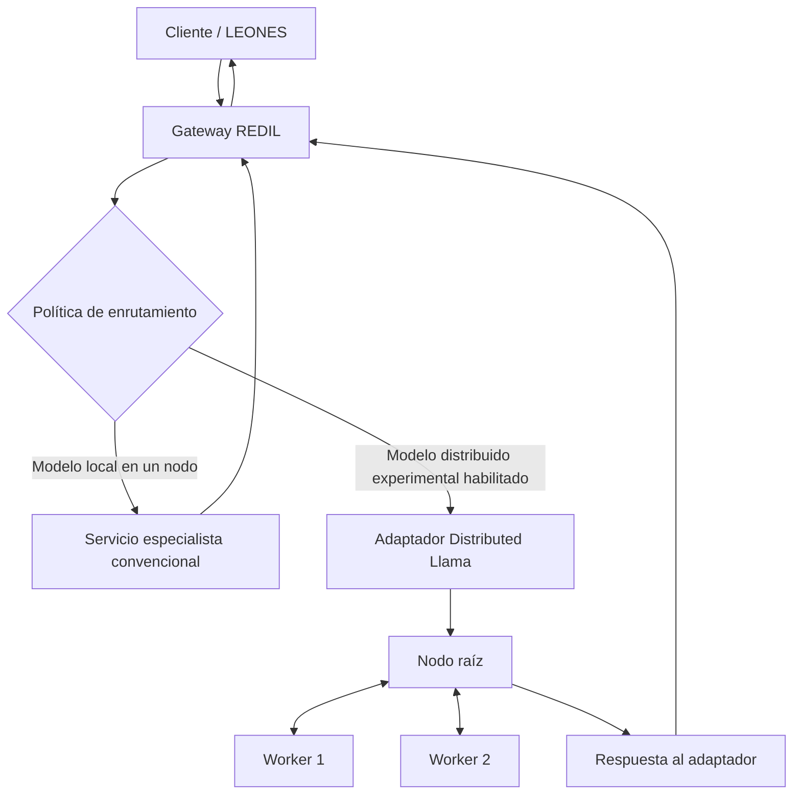

# Distributed Llama en REDIL — ficha experimental y plan de implantación

**Estado:** EXPERIMENTAL · evaluación documental y plan propuesto; no instalado ni validado físicamente por LEONES.  
**Proyecto:** LEONES → REDIL IA distribuida.  
**Upstream:** https://github.com/b4rtaz/distributed-llama  
**Licencia del código upstream:** MIT (verificar la licencia de la versión y de cada artefacto antes de distribuir).  
**Fecha de la evaluación:** 2026-10-28.

> Esta ficha no declara compatibilidad confirmada con el hardware de LEONES, con Qwen3.5, con LFM/LFM3 ni con la RTX 3050. Las capacidades atribuidas al proyecto deben volver a comprobarse contra la versión exacta que se vaya a probar.

## 1. Resumen ejecutivo

Distributed Llama es un candidato para **repartir una única inferencia de un modelo entre varios equipos** mediante tensor parallelism. Su topología distingue un nodo raíz y workers; el proyecto documenta ejecución CPU y una vía Vulkan experimental. Es distinto de REDIL en su conjunto: REDIL distribuye servicios especializados por función, mientras Distributed Llama intenta repartir el cálculo de un mismo modelo entre nodos.

**Recomendación:** incluirlo en el radar experimental de REDIL, primero como backend aislado y opcional, sin sustituir el gateway ni los servicios especialistas. Empezar con dos nodos CPU y un modelo oficialmente admitido por la versión fijada; solo ampliar a cuatro u ocho nodos si las métricas justifican la complejidad.

Fuentes primarias para revalidar:
- README upstream: https://github.com/b4rtaz/distributed-llama/blob/main/README.md
- Repositorio y versiones: https://github.com/b4rtaz/distributed-llama
- Releases: https://github.com/b4rtaz/distributed-llama/releases
- Issues upstream (incluidas dudas de CUDA/GPU y modelos): https://github.com/b4rtaz/distributed-llama/issues

## 2. Encaje arquitectónico en REDIL

REDIL conserva el enrutador global, políticas, cuotas, fallback y API unificada. Distributed Llama se encapsula detrás de un adaptador para aquellas solicitudes en las que sea útil ejecutar un modelo repartido.

### Responsabilidades y límites

- **REDIL:** identidad de servicio, autenticación, límites de petición, selección de backend, timeout, observabilidad y fallback.
- **Adaptador:** traducción del contrato interno de REDIL a la interfaz real de Distributed Llama, normalización de errores y metadatos de ejecución.
- **Distributed Llama:** reparto del cálculo de inferencia entre root y workers según la topología y el formato que soporte su versión.
- **No asumir:** que añade RAM como memoria unificada del sistema operativo, que sirve cualquier GGUF, que expone streaming, que admite cualquier arquitectura reciente o que usa CUDA en la RTX 3050.

No debe usarse para reemplazar servicios independientes como ASR, TTS, OCR, embeddings o FFmpeg: esos componentes realizan tareas distintas y deben seguir siendo servicios separados.

## 3. Compatibilidad: qué sabemos y qué falta comprobar

| Área | Evaluación preliminar | Acción obligatoria |
|---|---|---|
| CPU x86-64 / Linux | Candidato razonable según el soporte publicado | Compilar/instalar versión fijada en Ubuntu y ejecutar smoke test |
| CPU ARM | El proyecto declara optimizaciones para arquitecturas ARM y x86; validar el binario/compilación concreta | Comprobar ISA, toolchain, memoria y rendimiento por modelo |
| GPU Vulkan | Vía experimental/opcional en la documentación consultada | Verificar dispositivos detectados, backend efectivo y resultado reproducible |
| NVIDIA CUDA | No asumir soporte CUDA nativo ni que Vulkan equivale a CUDA | Comprobar documentación y logs de la versión fijada; no prometer aceleración |
| Qwen3 / Qwen3 MoE | Hay soporte anunciado para determinadas variantes/versiones | Fijar el nombre exacto del artefacto y comprobarlo en el catálogo de modelos de esa release |
| Qwen3.5 / Qwen3.5 MoE | Compatibilidad no confirmada por esta evaluación | No incluir en la primera prueba salvo evidencia upstream explícita |
| LFM / LFM3 | Compatibilidad no confirmada | Verificar arquitectura, tokenizer, conversión y soporte en upstream antes de dedicar tiempo a pruebas |
| GGUF arbitrario | No asumir compatibilidad directa; el proyecto usa artefactos/modelos preparados para su runtime | Seguir la ruta de conversión/documentación de la release; registrar hash y origen |
| API / streaming / herramientas | La API y sus capacidades varían por versión; una release consultada describe tool calls experimentales y ausencia de streaming | Inspeccionar contrato real y probarlo antes de diseñar el adaptador |
| Número de nodos | La documentación consultada impone topologías en potencias de dos y límites ligados a las cabezas KV | Validar las restricciones del modelo seleccionado; no planificar un clúster de diez workers como un único grupo |

Los tamaños publicados para modelos son referencias upstream, no medidas de LEONES. Un benchmark comunicado por el proyecto con Raspberry Pi tampoco predice el rendimiento de los nodos objetivo.

## 4. Estrategia de implantación por fases

### Fase 0 — Congelar requisitos y artefactos

**Objetivo:** que la prueba sea reproducible y no interfiera con instalaciones existentes.

1. Elegir una release estable concreta y registrar tag, commit y licencia.
2. Leer README, instrucciones de compilación, lista de modelos, notas de versión e issues abiertos para el modelo/backend elegidos.
3. Crear directorio de trabajo, configuración y puertos exclusivos para el experimento; no cambiar servicios activos de ODS, Hermes, TensorFold ni LEONES.
4. Registrar OS, kernel, CPU/ISA, RAM libre, disco, interfaz de red, firewall y versiones de compilador/runtime.
5. Fijar el artefacto exacto y su hash, tokenizer, contexto y cuantización.
6. Mantener los resultados como **PLAN** o **ESTIMATED** hasta ejecutarlos.

**Salida:** ficha de configuración y checklist de prerequisitos.  
**Criterio de avance:** se puede reconstruir la misma combinación de código, modelo y configuración.

### Fase 1 — Un nodo, referencia CPU

**Objetivo:** validar que el modelo seleccionado funciona sin distribución.

1. Ejecutar el modo single-node que documente la release.
2. Usar una batería pequeña de prompts deterministas, incluyendo español, respuesta larga y límite de contexto.
3. Registrar tiempo de descarga, tiempo de carga, TTFT, prefill, tokens/s de generación, RAM máxima, CPU, consumo de disco y errores.
4. Repetir al menos tres veces tras un calentamiento documentado.
5. Guardar logs completos y los comandos exactos.

**Criterio de avance:** inferencia estable y resultados repetibles en el nodo de referencia. Si no funciona en un nodo, no pasar a distribución.

### Fase 2 — Dos nodos CPU

**Objetivo:** validar el protocolo root/worker y medir el coste de la red.

1. Seleccionar dos máquinas Ubuntu accesibles por una red privada controlada.
2. Instalar la misma release en ambos nodos; verificar reloj, conectividad, puertos y reglas de firewall.
3. Arrancar el worker con la configuración upstream exacta y después el root; no exponer el servicio de inferencia a Internet.
4. Repetir exactamente los prompts de la Fase 1.
5. Medir TTFT, prefill, generación, RAM/CPU por nodo, tráfico, pérdidas/reintentos, errores y estabilidad.
6. Comparar uno frente a dos nodos con idénticos parámetros de modelo, contexto y salida.

**Criterio de avance:** inferencia correcta y estabilidad suficiente. El objetivo no es dar por hecho que dos nodos serán más rápidos: la red y la sincronización pueden empeorar la latencia.

### Fase 3 — Contraste de rendimiento y calidad

Comparar el backend distribuido con el runtime local de referencia usando el mismo modelo y prompts, cuando el formato y las implementaciones permitan una comparación justa.

Registrar:
- TTFT y latencia total p50/p95;
- prefill y tokens/s de generación;
- tiempo de carga y memoria máxima por nodo;
- bytes de red por petición;
- respuestas truncadas, fallos y variación entre repeticiones;
- calidad funcional básica y consistencia de la respuesta;
- límites de concurrencia y comportamiento al cancelar una petición.

**Criterio de avance:** beneficio medible para un objetivo explícito (por ejemplo, permitir un modelo que no cabe en un nodo, mejorar el throughput o reducir el tiempo de una tarea). Si no aporta valor, conservar la ficha experimental y detener la implantación.

### Fase 4 — Modelo MoE y escalado

Solo después de aprobar Fases 1–3:

1. Elegir un modelo MoE que la release soporte explícitamente, por ejemplo una variante concreta de Qwen3 MoE; no sustituirlo por Qwen3.5 sin evidencia.
2. Repetir primero con dos nodos y luego con cuatro. Probar ocho únicamente si la limitación de memoria/heads KV y la topología real lo permiten.
3. Evaluar la distribución de memoria, carga de expertos, red y calidad; documentar las diferencias frente al modelo denso.
4. No reservar los diez equipos REDIL para una sola inferencia: los tamaños de clúster admitidos pueden no encajar con diez nodos, y los nodos no asignados pueden seguir atendiendo servicios independientes.

**Criterio de avance:** mejora reproducible y sin regresiones graves frente al baseline.

### Fase 5 — Backend Vulkan / GPU opcional

Se evalúa en una rama y perfil separados, primero con un modelo pequeño y una sola GPU, sin tocar el entorno base.

En la máquina RTX 3050 Laptop de 4 GB VRAM:
- registrar driver, versión Vulkan y dispositivos visibles;
- medir VRAM libre antes y después de iniciar;
- confirmar en logs que el backend GPU se usa realmente;
- medir estabilidad, temperatura, VRAM y rendimiento frente a CPU;
- probar un modelo pequeño compatible antes de probar MoE;
- no inferir soporte CUDA a partir de que exista una GPU NVIDIA.

**Criterio de avance:** backend identificado de forma inequívoca, sin OOM ni impacto inaceptable en el escritorio y con beneficio medido. Si no cumple, mantener CPU como ruta experimental y cerrar la vía GPU.

### Fase 6 — Adaptador para REDIL

No comenzar hasta que las fases de inferencia hayan pasado.

1. Definir un contrato interno mínimo: petición, modelo/backend, timeout, salida, error, cancelación y metadatos.
2. Encapsular root/API con un adaptador desacoplado; el gateway no debe conocer la topología interna de workers.
3. Aplicar timeout, límites de tamaño/concurrencia y health checks.
4. Mantener el backend deshabilitado por defecto y activarlo por configuración explícita.
5. Si el backend falla, aplicar fallback a un especialista local compatible, sin reenviar datos a servicios cloud.
6. Añadir pruebas de contrato, integración y caída de worker; no habilitar streaming ni tool calls en el contrato hasta verificarlos.
7. Documentar instalación, actualización, rollback, eliminación y puertos.

**Criterio de avance:** el gateway puede seleccionar el backend de forma explícita, reporta el backend usado y recupera el servicio convencional cuando el clúster falla.

### Fase 7 — Piloto limitado y decisión

Ejecutar una prueba de carga pequeña, con datos no sensibles y límites conocidos. Revisar seguridad de red, trazas, reinicio, pérdida de root/worker, carga concurrente y consumo de recursos.

Emitir una decisión formal:
- **ACEPTAR como backend experimental** si el valor está demostrado y los fallbacks funcionan;
- **MANTENER EN RADAR** si la compatibilidad existe pero el beneficio no es concluyente;
- **DESCARTAR** si el soporte de modelos, estabilidad, coste operativo o rendimiento no justifican la integración.

## 5. Matriz de pruebas

| ID | Prueba | Métricas / evidencia | Resultado inicial |
|---|---|---|---|
| DL-00 | Inventario y pin de versión | commit, licencia, OS, CPU, RAM, red | PENDIENTE |
| DL-01 | Inferencia single-node CPU | logs, carga, TTFT, tok/s, RAM | PENDIENTE |
| DL-02 | Root + 1 worker CPU | logs por nodo, latencia, tráfico, fallos | PENDIENTE |
| DL-03 | Comparación 1 vs 2 nodos | misma batería y configuración | PENDIENTE |
| DL-04 | Robustez de prompts | español, contexto, salida larga, truncamiento | PENDIENTE |
| DL-05 | Pérdida/reinicio de worker | timeout, error, recuperación | PENDIENTE |
| DL-06 | Modelo Qwen3 MoE explícitamente soportado | artefacto exacto, memoria, calidad, latencia | PENDIENTE |
| DL-07 | Escalado a 4 nodos | comparación con 2 nodos y topología admitida | PENDIENTE |
| DL-08 | Vulkan / GPU | backend efectivo, VRAM, temperatura, rendimiento | PENDIENTE |
| DL-09 | Adaptador REDIL | contrato API, fallback, health checks, aislamiento | PENDIENTE |
| DL-10 | Seguridad y rollback | puertos, exposición, logs, parada/eliminación | PENDIENTE |

## 6. Formato de registro de cada ejecución

Por cada prueba guardar un registro junto a los logs con:
- ID de prueba y fecha/hora;
- equipo, OS/kernel, CPU, RAM y red;
- commit/tag de Distributed Llama;
- artefacto de modelo, fuente, hash, tokenizer y cuantización;
- comandos y variables de entorno;
- parámetros de contexto, batch, temperatura y tokens solicitados;
- tiempo de carga, TTFT, prefill, tokens/s y latencia total;
- RAM/VRAM máximas por nodo, CPU, temperatura y tráfico;
- resultado, fallos, limitaciones y conclusión;
- clasificación explícita: **SOURCE**, **ESTIMATED** o **MEASURED**.

## 7. Riesgos y controles

- **Modelo no compatible:** elegir solo de la lista de la release fijada y probar single-node primero.
- **Formato propietario/de conversión:** no tratar GGUF como intercambiable; preservar artefacto original, conversor y hash.
- **Latencia de red:** mantener root y workers en red cableada fiable; medir antes de escalar.
- **Restricciones de topología:** confirmar potencia de dos y límites de cabezas KV para cada modelo.
- **API incompleta:** no prometer streaming o herramientas; inspeccionar la versión real.
- **GPU no acelerada:** exigir evidencia en logs y medición comparativa.
- **Seguridad:** red privada, puertos mínimos, sin exposición directa a Internet, datos de prueba no sensibles.
- **Regresión de servicios:** directorio, puertos y configuración separados; ninguna modificación automática de ODS/Hermes/TensorFold.
- **Métricas engañosas:** mismos prompts, parámetros y modelo para comparaciones; separar prefill de generación.
- **Dependencia de upstream:** fijar commit y revisar cambios antes de actualizar.

## 8. Decisión propuesta

**Aprobar solo la evaluación experimental documental y el plan, no el despliegue.**

Orden recomendado:
1. CPU single-node.
2. Dos nodos CPU.
3. Comparación controlada contra baseline local.
4. Modelo MoE explícitamente soportado.
5. Cuatro nodos si la evidencia lo justifica.
6. Vulkan/GPU opcional.
7. Adaptador REDIL tras validación.

No instalar ni ejecutar automáticamente en la máquina de trabajo. La RTX 3050 de 4 GB VRAM es una plataforma de evaluación posterior, no una compatibilidad ya demostrada. Qwen3.5 y LFM/LFM3 permanecen fuera de la matriz de compatibilidad confirmada hasta que exista evidencia de upstream y una prueba reproducible.

## 9. Registro de cambios y revisión

- 2026-10-28: evaluación documental inicial y plan de implantación por fases.
- Próxima revisión: al fijar release/commit y artefacto de modelo, o cuando upstream cambie soporte de modelos, API o backend GPU.
