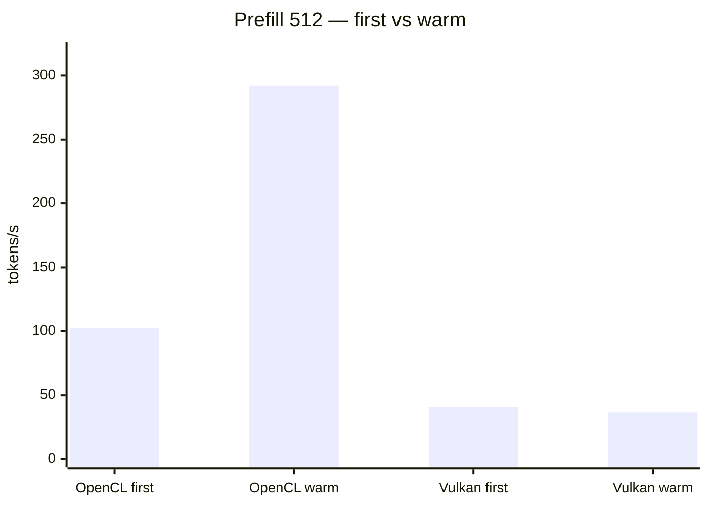
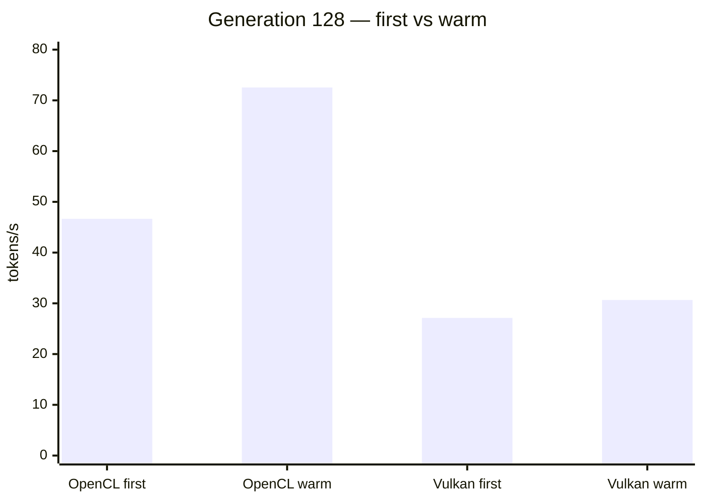

# Pithos 0.6.1 — LFM2.5-8B-A1B MoE validation on RTX 3050 (2026-11-10)

## Summary

This report records local validation of the official Pithos 0.6.1 Linux x64 release with LiquidAI's LFM2.5-8B-A1B GGUF model on an MSI Thin 15 B12UC. The principal comparison uses Q4_K_M and three short generation runs per backend (CPU, NVIDIA OpenCL, NVIDIA Vulkan), with identical prompt and CLI settings.

**Main result:** NVIDIA OpenCL executed MoE experts on the RTX 3050 and averaged **13.77 tok/s** generation over three runs. CPU averaged **4.79 tok/s**; Vulkan averaged **9.10 tok/s**. These correspond to observed generation ratios of approximately **2.88×** (OpenCL/CPU) and **1.90×** (Vulkan/CPU) for this test configuration.

The backends do different work:
- OpenCL: 298 expert slots (1.98 GB, reported as 42% of experts) and dense layers (0.46 GB) resident on the GPU; the three runs reported 2,041, 5,147 and 5,192 expert executions on GPU.
- Vulkan: 67 matrices and 471 MB of weights on GPU; Pithos explicitly reported "matmuls only", and all three runs reported zero expert executions on GPU.
- CPU: no GPU execution.

**CUDA:** Pithos 0.6.1's CLI help exposes `off`, `opencl` and `vulkan` GPU modes, not a native `cuda` backend. The host has an NVIDIA driver/CUDA runtime, but no native CUDA mode was tested or available through this release's CLI.

## Hardware and software

| Item | Observed configuration |
|---|---|
| Laptop | MSI Thin 15 B12UC |
| OS | Ubuntu |
| CPU | Intel Core i7-12650H, 10 cores / 16 threads |
| System RAM | 14.8 GB detected |
| GPU | NVIDIA GeForce RTX 3050 Laptop GPU, 4 GB VRAM |
| NVIDIA driver | 580.178.04 |
| CUDA runtime reported by nvidia-smi | 13.0 |
| CUDA toolkit installed on host | 13.4 |
| Pithos | Official v0.6.1 Linux x64 release |
| Model architecture | lfm2moe; 24 layers (6 attention, 18 convolution); 32 experts, top-4 |
| Context / threads / batch | 512 / 8 / 32 |
| Reasoning / seed / output | off / 42 / 64 tokens |
| Prompt | `Explain briefly what a mixture-of-experts language model is.` |

The selected NVIDIA device was OpenCL device 1 or Vulkan device 1. Intel integrated graphics was not selected for the Q4_K_M backend comparison.

## Model files

| File | Size | SHA-256 |
|---|---:|---|
| `LFM2.5-8B-A1B-Q4_0.gguf` | 4,844,678,368 bytes | `48ed1465d761311b2fd57b7fb46cf969a20b3a8281945b04e10f52bd1609e715` |
| `LFM2.5-8B-A1B-Q4_K_M.gguf` | 5,155,564,768 bytes | `4923ec14f06b968b74d663e5949867d2d9c3bf13a20b8be1a9f9af39989b2bb0` |

Both models were downloaded from the official `LiquidAI/LFM2.5-8B-A1B-GGUF` Hugging Face repository. Q4_K_M is the principal comparison quantization because it activated the OpenCL expert path on this GPU. Q4_0 did not.

## Q4_K_M — controlled short-generation comparison

All nine runs used the same model, prompt, seed, context, thread count, batch size and output limit. Values below are the throughput printed by Pithos.

### Per-run results

| Backend | Run | Prefill (tok/s) | Generation (tok/s) | GPU execution detail |
|---|---:|---:|---:|---|
| CPU | 1 | 5.0 | 5.36 | CPU only |
| CPU | 2 | 4.7 | 4.51 | CPU only |
| CPU | 3 | 4.2 | 4.50 | CPU only |
| OpenCL / RTX 3050 | 1 | 3.7 | 10.24 | 298 expert slots; 1.98 GB experts; 0.46 GB dense; 2,041 expert executions |
| OpenCL / RTX 3050 | 2 | 4.0 | 15.00 | 298 expert slots; 1.98 GB experts; 0.46 GB dense; 5,147 expert executions |
| OpenCL / RTX 3050 | 3 | 4.9 | 16.07 | 298 expert slots; 1.98 GB experts; 0.46 GB dense; 5,192 expert executions |
| Vulkan / RTX 3050 | 1 | 5.7 | 12.11 | 67 matrices; 471 MB weights; matmuls only; 0 expert executions |
| Vulkan / RTX 3050 | 2 | 4.5 | 7.51 | 67 matrices; 471 MB weights; matmuls only; 0 expert executions |
| Vulkan / RTX 3050 | 3 | 7.4 | 7.68 | 67 matrices; 471 MB weights; matmuls only; 0 expert executions |

### Means across the three runs

| Backend | Mean prefill | Mean generation | Generation relative to CPU |
|---|---:|---:|---:|
| CPU | 4.63 tok/s | 4.79 tok/s | 1.00× |
| OpenCL / RTX 3050 | 4.20 tok/s | 13.77 tok/s | 2.88× |
| Vulkan / RTX 3050 | 5.87 tok/s | 9.10 tok/s | 1.90× |

These are three short runs of 64 generated tokens, not a sustained long-context benchmark. The run-to-run spread is material, especially for Vulkan and OpenCL; the means are descriptive of these observations and should not be treated as stable performance guarantees. OpenCL's generation results were 10.24–16.07 tok/s; Vulkan's were 7.51–12.11 tok/s.

### Interpretation

1. OpenCL is the only tested backend that reported actual MoE expert execution on the RTX 3050. It placed 298 expert slots in 1.98 GB of VRAM (reported as 42% of experts), plus 0.46 GB of dense layers.
2. Vulkan offloaded 67 matrices / 471 MB of weights, but Pithos explicitly identified the mode as matmuls-only. It reported zero expert executions on GPU. It is therefore not evidence of GPU-resident MoE expert execution.
3. For this short test, OpenCL had the highest mean generation rate (13.77 tok/s), while Vulkan had the highest mean prefill rate (5.87 tok/s).
4. OpenCL prefill was slower than CPU in this sample set. The result should not be summarized as an overall speedup for every workload stage.
5. No native CUDA CLI backend is exposed by Pithos 0.6.1. OpenCL and Vulkan are NVIDIA GPU paths, but neither is CUDA.

## Q4_0 — quantization-specific behavior

The same model family was also tested with Q4_0. These runs were preliminary single samples, not part of the three-run Q4_K_M comparison.

| Backend | Prefill | Generation | GPU detail |
|---|---:|---:|---|
| CPU | 2.5 tok/s | 8.21 tok/s | CPU only |
| OpenCL / RTX 3050 | 6.9 tok/s | 7.82 tok/s | Pithos reported "OpenCL not used (expert formats not supported by the GPU)"; execution fell back to CPU; zero experts on GPU |
| Vulkan / RTX 3050 | 8.7 tok/s | 33.42 tok/s | 1 matrix; 219 MB weights; matmuls only; zero experts on GPU |

The Q4_0 OpenCL result is a CPU fallback, not an OpenCL performance result. The Q4_0 Vulkan result demonstrates partial matrix offload, not expert offload. The difference between Q4_0 and Q4_K_M shows that the MoE expert offload result is quantization/format dependent in this test; it is not evidence of a general NVIDIA hardware incompatibility.

## Reproduction commands

From the extracted official release directory:

```bash
cd ~/pithos-0.6.1-validation/pithos-0.6.1-linux-x64
MODEL="$HOME/Pithos/models/LFM2.5-8B-A1B-Q4_K_M.gguf"
```

CPU:

```bash
./pithos --model "$MODEL" --gpu off --ctx 512 --threads 8 --batch 32 \
  --reasoning off --seed 42 --n-predict 64 --stats \
  --prompt "Explain briefly what a mixture-of-experts language model is."
```

NVIDIA OpenCL:

```bash
./pithos --model "$MODEL" --gpu opencl --gpu-device 1 --gpu-mem 2500 \
  --ctx 512 --threads 8 --batch 32 --reasoning off --seed 42 \
  --n-predict 64 --stats \
  --prompt "Explain briefly what a mixture-of-experts language model is."
```

NVIDIA Vulkan:

```bash
./pithos --model "$MODEL" --gpu vulkan --gpu-device 1 \
  --ctx 512 --threads 8 --batch 32 --reasoning off --seed 42 \
  --n-predict 64 --stats \
  --prompt "Explain briefly what a mixture-of-experts language model is."
```


## Additional validation — temporary-directory quota, fault injection and 512/128 benchmark

This section records the follow-up tests performed after the initial report was drafted. They use the same official Pithos 0.6.1 Linux x64 binary, the same LFM2.5-8B-A1B-Q4_K_M model and the MSI Thin 15 B12UC / RTX 3050 Laptop GPU.

### OpenCL startup failure: root cause identified

Initially, OpenCL generation and `--bench 512,128` exited with code 1 immediately after model loading, before a chat-ready message or generated output. A limited `strace` trace identified the failing operation:

```text
openat(..., "/tmp/dep-fe2585.d", O_WRONLY|O_CREAT|O_TRUNC|O_CLOEXEC, 0666) = 29
write(29, "dep-headers: <kernel>\n", 22) = -1 EDQUOT (Disk quota exceeded)
exit_group(1)
```

The host reported `/tmp` mounted as `tmpfs` with `usrquota`. A direct file-creation test failed in `/tmp` but succeeded in `$HOME`; the SSD-backed directory `$HOME/.cache/pithos-tmp` was writable. Disk-space inspection had shown free capacity, so the observed error was a quota rejection, not proof that the filesystem was full. The trace ties the failure to NVVM's temporary dependency-file write during NVIDIA OpenCL initialization.

**Workaround validated:** set `TMPDIR="$HOME/.cache/pithos-tmp"` for Pithos invocations. With this environment variable, OpenCL initialized, generated output and completed the 512/128 benchmark. No system-wide quota or permission changes were made.

Reproduction:

```bash
mkdir -p "$HOME/.cache/pithos-tmp"
TMPDIR="$HOME/.cache/pithos-tmp" ./pithos \
  --model "$MODEL" --gpu opencl --gpu-device 1 --gpu-mem 2500 \
  --prompt "Hello" --n-predict 8
```

Observed: NVIDIA GeForce RTX 3050 Laptop GPU, 284 expert slots (1.89 GB VRAM, 40% of experts), dense layers in 0.55 GB VRAM; prompt 11 tokens at 3.5 tok/s, generation 8 tokens at 1.33 tok/s; exit code 0. This is a very short smoke test and not a benchmark.

A second normal OpenCL generation test with a 22-token prompt and 16-token output completed successfully: prefill 4.2 tok/s, generation 5.51 tok/s, 1,465 expert executions on GPU; exit code 0. These short prompt-generation observations are kept separate from the 512/128 benchmark.

### Official-style `--bench 512,128` comparison

Both backends were run with the same Q4_K_M model, NVIDIA device 1 and the SSD-backed `TMPDIR`. Both exited with code 0.

| Stage | OpenCL first | OpenCL warm | Vulkan first | Vulkan warm |
|---|---:|---:|---:|---:|
| Prefill 512 | 102.33 tok/s | **292.39 tok/s** | 40.90 tok/s | 36.50 tok/s |
| Generation 128 | 46.66 tok/s | **72.54 tok/s** | 27.13 tok/s | 30.65 tok/s |

Warm OpenCL measured 8.01× Vulkan prefill and 2.37× Vulkan generation in these runs. These ratios compare the reported warm figures from this single benchmark execution; they are not multi-run statistical estimates.

| Backend / GPU work | OpenCL | Vulkan |
|---|---:|---:|
| GPU placement | 284 expert slots; 1.89 GB experts + 0.55 GB dense | 67 matrices; 471 MB weights |
| Expert execution | 60.5 experts/token (warm prefill profile); 53.0 experts/token (warm generation profile) | No expert offload; matmuls only |
| GPU wait | 0.08 ms/token (warm prefill profile); 3.01 ms/token (warm generation profile) | Not reported in the same profile format |
| Working set | 2.62 GB warm prefill; 2.79 GB warm generation | 3.30 GB warm prefill; 3.30 GB warm generation |

Page-fault figures reported by Pithos:

| Backend / stage | First | Warm |
|---|---:|---:|
| OpenCL prefill | 538,305 faults / 2.05 GB | 50,598 / 0.19 GB |
| OpenCL generation | 1,149 faults/token | 172 faults/token |
| Vulkan prefill | 1,495,625 faults / 5.71 GB | 1,557,959 / 5.94 GB |
| Vulkan generation | 1,148 faults/token | 441 faults/token |

The byte figures are Pithos-reported page-fault accounting, not direct measurements of physical SSD traffic. Notably, Vulkan's warm prefill reported more page faults than its first prefill; do not assume warm always means fewer faults for this backend.

#### Benchmark charts

The following charts visualize the measured first and warm throughput. Values are tokens/second.

```mermaid
xychart-beta
    title "Warm throughput — OpenCL vs Vulkan"
    x-axis ["Prefill 512", "Generation 128"]
    y-axis "tokens/s" 0 --> 320
    bar [292.39, 72.54]
    bar [36.50, 30.65]
```







The third chart uses the first series for OpenCL and the second series for Vulkan.

### OpenCL fault injection and CPU fallback

With the temporary-directory workaround in place, `PITHOS_CL_FAIL=3` allowed OpenCL initialization and triggered the requested simulated GPU failure during generation. The console reported:

```text
Okay,OpenCL: simulated GPU failure (PITHOS_CL_FAIL)
GPU: OpenCL error -5 in read logits
OpenCL failed: the GPU is not used any more
the context was lost with the GPU: continuing on the CPU from an empty context
[answer stopped: the GPU failed]
EXIT CODE: 1
```

**Interpretation:** fault injection is confirmed; the OpenCL error is detected and the GPU is disabled. However, the process does not recover the conversation successfully: Pithos explicitly reports an empty context, stops the answer and exits with code 1. This test does not validate successful CPU fallback or context preservation. Do not describe this behavior as successful automatic recovery.

A separate CPU-only interactive test in the earlier investigation did reach `chat ready` and generated a response; that establishes that CPU inference works independently, not that the OpenCL failure transition successfully hands off the existing context.

### Validation status after follow-up

| Test | Result |
|---|---|
| OpenCL initialization with default temporary directory | Fails with `EDQUOT` while writing NVVM dependency file under `/tmp` |
| OpenCL initialization with SSD-backed `TMPDIR` | Pass |
| OpenCL short generation, no fault injection | Pass; 16 generated tokens at 5.51 tok/s in the recorded run |
| OpenCL `--bench 512,128` | Pass; 292.39 tok/s warm prefill, 72.54 tok/s warm generation |
| Vulkan `--bench 512,128` | Pass; 36.50 tok/s warm prefill, 30.65 tok/s warm generation |
| `PITHOS_CL_FAIL=3` detection | Pass; simulated fault and OpenCL shutdown detected |
| CPU continuation after injected OpenCL failure | Fail/incomplete; context reported empty, answer stopped, exit 1 |

### Follow-up benchmark commands

OpenCL:

```bash
TMPDIR="$HOME/.cache/pithos-tmp" ./pithos \
  --model "$MODEL" --gpu opencl --gpu-device 1 --gpu-mem 2500 \
  --bench 512,128
```

Vulkan:

```bash
TMPDIR="$HOME/.cache/pithos-tmp" ./pithos \
  --model "$MODEL" --gpu vulkan --gpu-device 1 \
  --bench 512,128
```

Fault injection:

```bash
TMPDIR="$HOME/.cache/pithos-tmp" PITHOS_CL_FAIL=3 ./pithos \
  --model "$MODEL" --gpu opencl --gpu-device 1 --gpu-mem 2500 \
  --prompt "Explain briefly what a mixture-of-experts model is." \
  --n-predict 16 --stats
```


## Scope and outstanding tests

This report validates the Q4_K_M short-generation MoE path on Pithos 0.6.1. It does **not** claim that all experts or the entire model run on the GPU.

The following items remain outside this completed comparison:
- Benito's requested `--bench 512,128` comparison is now recorded above for both OpenCL and Vulkan. The original three-run comparison remains a separate 64-token short-generation experiment.
- The `PITHOS_CL_FAIL=N` fault injection is now recorded above. Fault detection is confirmed, but successful CPU continuation and context preservation are not.
- The original Intel UHD OpenCL read-logits issue was reproduced and documented with the earlier Pithos 0.6.0 testing. This report does not claim to re-test Intel OpenCL on 0.6.1 or prove that the Intel issue is fixed.
- Raw stdout/stderr was not redirected to per-run log files during these interactive tests. The tables and execution details in this report are transcribed from the console outputs preserved in the conversation; no raw log files or log hashes are claimed.

## Conclusion

Pithos 0.6.1 successfully ran LFM2.5-8B-A1B Q4_K_M on the MSI's NVIDIA RTX 3050 through OpenCL and Vulkan. OpenCL demonstrably executed MoE experts on the GPU and produced a three-run mean of 13.77 tok/s generation. Vulkan offloaded matrix multiplications only and produced a three-run mean of 9.10 tok/s. CPU averaged 4.79 tok/s.

This is a reproducible configuration and a useful confirmation of the OpenCL MoE expert path on a 4 GB laptop GPU. The follow-up 512/128 run measured 292.39 tok/s warm prefill and 72.54 tok/s warm generation on OpenCL, versus 36.50 and 30.65 tok/s on Vulkan. OpenCL's advantage in this run is consistent with its expert offload, while Vulkan reports matmuls only. The report also records the NVVM temporary-file quota issue and the SSD-backed TMPDIR workaround. Fault injection detects the simulated GPU failure, but CPU recovery remains incomplete because the context is lost and the process exits with code 1. All figures remain scoped to the stated hardware, binary, model and test conditions.

---
LEONES engineering validation record. Results are scoped to the hardware, software, model, quantization and test conditions stated above.
