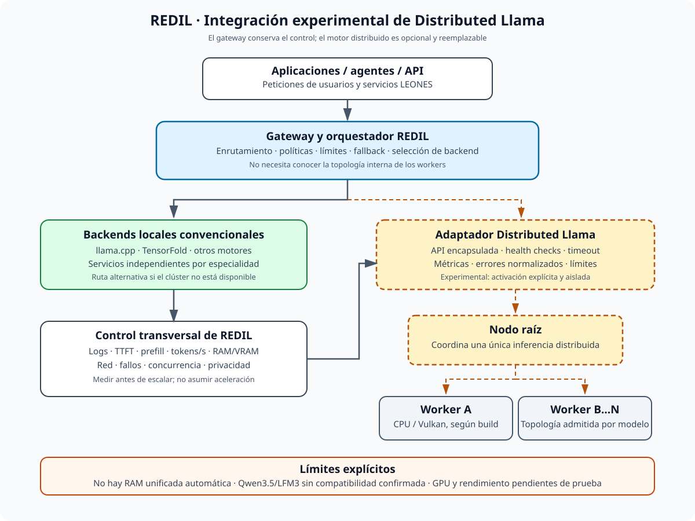
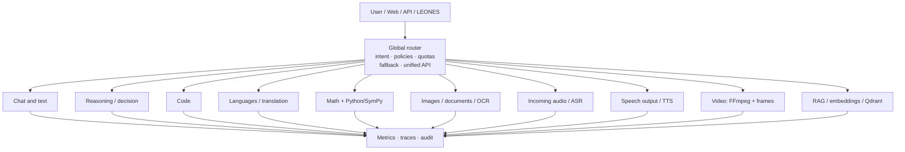
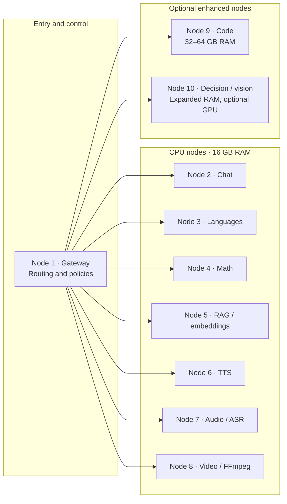
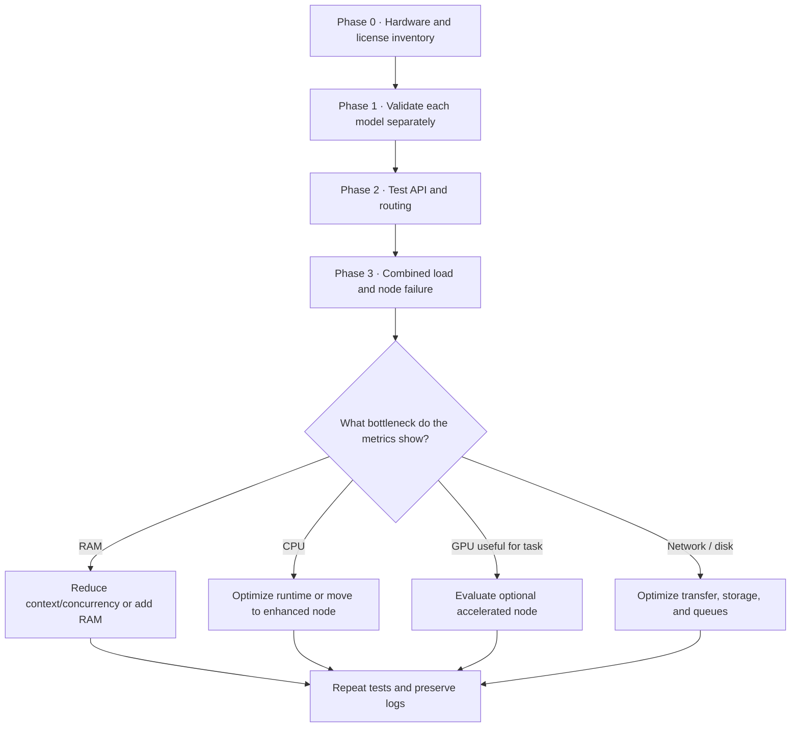
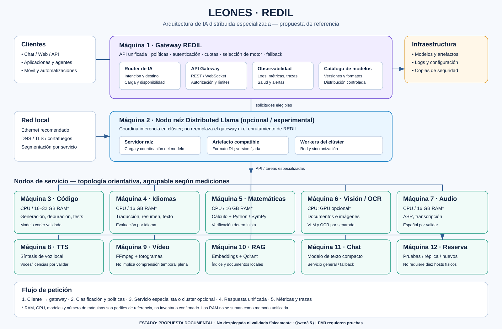

# REDIL — Distributed Local Artificial Intelligence Network

**REDIL** is a **distributed and shared computing** framework designed to democratize access to **Artificial Intelligence** by federating and collaboratively orchestrating **low-resource computers**.

## Name meaning and technical pillars

- **R — Red (Network):** node-to-node (*peer-to-peer*) communication linking heterogeneous devices into a collaborative computing mesh.
- **E — Económica (Economical):** energy efficiency and reuse of modest or recycled hardware, without requiring industrial clusters.
- **D — Dispositivos (Devices):** pooling and sharing local resources—RAM, VRAM, CPU threads, and modest accelerators—contributed by each node.
- **I — Inteligencia (Intelligence):** execution, orchestration, and distributed inference of AI models, including LLMs, SLMs, and autonomous agents.
- **L — Local:** sovereign *on-premises* operation, with privacy and local processing, without mandatory dependence on centralized clouds or their fees.

**Status:** architecture / research proposal; not deployed or physically validated.  
**Parent project:** LEONES (Local Ecosystem of Open Neural Expert Systems).  
**Subsystem name:** **REDIL**.

## 1. Executive summary

REDIL proposes a single AI service exposed through a global router that directs each request to the most suitable specialist. Specialists can run on heterogeneous computers using different GNU/Linux distributions—such as Debian, Red Hat Enterprise Linux (RHEL), Gentoo Linux, and Ubuntu—with 16 GB RAM and CPU as a preferred baseline and no dedicated GPU requirement for every node. The system can grow by adding one or more enhanced nodes with 32–64 GB RAM and, optionally, an NVIDIA GPU with 12–24 GB VRAM.

The core hypothesis is not to add all machines' RAM as if it were unified memory, but to **distribute independent specialist services**, with a common API, queues, concurrency limits, observability, and fallback. A typical request is handled by one node; only multimodal or agentic workflows need to coordinate several services.

REDIL must preserve LEONES principles:

- Local-first operation, with no mandatory cloud dependency.
- Replaceable components with documented interfaces.
- A clear distinction between declared compatibility, estimates, and actual tests.
- Every performance figure remains **ESTIMATED** until measured on the target hardware.
- No model, runtime, or provider is installed automatically without explicit selection.

## 2. Logical architecture

The reference diagrams are available in [ARQUITECTURA-VISUAL.md](ARQUITECTURA-VISUAL.md) and the vector file [ARQUITECTURA-REDIL.svg](ARQUITECTURA-REDIL.svg). An illustrative heterogeneous-cluster diagram with Debian, Red Hat Enterprise Linux (RHEL), Gentoo Linux, Ubuntu, and 32 GB / 64 GB nodes is also included: [REDIL-LEONES-ARQUITECTURA-MULTIDISTRO.png](REDIL-LEONES-ARQUITECTURA-MULTIDISTRO.png).

The architecture separates two planes: **REDIL as a federation/orchestration layer for specialized services**, based on **[LLM-Mesh](https://github.com/Mesh-LLM/mesh-llm)**, and optionally **[Distributed Llama](https://github.com/b4rtaz/distributed-llama) as an experimental engine that splits a single inference across workers**. Consult the [official Distributed Llama upstream repository](https://github.com/b4rtaz/distributed-llama) for source code, versions, and issues. These are different functions; not every request should be assumed to pass through Distributed Llama.

## Distributed Llama evaluation as a REDIL backend

**Official upstream reference:** [b4rtaz/distributed-llama](https://github.com/b4rtaz/distributed-llama)—an external project evaluated as an optional backend. Mentioning it does not mean it is installed or validated in LEONES.

**Architectural decision:** retain Distributed Llama as an optional, experimental distributed-inference backend. It must not become REDIL's gateway, general scheduler, or a requirement for its services.

REDIL and Distributed Llama address different problems:

- **REDIL — service distribution:** the gateway routes each request to an available specialist (chat, code, vision, ASR, TTS, RAG, etc.). Each service may run on a different machine.
- **Distributed Llama — distribution of one inference:** a root node and several workers cooperate to run the same model. This may make a model that does not fit on one computer usable, but adds communication and synchronization.
- **No automatic unified RAM:** splitting a model does not turn all computers' memory into transparent local memory, nor does adding nodes guarantee more tokens/s.

### Dedicated diagram — Distributed Llama adapter



The gateway should communicate with a decoupled adapter that encapsulates the API and root/worker topology. The adapter should expose health checks, timeouts, concurrency limits, metrics, and normalized errors. If the backend fails, REDIL removes it from selection and uses another compatible local backend; it must not forward data to the cloud without explicit authorization.

### Technical assessment

| Area | Assessment | REDIL decision |
|---|---|---|
| Linux x86-64 / ARM | Candidate for heterogeneous systems; check ISA and build per node. | Evaluate on Ubuntu, CPU first. |
| Topology | Upstream documents cluster-size and model-dependent KV-head constraints. | Do not automatically assign all REDIL nodes; validate each model's topology. |
| Qwen3 / Qwen3 MoE | Families listed in the upstream documentation reviewed. | Select an explicit version/artifact and test single-node before distribution. |
| Qwen3.5 / LFM3 | Compatibility not confirmed by the upstream reference reviewed. | Do not claim support until reproducible tests exist. |
| CPU / Vulkan / NVIDIA | CPU is the conservative initial path; Vulkan requires measurement. An RTX does not automatically mean CUDA acceleration. | Compare CPU and Vulkan separately; measure actual VRAM use and performance. |
| Network and latency | Synchronization may erase the benefit of adding nodes. | Use a private wired network; measure TTFT, prefill, tokens/s, and traffic. |
| API and agents | Equivalent support for streaming, cancellation, or tool calls must not be assumed. | Verify each feature against the pinned release before exposing it through the gateway. |
| License | Upstream repository indicates MIT; check the exact tag and model-weight licenses separately. | Record engine, weights, and dependency attribution and licenses. |

### Decision plan

1. Pin version/tag/commit, license, model, tokenizer, format, and hash.
2. Measure single-node CPU inference with reproducible prompts.
3. Run root + one worker on a private network and compare against baseline.
4. Test stability, worker loss, timeouts, cancellation, and concurrency limits.
5. Evaluate an MoE model only if explicitly supported by the upstream version.
6. Compare Vulkan/GPU only in an isolated profile and verify that the GPU backend is actually used.
7. Implement/enable the REDIL adapter only after the previous stages pass.

**Evidence status:** documentary assessment and test plan only. No installation, deployment, local benchmark, or compatibility with the RTX 3050, Qwen3.5, or LFM3 is claimed. All results remain **PENDING** until reproducible logs from the target hardware are preserved.

### Diagram 1 — Distributed architecture

The gateway classifies each request and routes it to a specialist. Services can run on separate computers; RAM is not represented as shared memory.



### Diagram 2 — Illustrative ten-node topology



> This allocation is a reference topology, not a rigid requirement. Services can be grouped or moved according to measured RAM, latency, and concurrency. The gateway may run on an existing node. Node 10 represents optional enhanced capacity; a GPU is not mandatory.

### Diagram 3 — Validation and scaling path



```text
                  User / Web / API / LEONES
                              |
                              v
                 +------------------------------+
                 |        GLOBAL ROUTER        |
                 | intent, policies, quotas   |
                 | fallback, node selection   |
                 | compatible unified API     |
                 +---------------+--------------+
                                 |
         +-----------+-----------+-----------+-----------+
         |           |           |           |           |
         v           v           v           v           v
      [Chat]    [Decision]   [Code]    [Languages]  [Math]
         |           |           |           |           |
         +-----------+-----------+-----------+-----------+
                                 |
         +-----------+-----------+-----------+-----------+
         |           |           |           |           |
         v           v           v           v           v
      [Vision]    [Audio]      [TTS]       [Video]    [RAG / DB]
         |           |           |           |           |
         +-----------+-----------+-----------+-----------+
                                 |
                    Metrics / traces / audit
```

```text
                  User / Web / API / LEONES
                              |
                              v
                 +------------------------------+
                 |        GLOBAL ROUTER        |
                 | intent, policies, quotas   |
                 | fallback, node selection   |
                 | compatible unified API     |
                 +---------------+--------------+
                                 |
         +-----------+-----------+-----------+-----------+
         |           |           |           |           |
         v           v           v           v           v
      [Chat]    [Decision]   [Code]    [Languages]  [Math]
         |           |           |           |           |
         +-----------+-----------+-----------+-----------+
                                 |
         +-----------+-----------+-----------+-----------+
         |           |           |           |           |
         v           v           v           v           v
      [Vision]    [Audio]      [TTS]       [Video]    [RAG / DB]
         |           |           |           |           |
         +-----------+-----------+-----------+-----------+
                                 |
                    Metrics / traces / audit
```

### Router responsibilities

1. Classify intent: conversation, code, reasoning, translation, calculation, image/document, audio, speech synthesis, video, or document search.
2. Select a service based on capability, language, availability, load, and local policy.
3. Validate inputs and limit context size, audio/video duration, and concurrency.
4. Apply fallback when a node is unavailable or a model does not cover the language/task.
5. Return a uniform response and record which model/runtime produced it.
6. Do not send data to external services unless explicitly configured by the user.

The first version can use deterministic rules and metadata. An additional LLM is not required to route every request. A small classifier may be added for ambiguous cases.

## 3. Specialties and candidates

Model names in this section are **evaluation candidates**, not claims of confirmed compatibility. Before pinning versions, verify the official repository, license, artifact (GGUF or other), tokenizer, CPU runtime, languages, actual memory, and quality against a LEONES test set.

| Service | Initial candidate | Alternative / tools | Notes |
|---|---|---|---|
| Chat and text | Liquid AI LFM2.5-1.2B-Instruct | Small CPU-compatible Qwen | Short conversation, summaries, structured extraction, classification. A small model does not replace advanced reasoning. |
| Reasoning / decision | Liquid AI LFM2.5-8B-A1B (MoE) | LFM2.5-1.2B-Thinking; Qwen 3–4B or larger on enhanced node | MoE activates only some parameters per token, but required expert weights still need to be hosted. Measure memory, latency, and tool reliability. |
| Coding | Qwen2.5-Coder-3B-Instruct | 7–8B coder on 32–64 GB RAM | Code generation/explanation, tests, debugging, refactoring. Whole-repository editing requires agent tools and tests, not just an LLM. |
| Languages / translation | LFM2.5-1.2B-Instruct baseline | Multilingual Qwen 3–4B or translation-specialized model | Evaluate language pairs; do not assume equal quality across languages. |
| Mathematics | LFM2.5-1.2B-Thinking as lightweight candidate | Reasoning Qwen on enhanced node + Python/SymPy | Complement the LLM with deterministic calculation and verification. Do not trust text generation alone for exact calculations. |
| Images / documents / OCR | LFM2.5-VL-1.6B | PaddleOCR or dedicated OCR + VLM | Confirm CPU support and preprocessing for the vision architecture. Separate OCR from semantic interpretation. |
| Incoming audio | LFM2.5-Audio-1.5B experimental candidate | Whisper.cpp / Spanish-validated ASR model | Confirm Spanish coverage, license, latency, and input format. Do not infer multilingual support from the family name. |
| Speech output (TTS) | Piper | Another local TTS engine with Spanish voices | Lightweight service separate from the LLM; verify license and voice availability. |
| Video | FFmpeg + frame sampling + VLM | GPU node for more demanding visual models | Initial video understanding extracts frames; it is not full temporal understanding or video generation. |
| RAG / memory | Multilingual embedding model + Qdrant | BM25, small reranker, document storage | Keep indexing/retrieval separate from generation. Record sources and permissions; keep data local. |

### LFM models: fit and limitations

LFM models are attractive candidates when compact size, local inference, and specialization matter. The family is not a universal solution:

- A language model does not generate images merely because it can discuss them.
- A vision-language model interprets images; it is not necessarily an image generator.
- An audio model may have language or modality limitations.
- Active MoE parameters are not equivalent to the total size of weights that must be stored.
- A published variant is not automatically supported by every llama.cpp, TensorFold, or other runtime version.

Initial official sources to revalidate before implementation:
- Liquid AI: https://github.com/Liquid4All
- Models on Hugging Face: https://huggingface.co/LiquidAI
- LFM: https://www.liquid.ai/

Record the consultation date, revision/commit, license, exact artifact, and runtime in each model's profile.

## Linux distributions and node naming (multi-distro proposal)

The visual architecture assumes a heterogeneous fleet. Names must be accurate; do not confuse distributions, companies, or version numbers.

| Correct name | Short form in diagrams | Precision note |
|---|---|---|
| Debian GNU/Linux | Debian | Specify a version only when decided and verified (e.g., Debian 12 or 13). Do not make old minor versions an architectural requirement. |
| Red Hat Enterprise Linux | Red Hat Enterprise Linux (RHEL) or RHEL | “Red Hat” is the company; RHEL is the distribution. Do not use “Red Hat 9.6” as the full OS name. |
| Gentoo Linux | Gentoo Linux | Rolling release; avoid “Gentoo 2.17” as an OS version unless referring to another component. |
| Ubuntu | Ubuntu | Specify an LTS version only when it matches a real node or deployment decision. |
| Fedora Linux | Fedora | A distribution distinct from RHEL, though related to its ecosystem. |
| Arch Linux | Arch Linux | Rolling release; do not assign a fixed version without reason. |

### RAM per node

The visual proposal includes nodes with **32 GB RAM** and at least one enhanced node with **64 GB RAM**. These are illustrative capacities, not measured inventory. RAM is not automatically pooled across computers: each service must fit in the memory of its host unless a distributed backend explicitly implements partitioning and inter-node communication.

### Node count

In the figure, **Machines 3–12 represent ten service nodes**. Machines 1 (REDIL Gateway) and 2 (Distributed Llama root/coordinator) are additional control and coordination components. Do not confuse “10 specialized nodes” with “10 total machines.”

## 4. Hardware classes

### Class A — baseline CPU node

- GNU/Linux x86-64 (Ubuntu, Debian, RHEL, Gentoo, or another validated distribution).
- 16 GB installed RAM.
- CPU with runtime-appropriate instruction support; AVX2 is desirable on x86.
- Practical minimum 512 GB SSD; 1 TB if hosting several models.
- Gigabit Ethernet; 2.5 GbE preferred if the additional cost is reasonable.
- No dedicated GPU.

Use cases: small quantized models, basic chat, lightweight translation, embeddings, RAG, classification, Piper, file processing, and coordination. 16 GB is total RAM, not free memory for weights; OS, caches, context, and services compete for it.

### Class B — enhanced CPU node

- 32–64 GB RAM.
- CPU with more cores and good memory bandwidth.
- 1 TB or larger NVMe SSD.
- No mandatory GPU.

Use cases: larger coding/reasoning models, longer contexts, more concurrency, and multiple services on one host. 32 GB is a useful step up; 64 GB provides more headroom but does not guarantee high performance by itself.

### Class C — optional accelerated node

- 32–64 GB RAM.
- NVIDIA GPU with 12–16 GB VRAM as an entry target; 24 GB preferred for more demanding vision or generation.
- Pinned and verified drivers/runtime.

Use cases: larger vision, intensive multimodal processing, image generation, and workloads that genuinely benefit from CUDA. CPU fallback should exist where feasible. Not every node needs a GPU.

## 5. Initial deployment size

| Profile | Nodes | Scope |
|---|---:|---|
| Minimum prototype | 4–5 | Group compatible services: chat, code, vision, audio/TTS, and RAG; some specialties share a host. |
| Practical minimum | 6 | Reasonable separation of essential services and headroom to avoid constant contention. |
| Recommended | 8 | Better isolation, concurrency, and service availability; may include an enhanced node. |
| Full deployment | 10 | One specialized service per node, with room for redundancy, tests, or replicas of high-demand services. |

These figures depend on request volume and selected models. Ten nodes do not make a single query ten times faster. The main benefit is specialization and parallel processing of independent requests.

## 6. Proposed ten-node allocation

1. General chat: compact LFM.
2. Reasoning/decision: validated LFM MoE or Thinking model; use enhanced node if memory requires it.
3. Code: compact coder; preferably 32 GB if moving to 7–8B.
4. Languages and translation: multilingual model selected through testing.
5. Mathematics: reasoning model + Python/SymPy.
6. Images, documents, and OCR: small VLM + dedicated OCR.
7. Incoming audio: locally hosted ASR with verified Spanish.
8. Speech output: Piper or another local TTS.
9. Video: FFmpeg, frame extraction, and visual-service client.
10. RAG, embeddings, index, and reserve capacity for lightweight tasks.

The router may run on an existing Class A node; in a critical deployment, separate it and keep a standby instance. Size document storage according to the corpus and provide backups.

## 7. Software stack to evaluate

- **Gateway and routing:** lightweight custom service or OpenAI-compatible proxy; Nginx/Traefik for HTTP/TLS ingress if needed.
- **Text inference:** llama.cpp or another runtime only after verifying the exact architecture and artifact.
- **Vision:** runtime compatible with the selected VLM plus dedicated OCR.
- **Audio:** validated local ASR such as Whisper.cpp; Piper for TTS.
- **Video:** FFmpeg for decoding and frame extraction.
- **RAG:** Qdrant plus embeddings and, if tests justify it, BM25/reranking.
- **Observability:** latency, TTFT, tokens/s, peak RAM, CPU, failures, queue, concurrency, and energy cost where measurable.
- **Deployment:** independent services with pinned versions, health checks, and controlled restart. Containers are optional and should not be imposed if they add unnecessary complexity.

Do not automatically install or modify existing services. Prototype in an isolated directory and port, without interfering with existing LEONES/ODS/Hermes installations.

## 8. LEONES validation plan

### Phase 0 — inventory and requirements

- Measure available RAM, CPU, storage, network, and OS on each computer.
- Identify model licenses and requirements.
- Choose an exact artifact per service.
- Mark every performance forecast **ESTIMATED**.

### Phase 1 — test each specialist on one node

For each model, record:
- Exact model/revision, format, and quantization.
- Runtime and version.
- Download and load time.
- Peak RAM, CPU use, and context size.
- First-response latency, tokens/s, or task duration.
- Language, quality, and failures on the test set.
- Concurrency behavior.

### Phase 2 — router

- Test correct intent classification.
- Measure routing overhead.
- Verify that data does not leak between users.
- Test timeout, cancellation, fallback, and understandable errors.
- Confirm logs do not store secrets or sensitive content by default.

### Phase 3 — combined load

- Run several specialties concurrently.
- Detect RAM, CPU, disk, and network contention.
- Tune queues, concurrency, and context limits.
- Test recovery after shutting down a node.

### Phase 4 — scaling decision

Add RAM or a GPU only when measurements identify the bottleneck. A GPU node does not automatically improve a workload limited by CPU, memory, network, or disk reads.

**Evidence rule:** published benchmarks or results from other machines are external references, never LEONES measurements. Mark **MEASURED** only after running the test on the actual machine and preserving reproducible logs.

## 9. Risks and mitigations

- **Insufficient RAM:** limit context/concurrency, use compatible quantization, or move the service to Class B.
- **Oversized MoE:** size by total weights, buffers, and cache—not only active parameters.
- **Weak Spanish audio coverage:** use alternative ASR/TTS with targeted tests.
- **Routing errors:** deterministic rules for known cases and fallback to general chat.
- **Network latency:** keep each service on one node where possible; transfer required metadata or chunks, not unnecessarily large files.
- **Single point of failure:** replicate the gateway and critical service; do not confuse redundancy with shared memory.
- **Upstream changes:** pin versions and revalidate after model/runtime updates.
- **Licensing:** review weights, code, voices, training data, and auxiliary components separately.

## 10. Acceptance criteria

REDIL must not be considered deployed until at least the following are met:

1. Documented and functional unified API.
2. Verifiable routing for every enabled specialty.
3. Reproducible hardware and model inventory.
4. Actual memory and latency measurements per service.
5. Language and quality tests for advertised tasks.
6. Tested node failure, timeout, and fallback.
7. No unauthorized external data transfer.
8. Installation, update, rollback, and removal documentation.
9. Clear separation of ESTIMATED and MEASURED results.

## 11. Recommended decision

Approve REDIL as an **experimental specialized distributed-AI architecture** within LEONES. Start with six 16 GB CPU nodes, reserve a 32–64 GB node for coding/reasoning, and expand toward eight or ten services based on results. GPU should be a strategic option for vision and demanding multimodal workloads, not a requirement for every node.

The first milestone is not running ten models at once; it is demonstrating a common API, correct routing, local fallback, and reproducible measurements for chat, code, vision, and voice.

## 12. Documentation, diagrams, and research bibliography

This section is REDIL's **reference index**: it gathers subsystem documents, repository-maintained architecture diagrams, and primary sources used to assess distributed architecture. Diagrams are conceptual proposals, not physically validated deployments.

### 12.1 Project documents

- [REDIL README (Spanish)](README.md)—architecture, node roles, specialties, requirements, risks, and acceptance criteria.
- [Visual architecture](ARQUITECTURA-VISUAL.md)—guide to interpreting diagrams and their limitations.
- [Distributed Llama experimental evaluation](DISTRIBUTED-LLAMA-EXPERIMENTAL.md)—compatibility analysis, risks, and test plan.
- [LEONES documentation index](../../README.md)—navigation to general documentation.
- [LEONES knowledge-source index](../../sources/README.md)—general external-source registry and research notes.

### 12.2 Diagrams

**Figure A — REDIL general architecture**



Source: [ARQUITECTURA-REDIL.svg](ARQUITECTURA-REDIL.svg). Shows the gateway, service roles, optional distributed-inference node, and logical infrastructure.

**Figure B — Distributed Llama integration**


Source: [DISTRIBUTED-LLAMA-REDIL.svg](DISTRIBUTED-LLAMA-REDIL.svg). Details gateway, adapter, fallback path, root node and workers, observability, and technical limits.

**Diagram C — Mermaid logical flow**

The [experimental document](DISTRIBUTED-LLAMA-EXPERIMENTAL.md#2-architectural-fit-in-redil) also contains an editable Mermaid diagram describing client → gateway → routing policy → conventional backend or Distributed Llama adapter → root/workers.

### 12.3 Distributed Llama primary sources

These upstream references should be reviewed when selecting an evaluation version. The `main` branch can change; record the exact tag or commit for reproducibility.

1. [Official repository — b4rtaz/distributed-llama](https://github.com/b4rtaz/distributed-llama)—source, requirements, formats, and project description.
2. [Upstream README](https://github.com/b4rtaz/distributed-llama/blob/main/README.md)—instructions, declared architectures/models, and root/worker topology.
3. [Releases and notes](https://github.com/b4rtaz/distributed-llama/releases)—change history and versions to pin before testing.
4. [Upstream issues](https://github.com/b4rtaz/distributed-llama/issues)—open questions about models, GPU, API, and operation.
5. [Repository license](https://github.com/b4rtaz/distributed-llama/blob/main/LICENSE)—verify the exact release file and license before redistribution.

### 12.4 Evidence scope and traceability

- Upstream documentation describes project capabilities; it does not prove every capability works on LEONES hardware.
- Upstream examples, estimates, and other teams' results are **external references**, not local benchmarks.
- Qwen3.5 and LFM3 compatibility, actual RTX 3050 acceleration, and cluster performance benefits remain pending reproducible tests.
- For every future run, record release/commit, model and hash, tokenizer, configuration, OS, hardware, effective backend, logs, TTFT, prefill, tokens/s, memory, and network traffic.
- Recheck references when the release, model format, or acceleration backend changes. Do not infer compatibility from similar family names.

### 12.5 Figures

    ...
