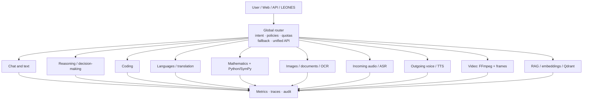
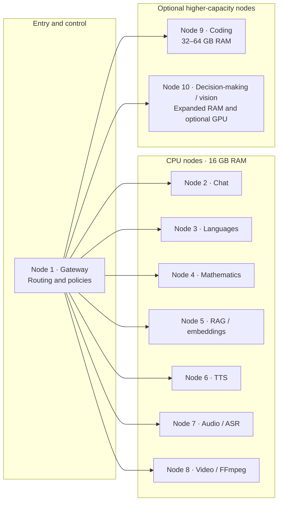
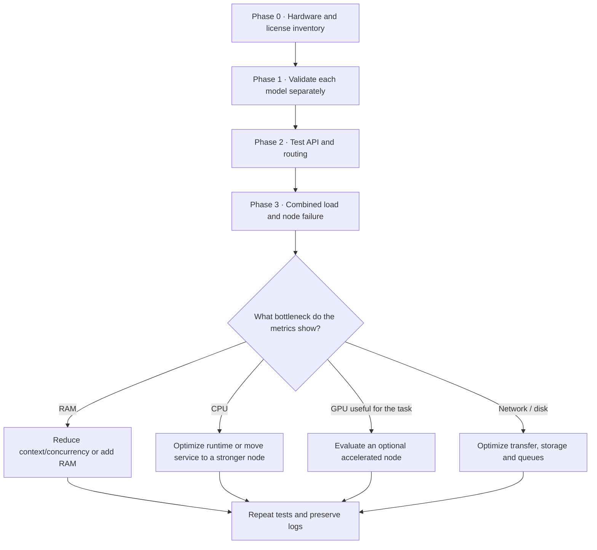

# REDIL — Distributed Local Artificial Intelligence Network

**REDIL** is a **distributed and shared computing framework** designed to democratize access to **Artificial Intelligence** through the federation and collaborative orchestration of **low-resource computers**.

## Name meaning and technical pillars

- **R — Red (Network):** peer-to-peer, node-to-node communication connecting heterogeneous devices into a collaborative computing mesh.
- **E — Económica (Economical / low-resource):** energy efficiency and the use of modest or recycled hardware, without requiring industrial-scale clusters.
- **D — Dispositivos (Shared Devices):** pooling and sharing local resources — RAM, VRAM, CPU threads and modest accelerators — contributed by each node.
- **I — Inteligencia (Intelligence):** execution, orchestration and distributed inference of AI models, including LLMs, SLMs and autonomous agents.
- **L — Local:** sovereign, on-premises operation, with privacy and local processing and no mandatory dependence on, or tolls imposed by, centralized clouds.

**Status:** architectural proposal / research; not deployed or physically validated.  
**Parent project:** LEONES (Local Ecosystem of Open Neural Expert Systems).  
**Subsystem name:** **REDIL**.

## 1. Executive summary

REDIL proposes providing a single AI service through a global router that directs each request to the most suitable specialist. Specialists may run on separate Ubuntu computers, preferably with 16 GB of RAM and a CPU, without requiring a dedicated GPU on every node. The system can grow by adding one or more higher-capacity nodes with 32–64 GB of RAM and, optionally, an NVIDIA GPU with 12–24 GB of VRAM.

The core hypothesis is not to add the RAM of all machines together as if it were unified memory. Instead, it is to **distribute independent services by area of expertise**, using a common API, queues, concurrency limits, observability and fallback mechanisms. A normal request is handled by one node; only multimodal or agent-based workflows need to coordinate several services.

REDIL must preserve LEONES principles:

- Local-first operation, without mandatory dependence on cloud services.
- Replaceable components with documented interfaces.
- A clear distinction between declared compatibility, estimates and actual tests.
- Every performance figure remains **ESTIMATED** until measured on the target hardware.
- No model, runtime or provider is installed automatically without explicit selection.

## 2. Logical architecture

The visual reference diagram is available in [ARQUITECTURA-VISUAL.md](ARQUITECTURA-VISUAL.md) and as the vector file [ARQUITECTURA-REDIL.svg](ARQUITECTURA-REDIL.svg). The architecture distinguishes two planes: **REDIL as a federation/orchestration layer for specialized services**, based on **[LLM-Mesh](https://github.com/Mesh-LLM/mesh-llm)**, and, optionally, **[Distributed Llama](https://github.com/b4rtaz/distributed-llama) as an experimental engine that splits a single inference across multiple workers**. The official source code, versions and issues are tracked in the [Distributed Llama upstream repository](https://github.com/b4rtaz/distributed-llama). These are different functions; it must not be assumed that every request goes through Distributed Llama.

## Evaluation of Distributed Llama as a REDIL backend

**Official upstream reference:** [https://github.com/b4rtaz/distributed-llama](https://github.com/b4rtaz/distributed-llama) — an external project evaluated as an optional backend; mentioning it does not mean it is installed or validated in LEONES.

**Architectural decision:** keep Distributed Llama as an optional, experimental distributed-inference backend. It must not become the gateway, the general-purpose scheduler or a requirement for REDIL services.

REDIL and Distributed Llama solve different problems:

- **REDIL — service distribution:** the gateway routes each request to an available specialized service (chat, coding, vision, ASR, TTS, RAG, etc.). Each service may run on a different computer.
- **Distributed Llama — distributing one inference:** a root node and several workers cooperate to run the same model. This may make it possible to host a model that does not fit on a single computer, but it adds communication and synchronization overhead.
- **No automatic unified RAM:** splitting a model does not turn all computers' memory into transparent local memory, nor does adding nodes guarantee more tokens per second.

### Specific diagram — Distributed Llama adapter


The gateway must communicate with a decoupled adapter that encapsulates the API and the root/worker topology. The adapter must expose health checks, timeouts, concurrency limits, metrics and normalized errors. If the backend fails to respond, REDIL removes it from the selection pool and uses another compatible local backend; it must not forward data to the cloud unless explicitly authorized.

### Technical assessment at a glance

| Area | Assessment | Decision for REDIL |
|---|---|---|
| Linux x86-64 / ARM | Candidate for heterogeneous computers; verify each node's ISA and build. | Evaluate on Ubuntu, starting with CPU. |
| Topology | Upstream documentation describes cluster-size constraints and model-dependent KV-head requirements. | Do not automatically assign every REDIL node; validate each model's topology. |
| Qwen3 / Qwen3 MoE | These model families are listed in the upstream documentation consulted. | Select an explicit version/artifact and test it on a single node before distributing it. |
| Qwen3.5 / LFM3 | Compatibility was not confirmed by the upstream specification consulted. | Do not advertise them as compatible until a reproducible test exists. |
| CPU / Vulkan / NVIDIA | CPU is the most conservative starting path; Vulkan requires measurement. Do not assume that an RTX GPU implies CUDA acceleration. | Compare CPU and Vulkan separately; measure actual VRAM use and performance. |
| Network and latency | Synchronization can cancel out the benefit of adding nodes. | Use a private wired network and measure TTFT, prefill, tokens/s and traffic. |
| API and agents | Equivalent support for streaming, cancellation or tool calls must not be taken for granted. | Verify each feature against the pinned release before exposing it through the gateway. |
| License | The upstream repository indicates MIT; check the exact tag and the model-weight licenses separately. | Record attribution and the licenses of the engine, weights and dependencies. |

### Decision plan

1. Pin the version/tag/commit, license, model, tokenizer, format and hash.
2. Measure a single-node CPU inference using reproducible prompts.
3. Run a root node plus one worker on a private network and compare it with the baseline.
4. Test stability, worker loss, timeouts, cancellation and concurrency limits.
5. Evaluate an MoE model only if the upstream version explicitly supports it.
6. Compare Vulkan/GPU only in an isolated profile and verify that the GPU backend is actually being used.
7. Implement/enable the REDIL adapter only after the previous stages have passed.

**Evidence status:** documentary assessment and test plan only. No installation, deployment, local benchmark or confirmed compatibility with the RTX 3050, Qwen3.5 or LFM3 is claimed. All results remain **PENDING** until reproducible logs from the tested hardware are preserved.

### Diagram 1 — Distributed architecture

The gateway classifies the request and routes it to the specialized service. Services may run on different computers; RAM is not represented as shared memory.



### Diagram 2 — Indicative ten-node topology



> This allocation is a reference topology, not a rigid requirement: services can be grouped or moved according to RAM, latency and concurrency measurements. The gateway can run on an existing node. Node 10 represents optional higher capacity; it does not imply that a GPU is mandatory.

### Diagram 3 — Validation and scaling path



```text
                    User / Web / API / LEONES
                                |
                                v
                 +------------------------------+
                 |        GLOBAL ROUTER        |
                 | intent, policies, quotas    |
                 | fallback, node selection    |
                 | compatible unified API      |
                 +---------------+--------------+
                                 |
         +-----------+-----------+-----------+-----------+
         |           |           |           |           |
         v           v           v           v           v
      [Chat]    [Decision]   [Coding]   [Languages] [Mathematics]
         |           |           |           |           |
         +-----------+-----------+-----------+-----------+
                                 |
         +-----------+-----------+-----------+-----------+
         |           |           |           |           |
         v           v           v           v           v
      [Image]     [Audio]       [TTS]      [Video]    [RAG / DB]
         |           |           |           |           |
         +-----------+-----------+-----------+-----------+
                                 |
                    Metrics / traces / audit
```

```text
                    User / Web / API / LEONES
                                |
                                v
                 +------------------------------+
                 |        GLOBAL ROUTER        |
                 | intent, policies, quotas    |
                 | fallback, node selection    |
                 | compatible unified API      |
                 +---------------+--------------+
                                 |
         +-----------+-----------+-----------+-----------+
         |           |           |           |           |
         v           v           v           v           v
      [Chat]    [Decision]   [Coding]   [Languages] [Mathematics]
         |           |           |           |           |
         +-----------+-----------+-----------+-----------+
                                 |
         +-----------+-----------+-----------+-----------+
         |           |           |           |           |
         v           v           v           v           v
      [Image]     [Audio]       [TTS]      [Video]    [RAG / DB]
         |           |           |           |           |
         +-----------+-----------+-----------+-----------+
                                 |
                    Metrics / traces / audit
```

### Router responsibilities

1. Classify intent: conversation, coding, reasoning, translation, calculation, image/document, audio, speech synthesis, video or document search.
2. Select a service based on capability, language, availability, load and local policy.
3. Validate inputs and limit context size, audio/video duration and concurrency.
4. Apply fallback when a node is unavailable or a model does not cover the requested language or task.
5. Return a consistent response while recording which model/runtime produced it.
6. Never send data to external services unless the user has explicitly configured this.

The first version can use deterministic rules and metadata. An additional LLM is not required to route every request. A small classifier can be added for ambiguous cases.

## 3. Specialties and candidate models

The model names in this section are **evaluation candidates**, not claims of verified compatibility. Before pinning versions, verify the official repository, license, artifact (GGUF or another format), tokenizer, CPU runtime, languages, actual memory requirements and quality on a LEONES test suite.

| Service | Initial candidate | Alternative / tools | Notes |
|---|---|---|---|
| Chat and text | Liquid AI LFM2.5-1.2B-Instruct | A small CPU-compatible Qwen model | Short conversations, summaries, structured extraction and classification. A small model is not a substitute for advanced reasoning. |
| Reasoning / decision-making | Liquid AI LFM2.5-8B-A1B (MoE) | LFM2.5-1.2B-Thinking; Qwen 3–4B or larger on a higher-capacity node | An MoE activates only some parameters per token, but the required expert weights still need to be hosted. Measure memory, latency and tool-use reliability. |
| Coding | Qwen2.5-Coder-3B-Instruct | A 7–8B coding model with 32–64 GB RAM | Code generation and explanation, testing, debugging and refactoring. Editing entire repositories requires agent tools and tests, not just an LLM. |
| Languages / translation | LFM2.5-1.2B-Instruct as a baseline | A multilingual 3–4B Qwen model or a translation-specialized model | Evaluate each language pair; do not assume equivalent quality across all languages. |
| Mathematics | LFM2.5-1.2B-Thinking as a lightweight candidate | A reasoning-capable Qwen model on a higher-capacity node + Python/SymPy | Complement the LLM with deterministic calculation and verification. Do not rely on generated text alone for exact calculations. |
| Images / documents / OCR | LFM2.5-VL-1.6B | PaddleOCR or another dedicated OCR engine + VLM | Confirm CPU support for the vision architecture and its preprocessing. Keep OCR separate from semantic interpretation. |
| Incoming audio | LFM2.5-Audio-1.5B as an experimental candidate | Whisper.cpp / an ASR model validated for Spanish | Confirm Spanish coverage, license, latency and input format. Do not infer multilingual support from the family name. |
| Outgoing voice (TTS) | Piper | Another local TTS engine with Spanish voices | A lightweight service separate from the LLM; verify the license and availability of each voice. |
| Video | FFmpeg + frame sampling + VLM | A GPU node for more demanding visual models | In the first phase, video is interpreted by extracting frames; this is not equivalent to full temporal understanding or video generation. |
| RAG / memory | A multilingual embedding model + Qdrant | BM25, a small reranker and document storage | Keep indexing and retrieval separate from generation. Record sources and permissions; keep data local. |

### LFM models: fit and limitations

LFM models are attractive candidates when compact size, local inference and specialization matter. The family should not be treated as a universal solution:

- A language model does not generate images simply because it can accept text about them.
- A vision-language model interprets images; it is not necessarily an image generator.
- An audio model may have language or modality limitations.
- The active parameters of an MoE do not equal the size of the weights that must be stored.
- A published variant is not automatically supported by every version of llama.cpp, TensorFold or another runtime.

Initial official sources to revalidate before implementation:

- Liquid AI: https://github.com/Liquid4All
- Models on Hugging Face: https://huggingface.co/LiquidAI
- LFM: https://www.liquid.ai/

Record the consultation date, revision/commit, license, exact artifact and runtime in each model's specification.

## 4. Hardware classes

### Class A — CPU base node

- Ubuntu x86-64.
- 16 GB installed RAM.
- CPU with instruction-set support suitable for the runtime; AVX2 is desirable on x86.
- SSD with at least 512 GB as a practical minimum; 1 TB if it hosts several models.
- Gigabit Ethernet; 2.5 GbE is preferable if the additional cost is reasonable.
- No dedicated GPU.

Use cases: small quantized models, basic chat, lightweight translation, embeddings, RAG, classification, Piper, file processing and coordination. 16 GB is total RAM, not free memory for model weights; Ubuntu, caches, context and services all compete for it.

### Class B — higher-capacity CPU node

- 32–64 GB RAM.
- CPU with more cores and good memory bandwidth.
- 1 TB or larger NVMe SSD.
- No mandatory GPU.

Use cases: coding and reasoning with larger models, longer contexts, more concurrency and multiple services on the same host. 32 GB is a useful step up; 64 GB provides additional headroom but does not, by itself, guarantee high performance.

### Class C — optional accelerated node

- 32–64 GB RAM.
- NVIDIA GPU with 12–16 GB VRAM as an entry target; 24 GB is preferable for more demanding vision or generation workloads.
- Pinned and verified drivers and runtime.

Use cases: larger vision models, intensive multimodal processing, image generation and workloads that genuinely benefit from CUDA. A CPU fallback should be available where practical. Not every node needs a GPU.

## 5. Initial deployment size

| Profile | Nodes | Scope |
|---|---:|---|
| Minimum prototype | 4–5 | Group compatible services: chat, coding, vision, audio/TTS and RAG; some specialties share a machine. |
| Practical minimum | 6 | Reasonable separation of essential services and some headroom to avoid constant contention. |
| Recommended | 8 | Better isolation, concurrency and service availability. May include one higher-capacity node. |
| Full deployment | 10 | One service per specialized node, with additional room for redundancy, testing or replicas of high-demand services. |

These figures depend on request volume and selected models. They do not mean that ten nodes make a single query ten times faster. The main benefit is specialization and parallel processing of independent requests.

## 6. Proposed allocation across ten nodes

1. General chat: compact LFM model.
2. Reasoning/decision-making: validated LFM MoE or Thinking model; preferably a higher-capacity node if resource use requires it.
3. Coding: compact coding model; preferably 32 GB if moving to 7–8B.
4. Languages and translation: multilingual model selected through testing.
5. Mathematics: reasoning model + Python/SymPy.
6. Images, documents and OCR: small VLM + dedicated OCR.
7. Incoming audio: local ASR with verified Spanish support.
8. Outgoing voice: Piper or another local TTS engine.
9. Video: FFmpeg, frame extraction and a client for the vision service.
10. RAG, embeddings, index and reserve capacity for lightweight tasks.

The router can run on an existing Class A node, although a critical deployment should separate the gateway and maintain a standby instance. Document storage must be sized according to the corpus and backed up.

## 7. Software stack to evaluate

- **Gateway and routing:** a lightweight custom service or OpenAI-compatible proxy; Nginx/Traefik for HTTP/TLS ingress if needed.
- **Text inference:** llama.cpp or another runtime, but only after verifying the specific architecture and artifact.
- **Vision:** a runtime compatible with the selected VLM plus dedicated OCR.
- **Audio:** Whisper.cpp or another validated local ASR engine; Piper for TTS.
- **Video:** FFmpeg for decoding and frame extraction.
- **RAG:** Qdrant plus embeddings and, if justified by testing, BM25/reranking.
- **Observability:** latency, TTFT, tokens/s, peak RAM, CPU, failures, queue depth, concurrency and energy cost where measurable.
- **Deployment:** independent services with pinned versions, health checks and controlled restarts. Containers are optional; they should not be imposed if they add unnecessary complexity.

Do not automatically install or change existing services. Prototype using an isolated port and directory, without interfering with current LEONES/ODS/Hermes installations.

## 8. LEONES validation plan

### Phase 0 — inventory and requirements

- Measure available RAM, CPU, storage, network and operating system on each computer.
- Identify model licenses and requirements.
- Select one specific artifact per service.
- Classify all performance forecasts as **ESTIMATED**.

### Phase 1 — test each specialist on one node

For each model, record:

- Exact model and revision, format and quantization.
- Runtime and version.
- Download and load times.
- Peak RAM, CPU usage and context size.
- Time to first response, tokens/s or task completion time.
- Language, quality and failures on the test suite.
- Behavior under concurrency.

### Phase 2 — router

- Test correct intent classification.
- Measure the latency added by routing.
- Verify that data is not leaked between users.
- Verify timeouts, cancellation, fallback and understandable errors.
- Confirm that logs do not store secrets or sensitive content by default.

### Phase 3 — combined load

- Run several specialties in parallel.
- Detect RAM, CPU, disk and network contention.
- Tune queues, concurrency and context limits.
- Check recovery after a node is shut down.

### Phase 4 — scaling decision

Only add RAM or a GPU when measurements identify the bottleneck. A GPU node does not automatically improve a workload limited by CPU, memory, network or disk reads.

**Evidence rule:** published benchmarks or results from other computers are external references, never LEONES measurements of local hardware. Mark a result **MEASURED** only after running the test on the actual machine and preserving reproducible logs.

## 9. Risks and mitigations

- **Insufficient RAM:** limit context and concurrency; use compatible quantization; move the service to Class B.
- **MoE too large:** size for total weights, buffers and cache, not just active parameters.
- **Poor Spanish audio coverage:** use alternative ASR/TTS engines with task-specific tests.
- **Routing errors:** use deterministic rules for known cases and fall back to general chat.
- **Network latency:** keep each service on a single node where possible; transfer only required metadata or chunks, not unnecessarily large files.
- **Single point of failure:** replicate the gateway and the most critical service; do not confuse redundancy with shared memory.
- **Upstream changes:** pin versions and revalidate when models or runtimes are updated.
- **Licensing:** review weights, code, voices, training data and auxiliary components separately.

## 10. Acceptance criteria

REDIL must not be considered deployed until at least the following conditions are met:

1. A documented, working unified API.
2. Verifiable routing for every enabled specialty.
3. A reproducible inventory of hardware and models.
4. Actual memory and latency measurements for each service.
5. Language and quality tests for the advertised tasks.
6. Tested node failure, timeout and fallback behavior.
7. No unauthorized external data transfers.
8. Installation, update, rollback and removal documentation.
9. A clear distinction between ESTIMATED and MEASURED results.

## 11. Recommended decision

Approve REDIL as an **experimental architecture for specialized distributed AI** within LEONES. Start with six 16 GB CPU nodes, reserve one 32–64 GB node for coding/reasoning, and expand towards eight or ten services according to the results. A GPU should be a strategic option for vision and demanding multimodal workloads, not a requirement for every node.

The first milestone is not to deploy ten models at once. It is to demonstrate a common API, correct routing, local fallback and reproducible measurements for chat, coding, vision and voice.

## 12. Documentation, diagrams and research bibliography

This section is the **REDIL reference index**: it brings together subsystem documents, all architectural diagrams maintained in the repository and the primary sources used to evaluate the distributed architecture. The diagrams are conceptual proposals; they do not represent a physically validated deployment.

### 12.1 Project documents

- [REDIL README](README.md) — architecture, node roles, specialties, requirements, risks and acceptance criteria (Spanish original).
- [Visual architecture](ARQUITECTURA-VISUAL.md) — guide to interpreting the diagrams and their limitations.
- [Experimental evaluation of Distributed Llama](DISTRIBUTED-LLAMA-EXPERIMENTAL.md) — compatibility analysis, risks and test plan.
- [LEONES documentation index](../../README.md) — navigation for the general documentation.
- [LEONES knowledge-source index](../../sources/README.md) — general register of external sources and research records.

### 12.2 Diagrams

**Diagram A — REDIL overall architecture**


Source file: [ARQUITECTURA-REDIL.svg](ARQUITECTURA-REDIL.svg). It represents the gateway, service roles, optional distributed-inference node and logical infrastructure.

**Diagram B — Distributed Llama integration**


Source file: [DISTRIBUTED-LLAMA-REDIL.svg](DISTRIBUTED-LLAMA-REDIL.svg). It details the gateway, adapter, fallback path, root node and workers, together with observability and technical limits.

**Diagram C — Mermaid logical flow**

The [experimental document](DISTRIBUTED-LLAMA-EXPERIMENTAL.md#2-encaje-arquitectónico-en-redil) also includes an editable Mermaid diagram describing the client → gateway → routing policy → conventional backend or Distributed Llama adapter → root/workers flow.

### 12.3 Distributed Llama primary sources

These are the upstream references to review when pinning an evaluation version. Pages on the `main` branch may change; for reproducible results, record the exact tag or commit consulted.

1. [Official repository — b4rtaz/distributed-llama](https://github.com/b4rtaz/distributed-llama) — source code, requirements, formats and project description.
2. [Upstream README](https://github.com/b4rtaz/distributed-llama/blob/main/README.md) — instructions, declared architectures/models and root/worker topology.
3. [Releases and release notes](https://github.com/b4rtaz/distributed-llama/releases) — change history and versions to pin before testing.
4. [Upstream issues](https://github.com/b4rtaz/distributed-llama/issues) — reports and open questions about models, GPU, API and operation.
5. [Repository license](https://github.com/b4rtaz/distributed-llama/blob/main/LICENSE) — verify the file and the exact release license before redistribution.

### 12.4 Evidence scope and traceability

- Upstream documentation describes project capabilities; it does not prove that every capability works on LEONES hardware.
- Upstream examples, estimates and results from other computers are **external references**, not our own benchmarks.
- Qwen3.5 and LFM3 compatibility, effective RTX 3050 acceleration and cluster performance gains remain to be tested reproducibly.
- For each future run, record the release/commit, model and hash, tokenizer, configuration, operating system, hardware, effective backend, logs, TTFT, prefill, tokens/s, memory and network traffic.
- Revisit references when the release, model format or acceleration backend changes. Do not infer compatibility from similar model-family names.

### 12.5 Figures

    ...
