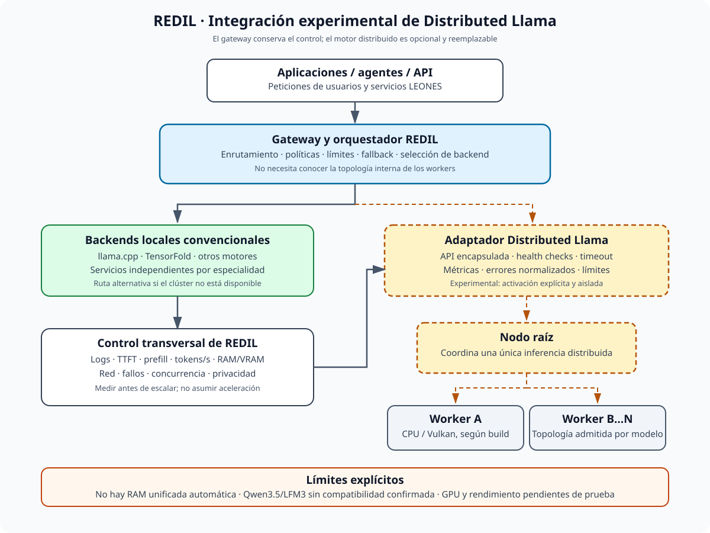
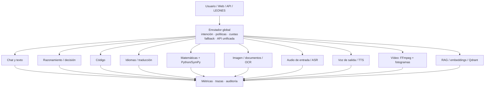
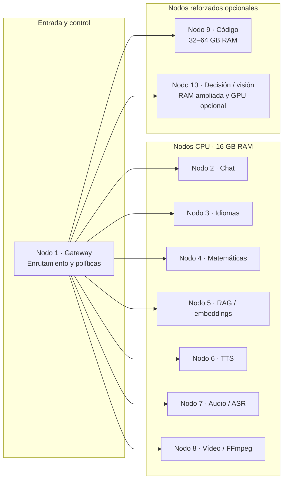
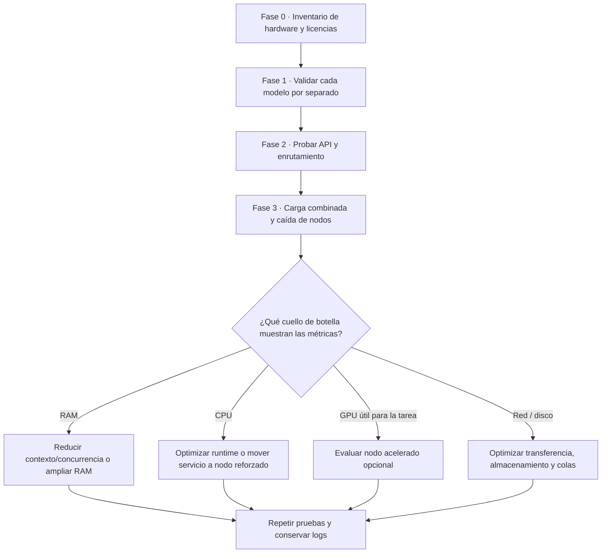
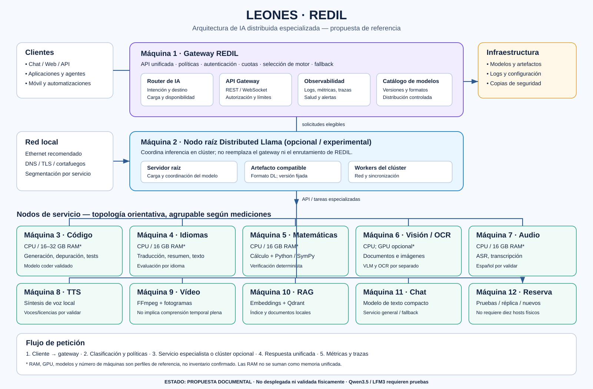

# REDIL — Red distribuida de Inteligencia Artificial Local

**REDIL** es un marco de cómputo **distribuido y compartido**, diseñado para democratizar el acceso a la **Inteligencia Artificial** mediante la federación y orquestación colaborativa de **ordenadores de bajos recursos**.

## Significado del nombre y pilares técnicos

- **R — Red (distribuida):** comunicación nodo a nodo (*peer-to-peer*) para vincular dispositivos heterogéneos en una malla de cómputo colaborativo.
- **E — Económica (bajos recursos):** eficiencia energética y aprovechamiento de hardware modesto o reciclado, sin exigir clústeres industriales.
- **D — Dispositivos (compartidos):** suma y compartición de recursos locales —RAM, VRAM, hilos de CPU y aceleradores modestos— aportados por cada nodo.
- **I — Inteligencia:** ejecución, orquestación e inferencia distribuida de modelos de IA, incluidos LLM, SLM y agentes autónomos.
- **L — Local:** operación soberana *on-premise*, con privacidad y procesamiento local sin dependencia obligatoria ni peajes de nubes centralizadas.

**Estado:** propuesta de arquitectura / investigación; no desplegada ni validada físicamente.  
**Proyecto padre:** LEONES (Local Ecosystem of Open Neural Expert Systems).  
**Nombre del subsistema:** **REDIL**.


## 1. Resumen ejecutivo

REDIL propone ofrecer un único servicio de IA a través de un enrutador global que dirige cada solicitud al especialista más adecuado. Los especialistas pueden ejecutarse en equipos Ubuntu distintos, preferentemente con 16 GB de RAM y CPU, sin exigir GPU dedicada en todos los nodos. El sistema puede crecer incorporando uno o varios nodos reforzados con 32–64 GB de RAM y, de forma opcional, una GPU NVIDIA de 12–24 GB de VRAM.

La hipótesis principal no es sumar la RAM de todas las máquinas como si fuese memoria unificada, sino **distribuir servicios independientes por especialidad**, con API común, colas, límites de concurrencia, observabilidad y fallback. Una solicitud normal se atiende en un nodo; solo los flujos multimodales o agentivos necesitan coordinar varios servicios.

REDIL debe preservar los principios de LEONES:

- Local-first y operación sin dependencia obligatoria de servicios cloud.
- Componentes reemplazables, con interfaces documentadas.
- Separación entre compatibilidad declarada, estimación y prueba real.
- Toda cifra de rendimiento queda como **ESTIMATED** hasta medirla en el hardware objetivo.
- Ningún modelo, runtime o proveedor se instala automáticamente sin selección explícita.

## 2. Arquitectura lógica

El diagrama visual de referencia está disponible en [ARQUITECTURA-VISUAL.md](ARQUITECTURA-VISUAL.md) y en el archivo vectorial [ARQUITECTURA-REDIL.svg](ARQUITECTURA-REDIL.svg). La arquitectura distingue dos planos: **REDIL como federación/orquestación de servicios especializados** basado en **[LLM-Mesh](https://github.com/Mesh-LLM/mesh-llm)** y, opcionalmente, **[Distributed Llama](https://github.com/b4rtaz/distributed-llama) como motor experimental que reparte una misma inferencia entre varios workers**. El código fuente oficial, las versiones y las incidencias se consultan en el [repositorio upstream de Distributed Llama](https://github.com/b4rtaz/distributed-llama). No son la misma función y no debe suponerse que toda petición pase por Distributed Llama.

## Evaluación de Distributed Llama como backend de REDIL

**Referencia upstream oficial:** [https://github.com/b4rtaz/distributed-llama](https://github.com/b4rtaz/distributed-llama) — proyecto externo evaluado como backend opcional; su mención no implica que esté instalado ni validado en LEONES.

**Decisión arquitectónica:** mantener Distributed Llama como backend opcional y experimental de inferencia distribuida. No debe convertirse en el gateway, en el planificador general ni en un requisito para los servicios de REDIL.

REDIL y Distributed Llama resuelven problemas diferentes:

- **REDIL — distribución de servicios:** el gateway dirige cada petición a un servicio especializado disponible (chat, código, visión, ASR, TTS, RAG, etc.). Cada servicio puede ejecutarse en una máquina diferente.
- **Distributed Llama — distribución de una inferencia:** un nodo raíz y varios workers cooperan para ejecutar el mismo modelo. Esto puede permitir alojar un modelo que no cabe en un solo equipo, pero añade comunicación y sincronización.
- **No hay RAM unificada automática:** repartir el modelo no convierte la memoria de todos los ordenadores en una memoria local transparente, ni garantiza más tokens/s al añadir nodos.

### Diagrama específico — Adaptador Distributed Llama



El gateway debe hablar con un adaptador desacoplado que encapsule la API y la topología root/worker. El adaptador debe exponer health checks, timeouts, límites de concurrencia, métricas y errores normalizados. Si el backend no responde, REDIL lo retira de la selección y utiliza otro backend local compatible; no debe reenviar datos a la nube salvo autorización explícita.

### Evaluación técnica resumida

| Área | Evaluación | Decisión para REDIL |
|---|---|---|
| Linux x86-64 / ARM | Candidato para equipos heterogéneos; comprobar ISA y build por nodo. | Evaluar en Ubuntu, primero CPU. |
| Topología | El upstream documenta restricciones de tamaño del clúster y de cabezas KV dependientes del modelo. | No asignar automáticamente todos los nodos REDIL; validar la topología de cada modelo. |
| Qwen3 / Qwen3 MoE | Familias enumeradas por la documentación upstream consultada. | Elegir una versión/artefacto explícito y probarlo en single-node antes de distribuir. |
| Qwen3.5 / LFM3 | Compatibilidad no confirmada por la ficha upstream consultada. | No anunciarlos como compatibles hasta que exista prueba reproducible. |
| CPU / Vulkan / NVIDIA | CPU es la ruta inicial más conservadora; Vulkan requiere medición. No asumir que la presencia de una RTX implica aceleración CUDA. | Comparar CPU y Vulkan por separado; medir uso real de VRAM y rendimiento. |
| Red y latencia | La sincronización puede anular el beneficio de añadir nodos. | Usar red privada cableada y medir TTFT, prefill, tokens/s y tráfico. |
| API y agentes | No dar por hecho soporte equivalente para streaming, cancelación o llamadas a herramientas. | Verificar cada función contra la release fijada antes de exponerla al gateway. |
| Licencia | El repositorio upstream indica MIT; revisar el tag exacto y las licencias de los pesos por separado. | Registrar atribución y licencia del motor, pesos y dependencias. |

### Plan de decisión

1. Fijar versión/tag/commit, licencia, modelo, tokenizer, formato y hash.
2. Medir una inferencia single-node CPU con prompts reproducibles.
3. Ejecutar root + un worker en una red privada y comparar con el baseline.
4. Probar estabilidad, pérdida de worker, timeouts, cancelación y límites de concurrencia.
5. Evaluar un modelo MoE solo si la versión upstream lo soporta explícitamente.
6. Comparar Vulkan/GPU únicamente en un perfil aislado y comprobar que el backend GPU se usa realmente.
7. Implementar/activar el adaptador REDIL solo después de aprobar las fases anteriores.

**Estado de evidencia:** evaluación documental y plan; no se declara instalación, despliegue, benchmark local ni compatibilidad confirmada con la RTX 3050, Qwen3.5 o LFM3. Todos los resultados permanecen **PENDIENTES** hasta conservar logs reproducibles del hardware probado.

### Gráfico 1 — Arquitectura distribuida

El gateway clasifica la petición y la dirige al servicio especializado. Los servicios pueden vivir en equipos distintos; no se presenta la RAM como memoria compartida.



### Gráfico 2 — Topología orientativa de diez nodos



> La asignación es una topología de referencia, no un requisito rígido: los servicios pueden agruparse o moverse según las mediciones de RAM, latencia y concurrencia. El gateway puede residir en un nodo existente. El nodo 10 representa capacidad reforzada opcional; no implica que una GPU sea obligatoria.

### Gráfico 3 — Ruta de validación y escalado



```text
                    Usuario / Web / API / LEONES
                                |
                                v
                 +------------------------------+
                 |       ENRUTADOR GLOBAL       |
                 | intención, políticas, cuotas |
                 | fallback, selección de nodo |
                 | API unificada compatible    |
                 +---------------+--------------+
                                 |
         +-----------+-----------+-----------+-----------+
         |           |           |           |           |
         v           v           v           v           v
      [Chat]    [Decisión]   [Código]    [Idiomas]  [Matemáticas]
         |           |           |           |           |
         +-----------+-----------+-----------+-----------+
                                 |
         +-----------+-----------+-----------+-----------+
         |           |           |           |           |
         v           v           v           v           v
      [Imagen]    [Audio]      [TTS]       [Vídeo]    [RAG / DB]
         |           |           |           |           |
         +-----------+-----------+-----------+-----------+
                                 |
                    Métricas / trazas / auditoría
```

```text
                    Usuario / Web / API / LEONES
                                |
                                v
                 +------------------------------+
                 |       ENRUTADOR GLOBAL       |
                 | intención, políticas, cuotas |
                 | fallback, selección de nodo |
                 | API unificada compatible    |
                 +---------------+--------------+
                                 |
         +-----------+-----------+-----------+-----------+
         |           |           |           |           |
         v           v           v           v           v
      [Chat]    [Decisión]   [Código]    [Idiomas]  [Matemáticas]
         |           |           |           |           |
         +-----------+-----------+-----------+-----------+
                                 |
         +-----------+-----------+-----------+-----------+
         |           |           |           |           |
         v           v           v           v           v
      [Imagen]    [Audio]      [TTS]       [Vídeo]    [RAG / DB]
         |           |           |           |           |
         +-----------+-----------+-----------+-----------+
                                 |
                    Métricas / trazas / auditoría
```

### Responsabilidades del enrutador

1. Clasificar la intención: conversación, código, razonamiento, traducción, cálculo, imagen/documento, audio, síntesis de voz, vídeo o búsqueda documental.
2. Seleccionar un servicio según capacidad, idioma, disponibilidad, carga y política local.
3. Validar entradas y limitar tamaño de contexto, duración de audio/vídeo y concurrencia.
4. Aplicar fallback cuando un nodo no esté disponible o un modelo no cubra el idioma o la tarea.
5. Devolver una respuesta uniforme, registrando qué modelo/runtime produjo el resultado.
6. No enviar datos a servicios externos salvo configuración explícita del usuario.

La primera versión puede usar reglas y metadatos deterministas. No es obligatorio usar un LLM adicional para enrutar cada solicitud. Para casos ambiguos puede añadirse un clasificador pequeño.

## 3. Especialidades y candidatos

Los nombres de modelos de esta sección son **candidatos de evaluación**, no afirmaciones de compatibilidad ya comprobada. Antes de fijar versiones hay que verificar repositorio oficial, licencia, artefacto (GGUF u otro), tokenizer, runtime CPU, idiomas, memoria real y calidad en un conjunto de pruebas LEONES.

| Servicio | Candidato inicial | Alternativa / herramientas | Observaciones |
|---|---|---|---|
| Chat y texto | Liquid AI LFM2.5-1.2B-Instruct | Qwen pequeño compatible con CPU | Conversación breve, resúmenes, extracción estructurada y clasificación. Un modelo pequeño no sustituye a uno de razonamiento avanzado. |
| Razonamiento / decisión | Liquid AI LFM2.5-8B-A1B (MoE) | LFM2.5-1.2B-Thinking; Qwen de 3–4B o mayor en nodo reforzado | El MoE activa una parte de los parámetros por token, pero hay que alojar los pesos de los expertos necesarios. Medir memoria, latencia y fiabilidad en herramientas. |
| Codificación | Qwen2.5-Coder-3B-Instruct | Modelo coder de 7–8B en 32–64 GB RAM | Generación y explicación de código, pruebas, depuración y refactorización. La edición de repositorios completos requiere herramientas de agente y pruebas, no solo el LLM. |
| Idiomas / traducción | LFM2.5-1.2B-Instruct como línea base | Modelo multilingüe Qwen de 3–4B o especializado en traducción | Evaluar por parejas de idiomas; no inferir calidad equivalente para todos los idiomas. |
| Matemáticas | LFM2.5-1.2B-Thinking como candidato ligero | Qwen con capacidad de razonamiento en nodo reforzado + Python/SymPy | Complementar el LLM con cálculo determinista y verificación. No confiar cálculos exactos solo a texto generado. |
| Imagen / documentos / OCR | LFM2.5-VL-1.6B | PaddleOCR u otro OCR dedicado + VLM | Confirmar soporte CPU de la arquitectura visual y su preprocesamiento. Separar OCR de interpretación semántica. |
| Audio de entrada | LFM2.5-Audio-1.5B como candidato experimental | Whisper.cpp / modelo ASR con español validado | Confirmar cobertura de español, licencia, latencia y formato de entrada. No asumir soporte multilingüe por el nombre de la familia. |
| Voz de salida (TTS) | Piper | Otro motor TTS local con voces en español | Servicio ligero separado del LLM; verificar licencia y disponibilidad de cada voz. |
| Vídeo | FFmpeg + muestreo de fotogramas + VLM | Nodo GPU para modelos visuales más exigentes | En la primera fase se interpreta vídeo extrayendo fotogramas; no equivale a comprensión temporal completa ni a generación de vídeo. |
| RAG / memoria | Modelo de embeddings multilingüe + Qdrant | BM25, reranker pequeño y almacenamiento documental | Indexación y recuperación separadas del generador. Registrar fuentes y permisos; mantener datos localmente. |

### Modelos LFM: encaje y límites

Los modelos LFM son candidatos atractivos cuando importan tamaño reducido, inferencia local y especialización. La familia no debe considerarse una solución universal:

- Un modelo de lenguaje no genera imágenes por el hecho de aceptar texto sobre ellas.
- Un modelo de visión-lenguaje interpreta imágenes; no es necesariamente un generador visual.
- Un modelo de audio puede tener limitaciones de idioma o de modalidad.
- Los parámetros activos de un MoE no equivalen al tamaño de los pesos que deben almacenarse.
- Una variante publicada no queda automáticamente soportada por cualquier versión de llama.cpp, TensorFold u otro runtime.

Fuentes oficiales iniciales para revalidar antes de implementación:
- Liquid AI: https://github.com/Liquid4All
- Modelos en Hugging Face: https://huggingface.co/LiquidAI
- LFM: https://www.liquid.ai/

Registrar fecha de consulta, revisión/commit, licencia, artefacto exacto y runtime en la ficha de cada modelo.

## 4. Clases de hardware

### Clase A — nodo base CPU

- Ubuntu x86-64.
- 16 GB de RAM instalados.
- CPU con soporte de instrucciones adecuado para el runtime; AVX2 es deseable en x86.
- SSD de 512 GB como mínimo práctico; 1 TB si aloja varios modelos.
- Ethernet gigabit; 2,5 GbE es preferible si el coste adicional es razonable.
- Sin GPU dedicada.

Usos: modelos pequeños cuantizados, chat básico, traducción ligera, embeddings, RAG, clasificación, Piper, procesamiento de archivos y coordinación. Los 16 GB son RAM total, no memoria libre para pesos; Ubuntu, cachés, contexto y servicios compiten por ella.

### Clase B — nodo CPU reforzado

- 32–64 GB de RAM.
- CPU con más núcleos y buen ancho de banda de memoria.
- SSD NVMe de 1 TB o más.
- Sin GPU obligatoria.

Usos: codificación y razonamiento con modelos de mayor tamaño, contextos más largos, más concurrencia y varios servicios en el mismo host. 32 GB es un escalón útil; 64 GB da margen adicional, sin garantizar por sí solo un rendimiento alto.

### Clase C — nodo acelerado opcional

- 32–64 GB de RAM.
- GPU NVIDIA con 12–16 GB de VRAM como objetivo de entrada; 24 GB preferible para visión o generación más exigente.
- Drivers y runtime fijados y comprobados.

Usos: visión de mayor tamaño, procesamiento multimodal intensivo, generación de imágenes y cargas que se beneficien realmente de CUDA. Debe existir fallback CPU cuando sea viable. No se requiere que todos los nodos tengan GPU.

## 5. Tamaño inicial del despliegue

| Perfil | Nodos | Alcance |
|---|---:|---|
| Prototipo mínimo | 4–5 | Agrupar servicios compatibles: chat, código, visión, audio/TTS y RAG; algunas especialidades comparten equipo. |
| Mínimo práctico | 6 | Separación razonable de servicios esenciales y margen para evitar contención constante. |
| Recomendado | 8 | Mejor aislamiento, concurrencia y disponibilidad de servicios. Puede incluir un nodo reforzado. |
| Despliegue completo | 10 | Un servicio por nodo especializado, más margen para redundancia, pruebas o réplica de servicios de mayor demanda. |

Estas cifras dependen del volumen de solicitudes y de los modelos seleccionados. No implican que diez nodos multipliquen por diez la velocidad de una única consulta. El beneficio principal es la especialización y el procesamiento paralelo de solicitudes independientes.

## 6. Distribución propuesta para diez nodos

1. Chat general: LFM compacto.
2. Razonamiento/decisión: LFM MoE o modelo Thinking validado; preferiblemente nodo reforzado si el consumo lo exige.
3. Código: modelo coder compacto; preferiblemente 32 GB si se eleva a 7–8B.
4. Idiomas y traducción: modelo multilingüe seleccionado mediante pruebas.
5. Matemáticas: modelo de razonamiento + Python/SymPy.
6. Imagen, documentos y OCR: VLM pequeño + OCR dedicado.
7. Audio de entrada: ASR local con español comprobado.
8. Voz de salida: Piper u otro TTS local.
9. Vídeo: FFmpeg, extracción de fotogramas y cliente del servicio visual.
10. RAG, embeddings, índice y reserva para tareas ligeras.

El enrutador puede residir en un nodo existente de clase A, aunque en un despliegue crítico conviene separar el gateway y mantener una instancia de reserva. El almacenamiento de documentos debe dimensionarse según el corpus y disponer de copias de seguridad.

## 7. Stack de software a evaluar

- **Gateway y enrutamiento:** servicio ligero propio o proxy compatible con OpenAI; Nginx/Traefik para entrada HTTP/TLS si se necesita.
- **Inferencia de texto:** llama.cpp u otro runtime solo después de verificar la arquitectura y el artefacto concretos.
- **Visión:** runtime compatible con el VLM seleccionado más OCR dedicado.
- **Audio:** Whisper.cpp u otro ASR local validado; Piper para TTS.
- **Vídeo:** FFmpeg para decodificación y extracción de fotogramas.
- **RAG:** Qdrant más embeddings y, si las pruebas lo justifican, BM25/reranking.
- **Observabilidad:** métricas de latencia, TTFT, tokens/s, RAM máxima, CPU, fallos, cola, concurrencia y coste energético cuando pueda medirse.
- **Despliegue:** servicios independientes con versiones fijadas, health checks y reinicio controlado. Contenedores son opcionales; no deben imponerse si añaden complejidad innecesaria.

No instalar ni cambiar servicios existentes automáticamente. Prototipar en un puerto y directorio aislados, sin interferir con las instalaciones actuales de LEONES/ODS/Hermes.

## 8. Plan de validación LEONES

### Fase 0 — inventario y requisitos

- Medir RAM disponible, CPU, almacenamiento, red y sistema operativo de cada equipo.
- Identificar licencias y requisitos de los modelos.
- Elegir un artefacto concreto por servicio.
- Clasificar todas las previsiones de rendimiento como **ESTIMATED**.

### Fase 1 — prueba de cada especialista en un nodo

Para cada modelo registrar:
- modelo y revisión exactos, formato y cuantización;
- runtime y versión;
- tiempo de descarga y carga;
- RAM máxima, uso de CPU y tamaño del contexto;
- latencia de primera respuesta, tokens/s o tiempo por tarea;
- idioma, calidad y fallos del conjunto de pruebas;
- comportamiento con concurrencia.

### Fase 2 — enrutador

- Probar clasificación correcta de intención.
- Medir latencia añadida por enrutamiento.
- Verificar que no se filtran datos entre usuarios.
- Verificar timeout, cancelación, fallback y errores comprensibles.
- Confirmar que los logs no almacenan secretos ni contenido sensible por defecto.

### Fase 3 — carga combinada

- Ejecutar varias especialidades en paralelo.
- Detectar contención de RAM, CPU, disco y red.
- Ajustar colas, concurrencia y límites de contexto.
- Comprobar recuperación tras apagar un nodo.

### Fase 4 — decisión de escalado

Solo añadir RAM o GPU cuando las mediciones identifiquen el cuello de botella. Un nodo GPU no mejora automáticamente una carga limitada por CPU, memoria, red o lectura de disco.

**Regla de evidencia:** benchmarks publicados o resultados de otros equipos son referencia externa, nunca mediciones LEONES del hardware local. Marcar **MEASURED** únicamente después de ejecutar la prueba en el equipo real y conservar logs reproducibles.

## 9. Riesgos y mitigaciones

- **RAM insuficiente:** limitar contexto y concurrencia; usar cuantización compatible; mover el servicio a clase B.
- **MoE demasiado grande:** dimensionar por pesos totales, buffers y caché, no solo por parámetros activos.
- **Cobertura de español deficiente en audio:** usar ASR/TTS alternativos con pruebas específicas.
- **Errores de enrutamiento:** reglas deterministas para casos conocidos y fallback al chat general.
- **Latencia de red:** mantener cada servicio en un único nodo cuando sea posible; transferir metadatos o fragmentos necesarios, no archivos enormes sin necesidad.
- **Punto único de fallo:** réplica del gateway y del servicio más crítico; no confundir redundancia con memoria compartida.
- **Cambios de upstream:** fijar versiones y revalidar al actualizar modelos o runtimes.
- **Licencias:** revisar por separado pesos, código, voces, datos de entrenamiento y componentes auxiliares.

## 10. Criterios de aceptación

REDIL no se considerará desplegada hasta que se cumplan como mínimo estos puntos:

1. API unificada documentada y funcional.
2. Enrutamiento verificable para cada especialidad habilitada.
3. Inventario reproducible de hardware y modelos.
4. Medidas reales de memoria y latencia por servicio.
5. Pruebas de idioma y calidad para las tareas anunciadas.
6. Fallos de nodo, timeout y fallback probados.
7. Sin envío externo de datos no autorizado.
8. Documentación de instalación, actualización, rollback y eliminación.
9. Resultados ESTIMATED y MEASURED claramente separados.

## 11. Decisión recomendada

Aprobar REDIL como **arquitectura experimental de IA distribuida especializada** dentro de LEONES. Comenzar con seis nodos CPU de 16 GB, reservar un nodo de 32–64 GB para código/razonamiento y ampliar hacia ocho o diez servicios según resultados. La GPU debe ser una opción estratégica para visión y cargas multimodales exigentes, no un requisito de cada nodo.

El primer hito no es desplegar diez modelos a la vez, sino demostrar una API común, enrutamiento correcto, fallback local y mediciones reproducibles para chat, código, visión y voz.


## 12. Documentación, gráficos y bibliografía de investigación

Este apartado es el **índice de referencia de REDIL**: reúne los documentos del subsistema, todos los gráficos arquitectónicos mantenidos en el repositorio y las fuentes primarias utilizadas para evaluar la arquitectura distribuida. Los diagramas son propuestas conceptuales; no representan un despliegue físico validado.

### 12.1 Documentos del proyecto

- [README de REDIL](README.md) — arquitectura, roles de nodos, especialidades, requisitos, riesgos y criterios de aceptación.
- [Arquitectura visual](ARQUITECTURA-VISUAL.md) — guía para interpretar los gráficos y sus límites.
- [Evaluación experimental de Distributed Llama](DISTRIBUTED-LLAMA-EXPERIMENTAL.md) — análisis de compatibilidad, riesgos y plan de pruebas.
- [Índice documental de LEONES](../../README.md) — navegación de la documentación general.
- [Índice de fuentes de conocimiento de LEONES](../../sources/README.md) — registro general de fuentes externas y fichas de investigación.

### 12.2 Gráficos y diagramas

**Gráfico A — Arquitectura general de REDIL**



Archivo fuente: [ARQUITECTURA-REDIL.svg](ARQUITECTURA-REDIL.svg). Representa el gateway, los roles de servicio, el nodo de inferencia distribuida opcional y la infraestructura lógica.

**Gráfico B — Integración de Distributed Llama**


Archivo fuente: [DISTRIBUTED-LLAMA-REDIL.svg](DISTRIBUTED-LLAMA-REDIL.svg). Detalla gateway, adaptador, ruta de fallback, nodo raíz y workers, junto con observabilidad y límites técnicos.

**Diagrama C — Flujo lógico Mermaid**

El [documento experimental](DISTRIBUTED-LLAMA-EXPERIMENTAL.md#2-encaje-arquitectónico-en-redil) incluye además un diagrama Mermaid editable en texto que explica el flujo cliente → gateway → política de enrutamiento → backend convencional o adaptador Distributed Llama → root/workers.

### 12.3 Fuentes primarias de Distributed Llama

Estas son las referencias upstream que deben revisarse al fijar una versión de evaluación. Las páginas de la rama `main` pueden cambiar; para resultados reproducibles se debe registrar el tag o commit exacto consultado.

1. [Repositorio oficial — b4rtaz/distributed-llama](https://github.com/b4rtaz/distributed-llama) — código fuente, requisitos, formatos y descripción del proyecto.
2. [README upstream](https://github.com/b4rtaz/distributed-llama/blob/main/README.md) — instrucciones, arquitecturas/modelos declarados y topología root/worker.
3. [Releases y notas de versión](https://github.com/b4rtaz/distributed-llama/releases) — historial de cambios y versiones que deben fijarse antes de probar.
4. [Issues upstream](https://github.com/b4rtaz/distributed-llama/issues) — incidencias y cuestiones abiertas sobre modelos, GPU, API y funcionamiento.
5. [Licencia del repositorio](https://github.com/b4rtaz/distributed-llama/blob/main/LICENSE) — verificar el fichero y la licencia de la release exacta antes de redistribuir.

### 12.4 Alcance y trazabilidad de la evidencia

- La documentación upstream describe capacidades del proyecto; no demuestra que cada capacidad funcione con el hardware de LEONES.
- Los ejemplos de upstream, las estimaciones y los resultados de otros equipos son **referencias externas**, no benchmarks propios.
- La compatibilidad de Qwen3.5 y LFM3, la aceleración efectiva de la RTX 3050 y las ventajas de rendimiento del clúster siguen pendientes de prueba reproducible.
- Para cada ejecución futura, registrar release/commit, modelo y hash, tokenizer, configuración, sistema operativo, hardware, backend efectivo, logs, TTFT, prefill, tokens/s, memoria y tráfico de red.
- Las referencias deben revisarse al cambiar la release, el formato del modelo o el backend de aceleración. No inferir compatibilidad por similitud de nombres de familias.
