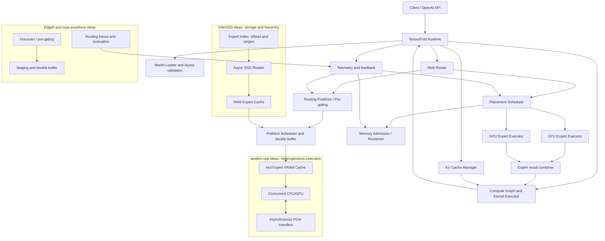

# TensorFold-MoE
## Sparse-MoE inference architecture: TensorFold + InferSSD + tandem.cpp + Edge0 + moe-anywhere + UBTree

**Date:** 2026-11-03  
**Scope:** local inference of sparse-MoE models, expert offloading, multi-level caches, SSD streaming, routing prediction, concurrent CPU/GPU execution, and speculative decoding.  
**Status:** technical analysis and proposed architecture. The integrations described are proposals, not features already implemented in TensorFold. Cited benchmarks belong to their original authors and platforms; they are not measurements on the MSI system.

---

## 1. Executive summary

This report consolidates the analysis of how ideas from several projects could be combined to extend TensorFold with efficient sparse-MoE inference on consumer hardware.

The projects address different parts of the same problem:

- **TensorFold** should remain the runtime and coordinator: model loading, compute graph, routing, kernels, KV cache, memory admission, and telemetry.
- **InferSSD** contributes SSD-based expert streaming, tensor-range indexing, and hierarchical caching.
- **tandem.cpp** contributes concurrent CPU/GPU expert execution, a hot-expert VRAM cache, and adaptive work splitting.
- **Edge0** contributes learned routing prediction (*prerouter*), double-buffered prefetch, and Recover-LoRA to recover some quality lost through quantization.
- **moe-anywhere** contributes pre-gating, routing traces, cache-policy evaluation, and hybrid cache-miss handling.
- **UBTree** contributes speculative decoding through a candidate tree built with a unigram model and a bigram selector.

The opportunity is not to copy entire runtimes or introduce MLX or GGML as dependencies. It is to port algorithms and module contracts, implement them natively inside TensorFold, and validate them incrementally.

**Recommendation:** start with RAM/VRAM caching, memory admission control, and hybrid CPU/GPU execution. Add prefetch/pre-gating next. SSD streaming and UBTree should follow only after the baseline and telemetry are solid.

## 2. Reference hardware

The local reference machine is:

| Resource | Configuration |
|---|---|
| Machine | MSI Thin 15 B12UC |
| CPU | Intel Core i7-12650H, 16 logical threads |
| GPU | NVIDIA RTX 3050 Laptop, 4 GiB VRAM, sm_86 |
| Observed RAM | approximately 14 GiB available to the system; earlier inventory found one 8 GB DDR4-3200 SODIMM |
| OS | Ubuntu |
| Driver / CUDA | NVIDIA driver 580.178.04; CUDA 13.0 environment |
| Storage | Local SSD; measure actual latency and throughput before choosing prefetch sizes |

Results from other machines must not be extrapolated directly. InferSSD tests on RTX 5060 Ti/5090 and moe-anywhere tests on an 8 GB RTX 5050 have more VRAM and, in several cases, substantially more RAM.

## 3. Proposed integrated architecture

The diagram describes a target architecture. InferSSD, tandem.cpp, Edge0, moe-anywhere, and UBTree blocks are ideas proposed for adaptation; their presence in the diagram does not mean they are already implemented in TensorFold.



### 3.1 Data flow

1. The model router emits the expert IDs required for the current token/layer.
2. An optional predictor estimates experts for the next layer or step and requests prefetch; predictions never replace the model's actual routing decisions.
3. The Placement Scheduler checks the VRAM cache, RAM cache, and, when needed, the SSD index.
4. Resident experts execute on the GPU. Cache misses are assigned to the CPU or transferred to the GPU according to measured cost.
5. The Async SSD Reader replenishes the RAM cache when an expert is not available in memory.
6. Partial results are combined while preserving the original graph's ordering and semantics.
7. Telemetry feeds back into placement, cache sizing, admission, and prefetch policy.

### 3.2 Proposed module contracts

| Proposed module | Responsibility | Minimum metrics |
|---|---|---|
| ExpertStore | offset index, layout, validation, SSD/RAM reads | bytes, latency, format errors |
| ExpertCache | RAM/VRAM caches, LRU/frequency/predictive policies | per-layer hit rate, bytes, evictions |
| RoutingPredictor | heuristic pre-gating or learned predictor | recall@K, precision, false positives |
| PrefetchScheduler | asynchronous queues, double buffering, cancellation | hidden latency, wasted bytes |
| PlacementScheduler | CPU vs GPU vs transfer | CPU, PCIe, and GPU time per expert |
| MemoryAdmission/Reclaimer | RAM/VRAM admission and reclamation | peak use, fragmentation, admission failures |
| Telemetry | traces and feedback | tok/s, TTFT, prefill, utilization and latency |
| Speculative interface | optional UBTree or other integration | acceptance, cost per round, KV and experts |

## 4. InferSSD: streaming experts from SSD

Repository: https://github.com/wici-ai/inferssd

### 4.1 Approach

InferSSD aims to run MoE models whose expert weights exceed available RAM/VRAM by fetching experts from SSD on demand. It builds on llama.cpp and separates dense/attention weights—which still need appropriate memory residency—from expert matrices that can be streamed.

Notable components:

- Expert-range index in GGUF/packages, avoiding duplication of weights.
- Packaging that preserves quantized bytes and aligns ranges (the described design uses 4 KiB alignment).
- CPU/RAM expert cache and GPU cache.
- Asynchronous reads: `io_uring` on Linux and `F_NOCACHE` on macOS.
- Reader workers, CPU workers, CUDA upload workers, streams, and events.
- Prefetch and placement to overlap loading with compute.
- Admission control, reclaimer, and telemetry.
- OpenAI-compatible API and a web server in the project.

The exact pairing between index/package and checkpoint is critical. The format must be validated against the model, layout, and quantization; an index must not be paired with a different checkpoint merely because the names look similar.

### 4.2 Models and published results

The project reports tests with very large MoE models, including DeepSeek-V4.1-Flash-1017 (763B total parameters, approximately 8–16B active depending on the cited configuration) and Muse-Spark-Open (816B total, around 42B active).

Published DeepSeek-V4.1-Flash decode results:

| Platform | Published decode |
|---|---:|
| Mac M5 Max | 2.874 tok/s |
| RTX 5060 Ti 16 GB | 2.550 tok/s |
| RTX 5090 | 7.270 tok/s |
| DGX Spark | 7.260 tok/s |

Published prefill: RTX 5060 Ti 75.1 tok/s; RTX 5090 164.5 tok/s; DGX Spark 127.5 tok/s; Mac M5 Max 28,766 tok/s (according to the unit/convention reported by the project; consult the original table before reusing this value).

For Muse-Spark-Open, substantially lower results are reported: RTX 5060 Ti 0.219 tok/s; RTX 5090 1.52 tok/s; DGX Spark 2.14 tok/s.

These are author-reported results on high-end platforms and do not predict performance on the 4 GiB RTX 3050. On the MSI, SSD streaming may remove a capacity constraint, but it does not guarantee useful speed: SSD bandwidth, PCIe, RAM, and synchronization overhead may dominate.

### 4.3 What to port to TensorFold

- Expert range index and strict checkpoint/layout/quantization validation.
- Hierarchical SSD → RAM → VRAM cache.
- Asynchronous reads, prefetch, and cancellation of reads that are no longer useful.
- Admission and reclaimer coordinated with compute buffers and KV.
- Telemetry for bytes, read latency, hit/miss, and hidden time.

**Priority:** medium, after RAM/VRAM caching and the scheduler have been demonstrated. SSD streaming should not be the first prototype.

## 5. tandem.cpp: cooperative CPU/GPU execution

Repository: https://github.com/ewhacc/tandem.cpp  
Archived LEONES snapshot: https://github.com/robertosantosx2/LEONES/tree/main/research/moe/tandem.cpp  
Preserved upstream commit: `e1acb8877bfcf92b4ae7c9f0e0f1d896dbf6c683`; llama.cpp base indicated by the snapshot: `f5222f25c`.

### 5.1 Approach

tandem.cpp is a patch set for a specific llama.cpp revision, not a standalone runtime. Its main ideas are:

- frequent experts resident in a GPU cache;
- remaining experts kept in host RAM;
- CPU execution of cache misses while the GPU processes resident experts;
- asynchronous PCIe transfers;
- adaptive work splitting based on CPU, PCIe, and GPU conditions;
- automatic cache budgeting based on VRAM remaining after weights, KV, compute buffers, and a safety margin.

Example flags discussed:

```bash
llama-server -m model.gguf -ngl 99 -cmoe \
  --moe-cache-mib auto -lm none -np 1 -c 16384
```

`-cmoe` keeps experts in host RAM; `--moe-cache-mib auto` computes a cache budget from available VRAM; `-lm none` forces weights to be loaded into RAM rather than mmap. The latter mode may be unsuitable for large models on a RAM-constrained machine. On the MSI, prefer mmap, a moderate context, and one session unless testing shows otherwise.

### 5.2 Evidence limitations

The author's tests discussed in the conversation used high-end GPUs (RTX 4090/RTX 6000 Ada) and systems with 64 GB or more RAM. There is no verified benchmark on the MSI's RTX 3050 sm_86. Build in an isolated worktree and measure before drawing conclusions.

### 5.3 What to port to TensorFold

- hot GPU cache and explicit budget;
- concurrent CPU/GPU miss path;
- scheduler based on measured CPU cost versus PCIe transfer + GPU execution;
- asynchronous events and transfers;
- adaptive policy per layer and expert.

Do not port the complete llama.cpp patch or couple TensorFold to its internal data structures.

## 6. Edge0: prerouter, streaming, and quality recovery

Repositories: https://github.com/menonpg/edge0 and https://github.com/Edge0-AI/Edge0  
Research: https://edge0.ai/research/edge0

### 6.1 Approach

Edge0 combines:

1. SSD expert streaming;
2. a trained prerouter that predicts next-token experts and overlaps reads with current computation;
3. staging and double buffering;
4. Recover-LoRA: adapters trained through distillation to compensate for some quality loss from an int4 base;
5. unmerged adapters and a modular runtime separation.

The public Python implementation targets MLX/Apple Silicon. CUDA appears as a planned/reserved backend; it should not be described as operational CUDA support in that framework.

### 6.2 Published models and benchmarks

| Model | Base | Published configuration |
|---|---|---|
| Edge0-35B | Qwen3.6-35B-A3B | int4, 40 layers, 256 experts, K=4 |
| Edge0-8B | Ling 3.0 hybrid | int4, 24 layers, 128 experts, K=8 |

Mac mini M4 Pro, 24 GB:

| Model | Decode | Cold/warm prefill | Peak active memory |
|---|---:|---:|---:|
| Edge0-35B-A3B | 14.9–17.7 tok/s | 113 / 140 tok/s | 2.9 GiB |
| Edge0-8B-A1B | 23.9–25.3 tok/s | 500 / 1428 tok/s | 1.0 GiB |

The team reports up to +59% decode throughput with the prerouter in certain scenarios. OpenCompass quality: Edge0-35B int4 + adapters 79.2 versus 83.2 fp16 (−4.0); Edge0-8B 69.9 versus 72.7 (−2.8). These are author results, not TensorFold measurements.

### 6.3 What to port

- optional anticipatory predictor module;
- double buffering for upcoming experts;
- measurement of recall@K, false prefetch, and hidden latency;
- exact fallback to the model's actual routing;
- investigate Recover-LoRA separately: it requires training, a teacher, dataset, and evaluation; adapters are not interchangeable across models/quantizations.

## 7. moe-anywhere: pre-gating, caching, and routing traces

Repository: https://github.com/carl0sfelipe/moe-anywhere  
Experiments: https://github.com/carl0sfelipe/moe-anywhere/blob/main/research/experiments.md

### 7.1 Approach

A llama.cpp-based lab for consumer GPUs:

- expert offloading between RAM and VRAM;
- GPU expert cache with policies such as LRU;
- pre-gating: estimate experts for a future layer using activations from the previous layer;
- asynchronous prefetch;
- hybrid cache miss: CPU processes non-resident experts while GPU continues with cached experts;
- routing traces containing layer, token, and top-k expert IDs, to train/evaluate predictors at horizons 1–3.

### 7.2 Published results

Sage-A1.5 (Qwen3.6-35B-A3B, 256 experts/layer, top-8):

| Experiment | Platform | Decode |
|---|---|---:|
| CPU-expert baseline | RTX 5050 8 GB + 31 GB RAM | 41.05 tok/s |
| VRAM cache + load-mode none | RTX 5050 8 GB + 31 GB RAM | 52.1 tok/s |
| hybrid CPU/GPU | RTX 5050 8 GB + 31 GB RAM | 55.1 tok/s |
| another hybrid system | RTX 5050 + Ryzen 7 7800X3D + 30 GB DDR5 | 61.5 tok/s |

The project reports 82% recall for next-layer experts with L+1 pre-gating (96% with 16 candidates). An LRU cache holding 64/256 experts per layer, around 4.9 GB, captures 79% of selections.

The published ~4.9 GB cache already exceeds the MSI's total 4 GiB VRAM, before weights, KV, and buffers. TensorFold would need much smaller budgets and mixed policies.

### 7.3 What to port

- reproducible routing traces;
- per-layer and per-expert metrics;
- LRU/frequency and pre-gating;
- CPU versus PCIe + GPU decisions;
- evaluation of false prefetch and wasted bytes, not recall alone;
- integration with admission/reclaim, including TensorFold PR #1879 work.

## 8. UBTree: tree-based speculative decoding

Paper: “Parallel Tree Drafting via Unigram and Bigram Models for Speculative Decoding,” by Inclusion AI, UIUC, and Purdue. PDF: https://www.inclusion-ai.org/ubtree/UBTree.pdf

### 8.1 Core idea

UBTree combines two stages:

1. A unigram proposer (related to DFlash) generates candidates in parallel by position.
2. A bigram selector scores transitions using proposer hidden states, frozen target embeddings, and two MLP codebooks.

The selector calibrates scores by depth and builds a tree with width W and budget B. The target verifies the tree using tree attention in one pass. The goal is to preserve the target distribution (lossless speculative decoding) while accepting multiple tokens per round.

### 8.2 Paper results

Results reported with SGLang, BF16, and CUDA graphs:

| Model | Greedy speedup | temp=1 speedup |
|---|---:|---:|
| Qwen3-4B | 6.88× | 6.00× |
| Qwen3-8B | 6.94× | 5.84× |
| Ling3-Tiny 7.9B-A1.3B MoE | 3.04× | — |
| Ling3-Flash 124B-A5.1B MoE | 3.27× | — |
| Qwen3.8-27B | 4.78× | — |

For Qwen3-4B, the paper reports an average of 10.23 accepted tokens per round in greedy mode; Qwen3-8B, 10.21.

These results do not prove that a UBTree checkpoint compatible with Qwen3-30B-A3B-2507 or the current TensorFold implementation exists. The proposer, tokenizer, target, hidden states, kernels, and tree attention must all be validated.

### 8.3 Interaction with MoE offloading

A speculative tree may activate diverse experts and increase cache misses, SSD reads, PCIe transfers, and KV memory. The scheduler must therefore optimize the combined cost of the tree and its experts, not just token acceptance. A larger speculative budget may reduce performance if it triggers excessive I/O.

## 9. Project comparison

| Capability | InferSSD | tandem.cpp | Edge0 | moe-anywhere | UBTree |
|---|---|---|---|---|---|
| SSD streaming | core | not central | core | secondary | no |
| RAM/VRAM cache | yes | hot VRAM + host RAM | streaming/cache | VRAM LRU | KV/tree |
| Routing prediction | prefetch/scheduler | not central | learned prerouter | pre-gating | token prediction |
| Concurrent CPU/GPU | workers | core | not central | yes | target/proposer |
| Routing traces | telemetry | possible benchmarking | predictor training | explicit | scores/candidates |
| int4 LoRA recovery | no | no | Recover-LoRA | no | no |
| Speculative tree | no | no | no | no | core |
| Direct portability | modules to port | llama.cpp patch | logic; MLX framework | llama.cpp patches | algorithm/model |

## 10. Fit with TensorFold and implementation strategy

TensorFold should retain ownership of the runtime, graph, kernels, memory, and telemetry. External contributions should be ported as independent mechanisms, not full dependencies.

### Phase 0 — baseline and memory admission

- Pin commit, model, quantization, context, and configuration.
- Validate PR #1879 and measure reserved/actual memory.
- Record loading, prefill, TTFT, decode, RAM/VRAM, stability, and errors.
- Do not modify the local environment's default llama-server.

### Phase 1 — RAM/VRAM cache and tandem placement

- Small, configurable VRAM cache.
- Remaining experts in RAM.
- CPU executes misses when cheaper than transfer + GPU execution.
- Asynchronous transfers and overlap.
- Compare baseline, cache-only, and hybrid modes.

### Phase 2 — routing traces and pre-gating

- Capture per-layer/token traces.
- Establish frequency/LRU baselines.
- Evaluate L+1 pre-gating and horizons 1–3.
- Measure recall@K, false positives, bytes, and tok/s.

### Phase 3 — InferSSD-style SSD streaming

- Validated offset/range index.
- Asynchronous SSD → RAM reads.
- Integrate with cache reclaimer and admission.
- Measure local SSD latency; do not assume PCIe 4/5 SSD performance.

### Phase 4 — Edge0-style learned prerouter

- Train a predictor for the exact model and routing configuration.
- Double buffering, cancellation, and prioritization.
- Compare learned prediction with heuristic pre-gating.
- Exact fallback to actual routing.

### Phase 5 — UBTree / speculative decoding

- First demonstrate proposer and target compatibility.
- Integrate tree attention only with real graph and kernel support.
- Make the scheduler aware of experts, KV, and I/O cost.
- Measure accepted tokens, drafting cost, per-round latency, and end-to-end tok/s.

### Phase 6 — Recover-LoRA

- Separate research line from runtime work.
- High-precision teacher, dataset, distillation, and evaluation.
- Do not conflate quality results with throughput improvements.

## 11. Risks and controls

| Risk | Control |
|---|---|
| Incorrect predictor | target routing remains authoritative; semantics-preserving fallback |
| Excessive prefetch | budget, cancellation, wasted-byte measurement |
| VRAM exhaustion | admission before allocation; reserve weights, KV, buffers, and safety margin |
| Slow SSD | measure latency; cache hot experts; streaming is not free |
| CPU saturation | cost-based scheduler and utilization telemetry |
| PCIe serializes the step | asynchronous transfers and measured overlap |
| Incompatible index | strict checkpoint, layout, and quantization fingerprint/validation |
| Irreproducible results | pin commit, hardware, model, prompt, context, and parameters |
| Speculative tree increases misses | adaptive budget aware of expert and KV costs |
| False portability claims | distinguish operational code, reserved backend, and conceptual design |

## 12. Priority experiments on the MSI

1. Measure the TensorFold baseline with pinned model and PR.
2. Measure actual free memory after weights, KV, and buffers.
3. Test small expert-cache budgets; do not assume all 4 GiB are available.
4. Compare LRU, frequency, and pre-gating.
5. Measure CPU miss handling versus PCIe transfer + GPU execution.
6. Measure local SSD sequential/random performance and range-read latency.
7. Only then evaluate learned prediction and speculative decoding.

Performance targets should be set after obtaining a baseline. No >1 tok/s claim is made for a specific model without a documented real run.

## 13. Main sources

- InferSSD: https://github.com/wici-ai/inferssd
- tandem.cpp: https://github.com/ewhacc/tandem.cpp
- tandem.cpp snapshot in LEONES: https://github.com/robertosantosx2/LEONES/tree/main/research/moe/tandem.cpp
- Edge0: https://github.com/menonpg/edge0
- Edge0 organization: https://github.com/Edge0-AI/Edge0
- Edge0 architecture: https://github.com/Edge0-AI/Edge0/blob/main/docs/architecture.md
- Edge0 research: https://edge0.ai/research/edge0
- moe-anywhere: https://github.com/carl0sfelipe/moe-anywhere
- moe-anywhere experiments: https://github.com/carl0sfelipe/moe-anywhere/blob/main/research/experiments.md
- UBTree paper: https://www.inclusion-ai.org/ubtree/UBTree.pdf
- TensorFold: https://github.com/Osmantic/TensorFold

## Conclusion

The most promising architecture for TensorFold combines **InferSSD for storage**, **tandem.cpp for heterogeneous execution**, **Edge0 and moe-anywhere for prediction/caching/observability**, and **UBTree to reduce decode rounds once compatibility is demonstrated**.

The sensible technical sequence is: admission and caching → concurrent CPU/GPU execution → traces and pre-gating → SSD streaming → learned prerouter → speculative tree. This makes each improvement attributable and measurable while keeping TensorFold independent of the runtimes that inspired it.
