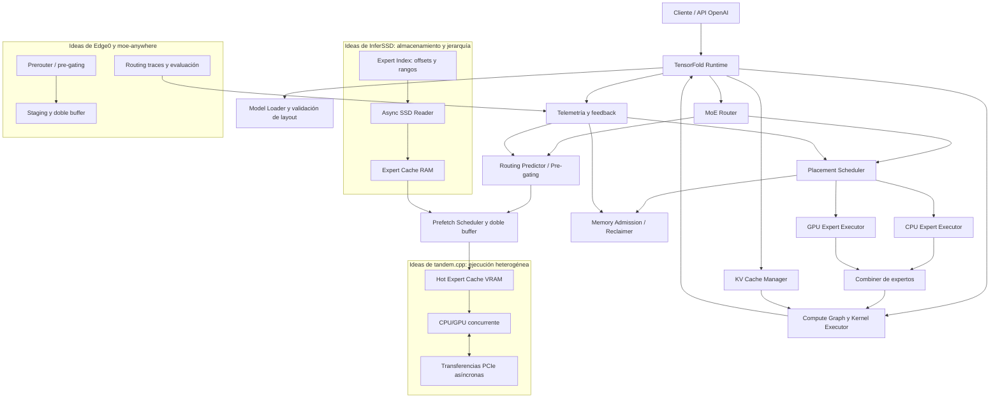

# TensorFold-MoE
## Arquitectura de inferencia sparse-MoE: TensorFold + InferSSD + tandem.cpp + Edge0 + moe-anywhere + UBTree

**Fecha:** 2026-11-03  
**Ámbito:** inferencia local de modelos sparse-MoE, offloading de expertos, cachés multinivel, streaming SSD, predicción de routing, ejecución CPU/GPU concurrente y speculative decoding.  
**Estado:** análisis técnico y propuesta de arquitectura. Las integraciones descritas son propuestas, no funcionalidades ya implementadas en TensorFold. Los benchmarks citados pertenecen a sus autores y plataformas originales; no son resultados medidos en el MSI.

---

## 1. Resumen ejecutivo

Este informe reúne los análisis de la conversación sobre cómo combinar ideas de varios proyectos para ampliar TensorFold con inferencia sparse-MoE eficiente en hardware de consumo.

La conclusión es que los proyectos estudiados resuelven partes distintas del mismo problema:

- **TensorFold** debe actuar como runtime y coordinador: carga del modelo, grafo de cómputo, routing, kernels, KV cache, admisión de memoria y telemetría.
- **InferSSD** aporta el patrón de streaming de expertos desde SSD, índice de rangos de tensores y caché jerárquica.
- **tandem.cpp** aporta la ejecución concurrente de expertos en CPU y GPU, caché de expertos calientes en VRAM y división adaptativa del trabajo.
- **Edge0** aporta predicción aprendida del routing (*prerouter*), prefetch anticipado con doble buffer y Recover-LoRA para recuperar parte de la calidad perdida por cuantización.
- **moe-anywhere** aporta pre-gating, trazas de routing, evaluación de políticas de caché y gestión de misses híbridos.
- **UBTree** aporta speculative decoding mediante un árbol de candidatos construido con un modelo unigram y un selector bigram.

La oportunidad no consiste en copiar runtimes completos ni incorporar MLX o GGML como dependencias. Consiste en portar algoritmos y contratos de módulos, implementados de forma nativa dentro de TensorFold y validados de manera incremental.

**Recomendación:** empezar por caché RAM/VRAM, admission control y ejecución híbrida CPU/GPU. Añadir prefetch/pre-gating después. El streaming SSD y UBTree deben llegar cuando el baseline y la telemetría estén consolidados.

## 2. Contexto de hardware de referencia

El equipo de referencia para los experimentos locales es:

| Recurso | Configuración |
|---|---|
| Equipo | MSI Thin 15 B12UC |
| CPU | Intel Core i7-12650H, 16 hilos lógicos |
| GPU | NVIDIA RTX 3050 Laptop, 4 GiB VRAM, arquitectura sm_86 |
| RAM observada | aproximadamente 14 GiB disponibles para el sistema; inventario previo detectó un SODIMM DDR4-3200 de 8 GB |
| Sistema | Ubuntu |
| Driver / CUDA | driver NVIDIA 580.178.04; entorno CUDA 13.0 |
| Almacenamiento | SSD local; medir latencia y throughput reales antes de diseñar el tamaño de prefetch |

Las cifras de otros equipos no deben extrapolarse directamente. En particular, las pruebas de InferSSD con RTX 5060 Ti/5090 y las de moe-anywhere con RTX 5050 8 GB disponen de más VRAM y, en varios casos, mucha más RAM.

## 3. Arquitectura integrada propuesta

El diagrama representa una arquitectura objetivo. Los bloques de InferSSD, tandem.cpp, Edge0, moe-anywhere y UBTree son ideas que se propone adaptar; no significa que ya existan dentro de TensorFold.



### 3.1 Flujo de datos

1. El router del modelo produce los IDs de expertos requeridos para el token/capa actual.
2. El predictor opcional estima expertos de la siguiente capa o paso y solicita prefetch; las predicciones nunca sustituyen al routing real del modelo.
3. El Placement Scheduler consulta la caché VRAM, la caché RAM y, si procede, el índice SSD.
4. Los expertos residentes se ejecutan en GPU. Los misses se asignan a CPU o se transfieren a GPU según el coste medido.
5. El Async SSD Reader repone la caché RAM cuando el experto no está disponible en memoria.
6. Los resultados parciales se combinan respetando el orden y la semántica del grafo original.
7. Telemetría realimenta placement, tamaño de caché, admission y política de prefetch.

### 3.2 Contratos de módulos

| Módulo propuesto | Responsabilidad | Métricas mínimas |
|---|---|---|
| ExpertStore | índice de offsets, layout, validación y lectura SSD/RAM | bytes, latencia, errores de formato |
| ExpertCache | cachés RAM/VRAM, LRU/frecuencia/predictiva | hit-rate por capa, bytes, evictions |
| RoutingPredictor | pre-gating heurístico o predictor entrenado | recall@K, precisión, falsos positivos |
| PrefetchScheduler | colas asíncronas, doble buffer y cancelación | latencia oculta, bytes inútiles |
| PlacementScheduler | CPU vs GPU vs transferencia | tiempo CPU, PCIe y GPU por experto |
| MemoryAdmission/Reclaimer | admisión y recuperación de RAM/VRAM | pico, fragmentación, fallos de admisión |
| Telemetry | trazas y feedback | tok/s, TTFT, prefill, uso y latencias |
| Speculative interface | integración opcional de UBTree u otros | aceptación, coste por ronda, KV y expertos |

## 4. InferSSD: streaming de expertos desde SSD

Repositorio: https://github.com/wici-ai/inferssd

### 4.1 Enfoque

InferSSD busca ejecutar modelos MoE cuyos pesos de expertos superan la RAM/VRAM disponibles, trayendo expertos desde SSD bajo demanda. Se apoya en una base llama.cpp y separa los pesos densos/atención —que siguen necesitando residencia adecuada en memoria— del conjunto de matrices de expertos que se pueden transmitir.

Elementos destacados:

- Índice de rangos de expertos en GGUF/paquetes, evitando duplicar los pesos.
- Empaquetado que conserva los bytes cuantizados y alinea los rangos (el diseño descrito usa alineación de 4 KiB).
- Caché de expertos en CPU/RAM y caché GPU.
- Lectura asíncrona: `io_uring` en Linux y `F_NOCACHE` en macOS.
- Workers de lectura, workers CPU, workers de subida CUDA, streams y eventos.
- Prefetch y placement para solapar carga con cómputo.
- Admission control, reclaimer y telemetría.
- API compatible con OpenAI y servidor web en el proyecto.

La pareja exacta entre índice/paquete y checkpoint es crítica. El formato debe validarse contra el modelo, layout y cuantización; no se debe asociar un índice a un checkpoint distinto por mera similitud de nombre.

### 4.2 Modelos y resultados publicados

El proyecto presenta pruebas con modelos MoE enormes, entre ellos DeepSeek-V4.1-Flash-1017 (763B parámetros totales, aproximadamente 8–16B activos según configuración citada) y Muse-Spark-Open (816B totales, alrededor de 42B activos).

Resultados publicados para DeepSeek-V4.1-Flash:

| Plataforma | Decode publicado |
|---|---:|
| Mac M5 Max | 2.874 tok/s |
| RTX 5060 Ti 16 GB | 2.550 tok/s |
| RTX 5090 | 7.270 tok/s |
| DGX Spark | 7.260 tok/s |

Prefill publicado: RTX 5060 Ti 75,1 tok/s; RTX 5090 164,5 tok/s; DGX Spark 127,5 tok/s; Mac M5 Max 28.766 tok/s (según la unidad/convención reportada por el proyecto, debe consultarse la tabla original antes de reutilizar el valor).

Para Muse-Spark-Open se reportan resultados sensiblemente menores: RTX 5060 Ti 0,219 tok/s; RTX 5090 1,52 tok/s; DGX Spark 2,14 tok/s.

Estas cifras son resultados de los autores en plataformas de gama alta y no predicen el rendimiento en la RTX 3050 de 4 GiB. En el MSI, SSD streaming puede evitar una limitación de capacidad, pero no garantiza velocidad útil: el ancho de banda del SSD, el PCIe, la RAM y el coste de sincronización pueden dominar.

### 4.3 Qué portar a TensorFold

- Índice de expertos por rangos y validación estricta de checkpoint/layout/cuántización.
- Caché jerárquica SSD → RAM → VRAM.
- Lectura asíncrona, prefetch y cancelación de lecturas que ya no sean útiles.
- Admission y reclaimer coordinados con los buffers de cómputo y KV.
- Telemetría de bytes, latencia de lectura, hit/miss y tiempo oculto.

**Prioridad:** media, después de demostrar que la caché RAM/VRAM y el scheduler funcionan. La ruta SSD no debe ser el primer prototipo.

## 5. tandem.cpp: ejecución CPU/GPU cooperativa

Repositorio: https://github.com/ewhacc/tandem.cpp  
Snapshot archivado en LEONES: https://github.com/robertosantosx2/LEONES/tree/main/research/moe/tandem.cpp  
Commit upstream preservado: `e1acb8877bfcf92b4ae7c9f0e0f1d896dbf6c683`; base llama.cpp indicada por el snapshot: `f5222f25c`.

### 5.1 Enfoque

tandem.cpp es un conjunto de patches sobre una revisión concreta de llama.cpp, no un runtime independiente. Sus ideas principales son:

- expertos frecuentes residentes en una caché GPU;
- expertos restantes conservados en RAM host;
- ejecución CPU de misses mientras GPU procesa expertos residentes;
- transferencias PCIe asíncronas;
- división adaptativa del trabajo según CPU, PCIe y GPU;
- cálculo automático de presupuesto de caché según VRAM disponible tras pesos, KV, buffers y margen.

Ejemplo de flags documentados en la conversación:

```bash
llama-server -m model.gguf -ngl 99 -cmoe \
  --moe-cache-mib auto -lm none -np 1 -c 16384
```

`-cmoe` mantiene expertos en RAM host; `--moe-cache-mib auto` calcula una caché a partir de la VRAM disponible; `-lm none` fuerza la carga de pesos a RAM en lugar de mmap. Este último modo puede ser inadecuado para modelos grandes en un equipo con RAM limitada. En el MSI conviene priorizar mmap, contexto moderado y una sola sesión, salvo que las pruebas indiquen lo contrario.

### 5.2 Límites de evidencia

Las pruebas del autor mencionadas en la conversación se realizaron en GPU de gama alta (RTX 4090/RTX 6000 Ada) y sistemas con 64 GB o más de RAM. No hay un benchmark acreditado en la RTX 3050 sm_86 del MSI. Debe compilarse en un worktree aislado y medirse antes de extraer conclusiones.

### 5.3 Qué portar a TensorFold

- caché caliente GPU y presupuesto explícito;
- ruta de misses CPU/GPU concurrente;
- scheduler basado en coste real CPU frente a transferencia PCIe + ejecución GPU;
- eventos y transferencias asíncronas;
- política adaptativa por capa y por experto.

No portar el patch completo de llama.cpp ni acoplar TensorFold a sus estructuras internas.

## 6. Edge0: prerouter, streaming y recuperación de calidad

Repositorios: https://github.com/menonpg/edge0 y https://github.com/Edge0-AI/Edge0  
Investigación: https://edge0.ai/research/edge0

### 6.1 Enfoque

Edge0 combina:

1. streaming de expertos desde SSD;
2. prerouter entrenado que predice expertos del siguiente token y solapa lectura con cómputo actual;
3. staging y doble buffer;
4. Recover-LoRA: adaptadores entrenados por destilación para compensar parte de la pérdida de calidad de una base int4;
5. adaptadores no fusionados y separación modular del runtime.

La implementación Python pública se orienta a MLX/Apple Silicon. CUDA aparece como backend previsto/reservado, no debe describirse como soporte CUDA operativo en ese framework.

### 6.2 Modelos y benchmarks publicados

| Modelo | Base | Configuración publicada |
|---|---|---|
| Edge0-35B | Qwen3.6-35B-A3B | int4, 40 capas, 256 expertos, K=4 |
| Edge0-8B | Ling 3.0 híbrido | int4, 24 capas, 128 expertos, K=8 |

Mac mini M4 Pro, 24 GB:

| Modelo | Decode | Prefill frío/caliente | Memoria activa pico |
|---|---:|---:|---:|
| Edge0-35B-A3B | 14,9–17,7 tok/s | 113 / 140 tok/s | 2,9 GiB |
| Edge0-8B-A1B | 23,9–25,3 tok/s | 500 / 1428 tok/s | 1,0 GiB |

El equipo reporta hasta +59% de throughput de decode con prerouter en ciertos escenarios. En calidad OpenCompass: Edge0-35B int4 + adapters 79,2 frente a 83,2 fp16 (−4,0); Edge0-8B 69,9 frente a 72,7 (−2,8). Son cifras del autor, no resultados TensorFold.

### 6.3 Qué portar

- predictor anticipado como módulo opcional;
- doble buffer para expertos siguientes;
- medición de recall@K, falsos prefetch y latencia oculta;
- fallback exacto al routing real del modelo;
- investigar Recover-LoRA por separado: requiere entrenamiento, teacher, dataset y evaluación, y los adapters no son intercambiables entre modelos/cuántizaciones.

## 7. moe-anywhere: pre-gating, caché y routing traces

Repositorio: https://github.com/carl0sfelipe/moe-anywhere  
Experimentos: https://github.com/carl0sfelipe/moe-anywhere/blob/main/research/experiments.md

### 7.1 Enfoque

Laboratorio sobre llama.cpp para GPU de consumo:

- offloading de expertos entre RAM y VRAM;
- caché GPU con políticas como LRU;
- pre-gating: estimar expertos de una capa futura usando activaciones de la capa anterior;
- prefetch asíncrono;
- miss híbrido: CPU procesa expertos no residentes mientras GPU continúa con expertos cacheados;
- routing traces con capa, token e IDs top-k, para entrenar/evaluar predictores a horizontes 1–3.

### 7.2 Resultados publicados

Sage-A1.5 (Qwen3.6-35B-A3B, 256 expertos/capa, top-8):

| Experimento | Plataforma | Decode |
|---|---|---:|
| baseline CPU experts | RTX 5050 8 GB + 31 GB RAM | 41,05 tok/s |
| caché VRAM + load-mode none | RTX 5050 8 GB + 31 GB RAM | 52,1 tok/s |
| híbrido CPU/GPU | RTX 5050 8 GB + 31 GB RAM | 55,1 tok/s |
| otro sistema híbrido | RTX 5050 + Ryzen 7 7800X3D + 30 GB DDR5 | 61,5 tok/s |

El proyecto informa 82% de recall de expertos de la siguiente capa mediante pre-gating L+1 (96% con 16 candidatos). Una caché LRU de 64/256 expertos por capa, alrededor de 4,9 GB, captura el 79% de selecciones.

La caché publicada de ~4,9 GB ya supera la VRAM total de 4 GiB del MSI, antes de reservar pesos, KV y buffers. TensorFold necesitaría presupuestos mucho menores y políticas mixtas.

### 7.3 Qué portar

- routing traces reproducibles;
- métricas por capa y experto;
- LRU/frecuencia y pre-gating;
- decisión CPU vs. PCIe + GPU;
- evaluación de falsos prefetch y bytes inútiles, no solo recall;
- integración con admission/reclaim, incluido el trabajo del PR #1879 de TensorFold.

## 8. UBTree: speculative decoding mediante árboles

Paper: “Parallel Tree Drafting via Unigram and Bigram Models for Speculative Decoding”, de Inclusion AI, UIUC y Purdue. PDF: https://www.inclusion-ai.org/ubtree/UBTree.pdf

### 8.1 Idea central

UBTree combina dos etapas:

1. Un proposer unigram (relacionado con DFlash) genera candidatos en paralelo por posición.
2. Un selector bigram puntúa transiciones usando hidden states del proposer, embeddings congelados del target y dos codebooks MLP.

El selector calibra scores por profundidad y construye un árbol con ancho W y presupuesto B. El modelo target verifica el árbol con tree attention en una pasada. El objetivo es conservar la distribución del target (speculative decoding lossless) mientras se aceptan varios tokens por ronda.

### 8.2 Resultados del paper

Resultados reportados en SGLang con BF16/CUDA graphs:

| Modelo | Aceleración greedy | Aceleración temp=1 |
|---|---:|---:|
| Qwen3-4B | 6,88× | 6,00× |
| Qwen3-8B | 6,94× | 5,84× |
| Ling3-Tiny 7.9B-A1.3B MoE | 3,04× | — |
| Ling3-Flash 124B-A5.1B MoE | 3,27× | — |
| Qwen3.8-27B | 4,78× | — |

Para Qwen3-4B se informa una media de 10,23 tokens aceptados por ronda en greedy; Qwen3-8B, 10,21.

Estos resultados no demuestran que exista un checkpoint UBTree compatible con Qwen3-30B-A3B-2507 ni con la implementación actual de TensorFold. Hay que validar proposer, tokenizer, target, hidden states, kernels y tree attention.

### 8.3 Interacción con offloading MoE

Un árbol especulativo puede activar expertos diversos y elevar misses, lecturas SSD, transferencias PCIe y memoria KV. Por tanto, el scheduler debería optimizar el coste conjunto del árbol y los expertos, no solo la aceptación de tokens. Un presupuesto especulativo mayor puede empeorar el rendimiento si desencadena demasiado I/O.

## 9. Comparación de proyectos

| Capacidad | InferSSD | tandem.cpp | Edge0 | moe-anywhere | UBTree |
|---|---|---|---|---|---|
| SSD streaming | núcleo | no central | núcleo | secundario | no |
| Caché RAM/VRAM | sí | VRAM caliente + RAM host | streaming/cache | VRAM LRU | KV/árbol |
| Predicción routing | prefetch/scheduler | no central | prerouter entrenado | pre-gating | predicción de tokens |
| CPU/GPU concurrente | workers | núcleo | no central | sí | target/proposer |
| Routing traces | telemetría | benchmark posible | entrenamiento predictor | explícito | scores/candidatos |
| Recuperación int4 LoRA | no | no | Recover-LoRA | no | no |
| Speculative tree | no | no | no | no | núcleo |
| Portabilidad directa | módulos a portar | patch llama.cpp | lógica; framework MLX | patches llama.cpp | algoritmo/modelo |

## 10. Encaje con TensorFold y estrategia de implementación

TensorFold debe mantener propiedad del runtime, del grafo, de los kernels, de la memoria y de la telemetría. Las contribuciones externas se deben portar como mecanismos independientes, no como dependencias completas.

### Fase 0 — baseline y admisión de memoria

- Fijar commit, modelo, cuantización, contexto y configuración.
- Validar PR #1879 y medir memoria reservada/real.
- Registrar carga, prefill, TTFT, decode, RAM/VRAM, estabilidad y errores.
- No modificar el llama-server predeterminado del entorno local.

### Fase 1 — caché RAM/VRAM y placement tandem

- Caché VRAM pequeña, configurable en MiB.
- Expertos restantes en RAM.
- CPU ejecuta misses cuando sea más barato que transferir y ejecutar en GPU.
- Transferencias asíncronas y solapamiento.
- Comparar baseline, cache-only e híbrido.

### Fase 2 — routing traces y pre-gating

- Capturar trazas por capa/token.
- Construir baseline de frecuencia/LRU.
- Evaluar pre-gating L+1 y horizontes 1–3.
- Medir recall@K, falsos positivos, bytes y tok/s.

### Fase 3 — SSD streaming tipo InferSSD

- Índice validado de offsets/rangos.
- Lectura asíncrona SSD → RAM.
- Integración con cache reclaimer y admission.
- Medir latencia real del SSD local; evitar asumir velocidades de SSD PCIe 4/5.

### Fase 4 — prerouter aprendido tipo Edge0

- Entrenar predictor con trazas del modelo y configuración exactos.
- Doble buffer, cancelación y prioridad.
- Comparar predictor entrenado frente a pre-gating heurístico.
- Fallback exacto al routing real.

### Fase 5 — UBTree / speculative decoding

- Primero demostrar compatibilidad del proposer y del target.
- Integrar tree attention solo con soporte real del grafo y kernels.
- Scheduler consciente de expertos, KV y coste de I/O.
- Medir tokens aceptados, coste de drafting, latencia por ronda y tok/s extremo a extremo.

### Fase 6 — Recover-LoRA

- Línea de investigación separada de runtime.
- Teacher de alta precisión, dataset, destilación y evaluación.
- No mezclar resultados de calidad con mejoras de throughput.

## 11. Riesgos y controles

| Riesgo | Control |
|---|---|
| Predictor incorrecto | routing target siempre autoritativo; fallback sin pérdida de semántica |
| Prefetch excesivo | presupuesto, cancelación, medición de bytes inútiles |
| VRAM agotada | admission antes de asignar; reservar pesos, KV, buffers y margen |
| SSD lento | medir latencias; cachear expertos calientes; no asumir que streaming es gratis |
| CPU saturada | scheduler por coste y telemetría de utilización |
| PCIe serializa el paso | transferencias asíncronas y solapamiento medido |
| Índice incompatible | fingerprint/validación estricta de checkpoint, layout y cuantización |
| Resultados no reproducibles | fijar commit, hardware, modelo, prompt, contexto y parámetros |
| Speculative tree dispara misses | budget adaptativo sensible al coste de expertos y KV |
| Portabilidad falsa | distinguir código operativo, backend reservado y diseño conceptual |

## 12. Experimentos prioritarios en el MSI

1. Medir baseline TensorFold con modelo y PR fijados.
2. Medir memoria realmente libre después de pesos, KV y buffers.
3. Probar cachés de expertos con presupuestos pequeños, sin asumir que los 4 GiB son enteramente utilizables.
4. Comparar LRU, frecuencia y pre-gating.
5. Medir CPU miss frente a transferencia PCIe + ejecución GPU.
6. Medir SSD secuencial y aleatorio y latencia de lectura de rangos.
7. Solo después evaluar predictor entrenado y speculative decoding.

Los objetivos de rendimiento deben fijarse tras obtener baseline. No se promete >1 tok/s para un modelo concreto sin una ejecución real documentada.

## 13. Fuentes principales

- InferSSD: https://github.com/wici-ai/inferssd
- tandem.cpp: https://github.com/ewhacc/tandem.cpp
- Snapshot tandem.cpp en LEONES: https://github.com/robertosantosx2/LEONES/tree/main/research/moe/tandem.cpp
- Edge0: https://github.com/menonpg/edge0
- Edge0 organization: https://github.com/Edge0-AI/Edge0
- Edge0 architecture: https://github.com/Edge0-AI/Edge0/blob/main/docs/architecture.md
- Edge0 research: https://edge0.ai/research/edge0
- moe-anywhere: https://github.com/carl0sfelipe/moe-anywhere
- moe-anywhere experiments: https://github.com/carl0sfelipe/moe-anywhere/blob/main/research/experiments.md
- UBTree paper: https://www.inclusion-ai.org/ubtree/UBTree.pdf
- TensorFold: https://github.com/Osmantic/TensorFold

## Conclusión

La arquitectura con mayor potencial para TensorFold combina **InferSSD para almacenamiento**, **tandem.cpp para ejecución heterogénea**, **Edge0 y moe-anywhere para anticipación/caché/observabilidad**, y **UBTree para reducir rondas de decode cuando exista compatibilidad demostrada**.

La secuencia técnica sensata es: admission y caché → CPU/GPU concurrente → trazas y pre-gating → SSD streaming → prerouter entrenado → speculative tree. Así se puede atribuir cada mejora, medir su coste y mantener TensorFold independiente de los runtimes de los que toma inspiración.
