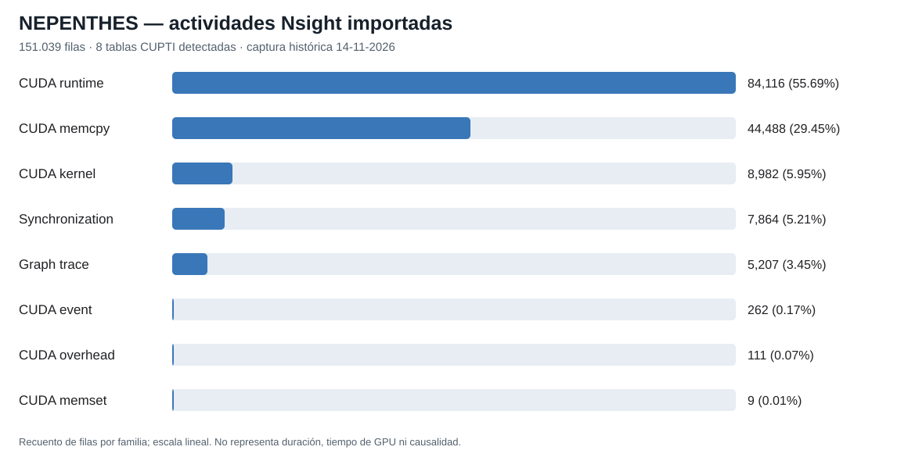

# Historical capture report — Qwen3.5-35B / Nsight Systems

**Language:** [English]( research/moe/tandem.cpp/NEPENTHES-QWEN35-HISTORICAL-REPORT-20261115-EN.md ) · [Español]( research/moe/tandem.cpp/NEPENTHES-QWEN35-HISTORICAL-REPORT-20261115.md )

**Report date:** 2026-11-15  
**Type:** retrospective analysis of an existing Nsight capture; standalone NEPENTHES import.  
**Status:** import structurally validated. This is not a new `nepenthes run` execution or a paired JSONL+Nsight capture.

## 1. Executive summary

The historical Nsight Systems SQLite database was imported on the MSI:

- Source: `~/NEPENTHES_QWEN35_CORRELATED_20261114/qwen35-correlated-20261114.sqlite`
- Destination: `qwen35-nepenthes-nsys-only-20261115.sqlite`
- Mode: `nsys_only`
- Import ID: `nsys-30df43c0a1b2`
- Source SHA-256: `30df43c0a1b235cc25987e2af87e5cf19e5f900f324c26fa22f28cd83144e4fc`
- Imported rows: **151,039**
- Observed destination size: approximately **82 MiB** (85,020,672 bytes).

Provenance remains separate: `run_id=null`, `jsonl=null`. No associated NEPENTHES JSONL is claimed.

## 2. Activity distribution

| Normalized family | CUPTI table | Rows |
|---|---|---:|
| CUDA kernel | `CUPTI_ACTIVITY_KIND_KERNEL` | 8,982 |
| CUDA memcpy | `CUPTI_ACTIVITY_KIND_MEMCPY` | 44,488 |
| CUDA memset | `CUPTI_ACTIVITY_KIND_MEMSET` | 9 |
| CUDA runtime | `CUPTI_ACTIVITY_KIND_RUNTIME` | 84,116 |
| CUDA graph trace | `CUPTI_ACTIVITY_KIND_GRAPH_TRACE` | 5,207 |
| CUDA synchronization | `CUPTI_ACTIVITY_KIND_SYNCHRONIZATION` | 7,864 |
| CUDA event | `CUPTI_ACTIVITY_KIND_CUDA_EVENT` | 262 |
| CUDA overhead | `CUPTI_ACTIVITY_KIND_OVERHEAD` | 111 |
| **Total** | **8 detected tables** | **151,039** |

Declared coverage: `complete_for_detected_cupti_tables`. No unsupported rows were found in the detected CUPTI tables. This label does not mean Nsight captured every possible activity category; it describes only the tables detected in this file.

### Activity-volume chart

The chart compares row counts, not duration or percentage of GPU time. The scale is linear and runtime activity dominates the record volume.

## 3. Integrity audit

| Check | Result |
|---|---|
| SQLite `PRAGMA integrity_check` | `ok` |
| `PRAGMA foreign_key_check` | No rows |
| Activities | 151,039 |
| Unique IDs | 151,039 |
| Unique table/ID pairs | 151,039 |
| Null `start_ns` | 0 |
| `end_ns < start_ns` | 0 |
| Negative duration | 0 |
| Migrations | 002 and 003 applied |
| Standalone imports | 1 |
| Paired JSONL imports | 0 |
| JSONL events | 0 |

The SHA-256 recorded in the provenance row matches the source hash reported by the importer. The source file was not modified.

## 4. CUDA_EVENT special case

The source `CUPTI_ACTIVITY_KIND_CUDA_EVENT` table contains 262 rows. A direct query against the source returned:

- Total: 262
- `timestamp = 0`: 262
- `timestamp IS NULL`: 0
- Minimum and maximum: 0

In the imported database, all 262 rows have `start_ns=0`, `end_ns=null` and `duration_ns=null`. This matches the source and is not importer data loss. Do not use these records to order events or calculate duration.

## 5. Observed time domain

For activities with timestamps, the global ranges observed in the audit were approximately:

- Earliest start: 1,453,681,912 ns (runtime).
- Latest end: 85,612,540,605 ns (runtime).

These timestamps belong to the Nsight-exported time domain. They must not be directly compared with NEPENTHES `monotonic_ns` without calibration. CUDA_EVENT rows with timestamp zero are excluded from temporal reconstruction.

## 6. Historical execution context

Benchmark metadata retained for this Qwen3.5-35B-A3B execution indicates 39 evaluated tokens, 128 generated tokens, approximately 14.96 prompt tokens/s and 32.07 generation tokens/s. The Nsight recording lasted approximately 217.805 s.

These values describe the historical benchmark associated with the capture, not a new measurement performed by the importer. CUPTI activity count is not token count and cannot by itself assign a kernel to a token or request.

## 7. What can be concluded

1. The historical SQLite contains substantial CUDA activity and was imported without requiring a nonexistent JSONL file.
2. All eight detected CUPTI families were imported according to the current adapter.
3. The destination database is structurally intact, with no detected duplicates and explicit provenance.
4. `correlationId` values are preserved in the Nsight domain; they can help relate internal CUDA activities but do not create a relationship with NEPENTHES `request_id`.
5. The historical file is useful as a retrospective dataset for kernel, transfer, runtime, synchronization and graph-trace analysis.

## 8. What cannot be concluded

- Individual kernels cannot be attributed to NEPENTHES requests: no paired JSONL or demonstrated shared identifier exists.
- Nsight timestamps cannot be mixed with NEPENTHES monotonic timestamps.
- The capture does not prove lookahead/prefetch was active or that a particular transfer belonged to it.
- It does not prove general absence of OOM or reconstruct the complete KV-cache lifecycle.
- It does not validate the integrated CLI wrapper capture.
- It does not measure NEPENTHES overhead because this capture predates the wrapper end-to-end test.

## 9. Required next test

Run a new inference with the instrumented Tandem.cpp engine under `nepenthes run --profile full`, retaining in the same package:

1. manifest and exact configuration;
2. host-events and engine-events JSONL;
3. SQLite and native Nsight report;
4. response, logs, exit code and checksums;
5. paired import into LEONES;
6. coverage, loss, integrity and overhead audit.

Only this test can close end-to-end acceptance. See the [roadmap](NEPENTHES-ROADMAP-EN.md).
