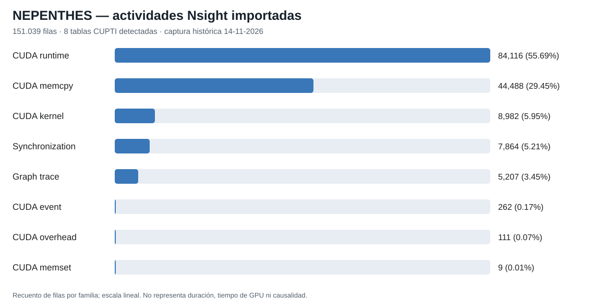

# Historical capture report — Qwen3.5-35B / Nsight Systems

**Report date:** 2026-11-15  
**Type:** retrospective analysis of an existing Nsight capture; standalone NEPENTHES import.  
**Status:** import structurally validated. This is not a new `nepenthes run` execution or a paired JSONL+Nsight capture.

## 1. Executive summary

The historical Nsight Systems SQLite database was imported on the MSI:

- Source: `~/NEPENTHES_QWEN35_CORRELATED_20261114/qwen35-correlated-20261114.sqlite`
- Destination: `qwen35-nepenthes-nsys-only-20261115.sqlite`
- Mode: `nsys_only`
- Import ID: `nsys-30df43c0a1b2`
- Source SHA-256: `30df43c0a1b235cc25987e2af87e5cf19e5f900f324c26fa22f28cd83144e4fc`
- Imported rows: **151,039**
- Observed destination size: approximately **82 MiB** (85,020,672 bytes).

The import preserves separate provenance: `run_id=null`, `jsonl=null`; it does not claim that the file has an associated NEPENTHES JSONL.

## 2. Activity distribution

| Normalized family | CUPTI table | Rows |
|---|---|---:|
| CUDA kernel | `CUPTI_ACTIVITY_KIND_KERNEL` | 8,982 |
| CUDA memcpy | `CUPTI_ACTIVITY_KIND_MEMCPY` | 44,488 |
| CUDA memset | `CUPTI_ACTIVITY_KIND_MEMSET` | 9 |
| CUDA runtime | `CUPTI_ACTIVITY_KIND_RUNTIME` | 84,116 |
| CUDA graph trace | `CUPTI_ACTIVITY_KIND_GRAPH_TRACE` | 5,207 |
| CUDA synchronization | `CUPTI_ACTIVITY_KIND_SYNCHRONIZATION` | 7,864 |
| CUDA event | `CUPTI_ACTIVITY_KIND_CUDA_EVENT` | 262 |
| CUDA overhead | `CUPTI_ACTIVITY_KIND_OVERHEAD` | 111 |
| **Total** | **8 detected tables** | **151,039** |

Declared coverage: `complete_for_detected_cupti_tables`. No unsupported rows were found in the detected CUPTI tables. This label does not mean Nsight captured every possible activity category; it describes only the tables detected in this file.

### Activity volume visualization

The chart compares row counts, not duration or percentage of GPU time. The scale is linear, and runtime activity dominates the record volume.

## 3. Integrity audit

| Test | Result |
|---|---|
| SQLite `PRAGMA integrity_check` | `ok` |
| `PRAGMA foreign_key_check` | No rows |
| Activities | 151,039 |
| Unique IDs | 151,039 |
| Unique table/ID pairs | 151,039 |
| Null `start_ns` | 0 |
| `end_ns < start_ns` | 0 |
| Negative duration | 0 |
| Migrations | 002 and 003 applied |
| Standalone imports | 1 |
| Paired JSONL imports | 0 |
| JSONL events | 0 |

The SHA-256 hash stored in the provenance record matches the source hash reported by the importer. The source file was not modified.

## 4. CUDA_EVENT particularity

The original `CUPTI_ACTIVITY_KIND_CUDA_EVENT` table contains 262 rows. A direct query against the source returned:

- total: 262
- `timestamp = 0`: 262
- `timestamp IS NULL`: 0
- minimum and maximum: 0

In the imported database, all 262 rows have `start_ns=0`, `end_ns=null`, and `duration_ns=null`. The value matches the source. This is not importer data loss. These records must not be used to order events by time or calculate duration.

## 5. Observed time domain

For activities with timestamps, the global ranges observed in the audit were approximately:

- Earliest start: 1,453,681,912 ns (runtime).
- Latest end: 85,612,540,605 ns (runtime).

These timestamps belong to the time domain exported by Nsight. They must not be directly compared with NEPENTHES `monotonic_ns` without calibration. CUDA_EVENT records with zero timestamps are excluded from any temporal reconstruction.

## 6. Historical execution context

Benchmark metadata preserved for this Qwen3.5-35B-A3B run indicates 39 evaluated tokens, 128 generated tokens, approximately 14.96 prompt tokens/s and 32.07 generation tokens/s. The Nsight record had an approximate duration of 217.805 s.

These values describe the historical benchmark associated with the capture, not a new measurement made by the importer. The number of CUPTI activities is not the number of tokens and cannot, by itself, assign a kernel to a token or request.

## 7. What this supports

1. The historical SQLite contains a substantial amount of CUDA activity and could be imported without requiring a nonexistent JSONL.
2. All eight detected CUPTI families were imported completely according to the current adapter.
3. The destination database is structurally sound, with no detected duplicates and explicit provenance.
4. `correlationId` values are preserved in the Nsight domain; they can help relate internal CUDA activities, but they do not create a relationship with NEPENTHES `request_id`.
5. The historical file is suitable as a retrospective dataset for kernel, transfer, runtime, synchronization, and graph-trace analysis.

## 8. What this does not support

- It cannot attribute every kernel to a NEPENTHES request: there is no paired JSONL or demonstrated shared identifier.
- It cannot mix Nsight timestamps and NEPENTHES monotonic timestamps.
- It does not prove that lookahead/prefetch was active or that a specific transfer belonged to it.
- It does not prove the general absence of OOM or independently reconstruct the full KV cache lifecycle.
- It is not validation of an integrated capture through the CLI wrapper.
- It does not measure NEPENTHES overhead, because this capture predates the wrapper end-to-end test.

## 9. Next required test

Run a new inference with the instrumented Tandem.cpp engine under `nepenthes run --profile full`, preserving in the same package:

1. manifest and exact configuration;
2. host-events and engine-events JSONL;
3. SQLite and native Nsight report;
4. response, logs, exit code, and checksums;
5. paired import into LEONES;
6. coverage, loss, integrity, and overhead audit.

Only this test can close end-to-end acceptance. See the [roadmap](NEPENTHES-ROADMAP.md).

## 10. Independent end-to-end revalidation from LEONES `main` — 2026-11-15

After the initial historical import documented above, the import was repeated using the importer from the local LEONES `main` validation worktree, commit `d548a37cc4f05632eba946495ad9d98bdf862c63`. This second run used a new, independent destination; it did not overwrite the earlier database or modify the source.

- Source: `~/NEPENTHES_QWEN35_CORRELATED_20261114/qwen35-correlated-20261114.sqlite`
- SHA-256 verified before import: `30df43c0a1b235cc25987e2af87e5cf19e5f900f324c26fa22f28cd83144e4fc`
- Destination: `~/nepenthes-real-nsys-20261115/qwen35-nsys-only.sqlite`
- Observed destination size: approximately 90 MiB.
- Import ID: `qwen35-real-nsys-only-20261115`
- CLI: `--nsys-only`; exit code 0.
- Importer summary: `activity_count=151039`, `run_id=null`, `jsonl=null`, correlation `none`, and standalone Nsight provenance.

### Independent audit of the second destination

Read-only queries against the destination database confirmed:

| Check | Result |
|---|---:|
| Imported activities | 151,039 |
| Distribution across eight families | Exactly matches importer summary |
| Distinct activity IDs | 151,039 |
| Distinct `source_table/source_activity_id` pairs | 151,039 |
| Detected CUPTI tables | 8 |
| Imported rows | 151,039 |
| Unsupported rows | 0 |
| Coverage status | `complete_for_detected_cupti_tables` |
| Paired imports in `nepenthes_imports` | 0 |
| JSONL events in `nepenthes_events` | 0 |
| Paired-import Nsight activities in `nsys_activities` | 0 |
| `PRAGMA integrity_check` | `ok` |
| `PRAGMA foreign_key_check` | No rows |

The confirmed distribution was: CUDA event 262; graph trace 5,207; kernel 8,982; memcpy 44,488; memset 9; overhead 111; runtime 84,116; synchronization 7,864.

**Acceptance conclusion:** the historical Nsight-only import is end-to-end validated with LEONES `main` code and an independent audit of the resulting SQLite database. Complete coverage is explicitly limited to the eight CUPTI tables detected in this capture; it does not imply that Nsight recorded every possible category. This test establishes no correlation with JSONL events and does not replace a paired capture from the same instrumented execution.

Revalidation artifacts on the MSI: `~/nepenthes-real-nsys-20261115/import.json`, `import.stderr`, `qwen35-nsys-only.sqlite`, and `exit-code` (code 0). The historical source database remains intact.
