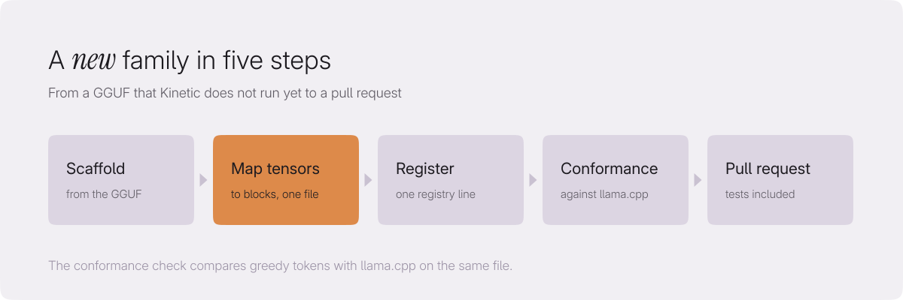

# Contributing to Kinetic

Thank you for helping. Bug reports, benchmarks on your hardware, fixes and
new model support are all welcome.

The [contributor guide](https://veloresearch.github.io/kinetic/contributing.html)
explains how the code is laid out and walks through adding an architecture
and a weight format.

## First contribution: add a model family

A family is one file and one line. With the GGUF file of the model:

1. `python scripts/new_family.py model.gguf` prints the file's layout and
   writes a starter `crates/kinetic-models/src/arch/<name>.rs` that builds,
   already in the family list.
2. Map the tensors of one layer onto the shared blocks in that file;
   [Adding a model family](docs/src/adding-a-family.md) lists the blocks and
   shows LFM2 end to end.
3. `python scripts/conformance.py model.gguf --kinetic target/release/kinetic --llama <llama.cpp bin>`
   compares greedy tokens with llama.cpp.
4. Run the identity gates (`KINETIC_TEST_GGUF=model.gguf cargo test --release -p kinetic-models --test architectures -- --ignored`),
   add a row to `docs/src/models.md` and open the pull request with the
   conformance output.

No time to write it? Open a "Support a new model family" issue.

## Before you start

- For anything larger than a small fix, open an issue first so we can agree
  on the approach.
- Security problems go to contact@veloresearch.com, not to an issue; see
  [SECURITY.md](SECURITY.md).
- Everyone taking part follows the [Code of Conduct](CODE_OF_CONDUCT.md).

## Building

You need Rust 1.91 or newer, on Windows or Linux (x86-64).

```sh
cargo build --release -p kinetic-cli
target/release/kinetic info model.gguf
```

The `cuda` feature is on by default. Its kernels need the CUDA toolkit
(12.8 or newer, for `nvcc`) at build time only; without it the crate still
builds and reports at runtime that the kernels are missing. For a CPU-only
build:

```sh
cargo build --release -p kinetic-cli --no-default-features
```

The Python bindings live outside the workspace and build with
[maturin](https://www.maturin.rs): `cd bindings/python && maturin build --release`.

## Checks

Every pull request must pass:

```sh
cargo fmt --all -- --check
cargo clippy --release --workspace --all-targets --all-features -- -D warnings
cargo test --release --workspace
```

Tests that need a real model are ignored by default. Point them at a file and
include them:

```sh
KINETIC_TEST_GGUF=SmolLM2-135M-Instruct-f16.gguf cargo test --release -p kinetic-server -- --include-ignored
```

## What we look for

- **Exactness.** Anything that speeds up decoding, such as drafting, caching
  or a shortened output head, must give the same tokens as plain decoding.
  Add a test that compares the two.
- **Measurements.** A change that claims to be faster comes with numbers:
  hardware, model, command, before and after, best of several runs.
- **Small, focused code.** One responsibility per file, doc comments on
  public items, comments only where the reason is not obvious. `unsafe` only
  at FFI, SIMD and kernel boundaries, each block with a `// SAFETY:` comment.
- **No network.** Kinetic never connects to the network, except when you
  run `kinetic pull`. Nothing else may open a connection.
- **Own code.** No code copied from other inference engines. Format tables
  and grids are data; note their source in [NOTICE](NOTICE).
- **Dependencies** under MIT, Apache-2.0, BSD, ISC, Zlib, Unicode or CC0
  licenses, with explicit versions.

## Add a model family

A new family is one file that maps a GGUF's tensors onto Kinetic's shared
blocks, walked through step by step in the
[contributor guide](https://veloresearch.github.io/kinetic/contributing.html#adding-an-architecture).

<p align="center">
<picture>
  <source media="(prefers-color-scheme: dark)" srcset="assets/diagrams/add-a-family-dark.svg">
  
</picture>
</p>

## Sign your work

Kinetic uses the [Developer Certificate of Origin](https://developercertificate.org)
(DCO) 1.1. By adding a `Signed-off-by` line to a commit you certify that you
wrote the change or otherwise have the right to submit it under the
project's license. Sign every commit with your real name:

```sh
git commit -s -m "Explain what the change does"
```

which adds

```
Signed-off-by: Your Name <you@example.com>
```

Pull requests with unsigned commits cannot be merged. To sign commits you
already made, run `git rebase --signoff main` and force-push your branch.

## License

Kinetic is licensed under the [Apache License 2.0](LICENSE). Contributions
are accepted under the same license.
