<a name="top"></a>

<div align="center">

<br>

<picture>
  <source media="(prefers-color-scheme: dark)" srcset="assets/kinetic-lockup-on-dark.svg">
  <source media="(prefers-color-scheme: light)" srcset="assets/kinetic-lockup-on-light.svg">
  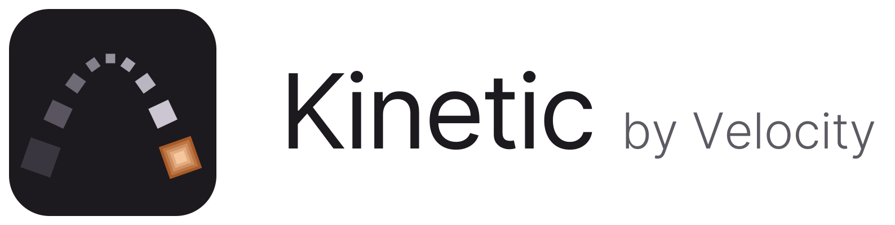
</picture>

### The open engine for running AI on your own computer.

Written in Rust. It reads GGUF files, the format llama.cpp uses, and runs the models it
supports on the CPU and on NVIDIA, AMD and Intel GPUs, from one binary. Fast, and no
speed-up ever changes the answer.

<br>

[](#install)
[](#devices)
[](#use-it-from-your-app)
[](LICENSE)

**[Documentation](https://veloresearch.github.io/kinetic/)** &emsp; **[Technical report](https://veloresearch.com/research/kinetic)** &emsp; **[Releases](https://github.com/Veloresearch/kinetic/releases)** &emsp; **[veloresearch.com](https://veloresearch.com)**

</div>

<a name="install"></a>

## Get started in three steps

**1. Install Kinetic.** On Windows, in PowerShell (no administrator rights needed):

```powershell
irm https://raw.githubusercontent.com/Veloresearch/kinetic/main/scripts/install.ps1 | iex
```

On Linux:

```sh
curl -fsSL \
  https://raw.githubusercontent.com/Veloresearch/kinetic/main/scripts/install.sh | sh
```

**2. Download a model.** LFM3 1.7B (1.1 GB) is quick even on a laptop CPU:

```sh
kinetic pull LiquidAI/LFM3-1.7B-GGUF:Q4_K_M
```

**3. Chat with it.**

```sh
kinetic chat LiquidAI/LFM3-1.7B-GGUF
```

<a name="quick-start"></a>
Not sure which model to take? Run `kinetic` alone: it checks your computer,
suggests two or three models that run well on it (the ones you already have
first), and one key press downloads it and opens a chat. A GGUF file you already
have works too if its model family is [supported](#supported-models):
`kinetic chat path/to/model.gguf`.

<div align="center">

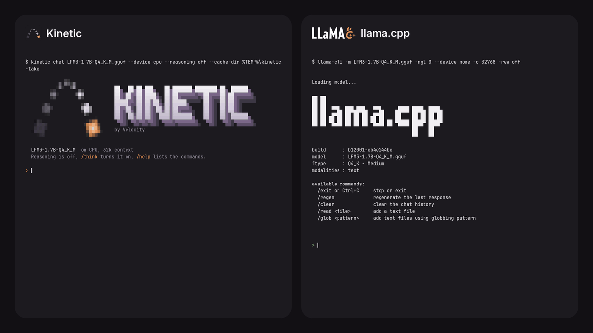

<sub>Real time, same laptop, same GGUF file, same prompt. Every recording on this page is the output of the command it shows.</sub>

</div>

<br>

## Measured against llama.cpp

Same GGUF files, same settings, one laptop (Ryzen 5 6600H, RTX 3060 Laptop
6 GB), llama.cpp b12001:

| | llama.cpp | Kinetic |
|---|---:|---:|
| Rewrite a file on the CPU, LFM3 1.7B | 28.1 t/s | **128.1 t/s**, 4.6x |
| Rewrite a file on the GPU, LFM3 1.7B | 229.7 t/s | **1033.7 t/s**, 4.5x |
| Qwen3.5 4B with 8 of 32 layers on the GPU | 5.1 t/s | **13.3 t/s**, 2.6x |
| First token after pasting 22,631 tokens and typing a question | 10.95 s | **0.13 s** |

Every answer is token for token what plain decoding gives: the speed comes
from doing less work, never from changing the output.
[All benchmarks](#benchmarks).

## Other ways to install

<details>
<summary><b>Archives, source, Docker and Python</b></summary>

<br>

The install scripts download the latest release, check it against
`SHA256SUMS` and put `kinetic` on your `PATH`: in
`%LOCALAPPDATA%\Programs\kinetic` on Windows, in `~/.local/bin` on Linux.

**By hand.** Take an archive from the
[releases page](https://github.com/Veloresearch/kinetic/releases), check it
and unpack it anywhere:

```sh
sha256sum -c SHA256SUMS --ignore-missing      # Windows: Get-FileHash <archive>
tar xzf kinetic-0.1.0-linux-x86_64-cuda.tar.gz
```

| Archive | Runs on |
|---|---|
| `...-x86_64-cuda` | NVIDIA through CUDA, any GPU through Vulkan, the CPU |
| `...-x86_64-cpu` | the CPU only, the smallest download |

Take a `cuda` archive even if you are not sure you have a GPU: it starts on
any machine and falls back to the CPU. It needs only the graphics driver,
not the CUDA toolkit. The Windows binary is not signed yet, so SmartScreen
may stop the first run: choose **More info**, then **Run anyway**.

**From source**, with Rust 1.91 or newer (and the CUDA toolkit 12.8 or newer
for the CUDA kernels):

```sh
cargo install --locked --git https://github.com/Veloresearch/kinetic kinetic-cli
```

**Docker.** `docker/Dockerfile` and `docker/Dockerfile.cuda` build images
that run `kinetic serve` on port 8080; published images are coming.

**Python:** `pip install kinetic-engine`, then `import kinetic`.

All options: [Install](https://veloresearch.github.io/kinetic/install.html).

</details>

**A first model.** [Qwen3-0.6B](https://huggingface.co/Qwen/Qwen3-0.6B-GGUF)
(0.6 GB) is a quick try on any laptop; Qwen3.5 4B in Q4_K_M (2.8 GB) is a
capable everyday model on a GPU with 4 GB or more.
`kinetic pull Qwen/Qwen3-0.6B-GGUF` downloads one, and `kinetic models` lists
what Ollama, LM Studio and the Hugging Face cache already hold, runnable by
name: `kinetic run qwen3:0.6b "Hi"`.

<p align="right"><sub><a href="#top">Back to top</a></sub></p>

## Contents

[What makes it fast](#what-makes-it-fast), [Switching from llama.cpp](#switching-from-llamacpp),
[Chat in the terminal](#chat-in-the-terminal), [Use it from your app](#use-it-from-your-app),
[Supported models](#supported-models), [Devices](#devices), [Benchmarks](#benchmarks),
[Privacy](#privacy), [FAQ](#faq), [Roadmap](#roadmap), [Contributing](#contributing).

## What makes it fast

On a personal computer, generating a token is limited by memory bandwidth:
a dense model reads all of its weights once per token. Kinetic works around
that limit without touching the answer. Every technique below is on by
default, needs no tuning, and gives the output plain decoding gives. The
[docs](https://veloresearch.github.io/kinetic/how-it-is-fast.html) cite the
research behind each.

To measure one, turn it off: `--off rad1,warm-start,zero-wait,shortlist,torque,convoy`
works on `run`, `chat`, `serve` and `bench`.

### RAD-1: exact speculative decoding

Kinetic guesses the next few tokens from the conversation, from earlier
requests and from the model's own prediction block, then checks every guess
in one pass over the weights, so each correct guess is a token for free.
CPU, CUDA and Vulkan.

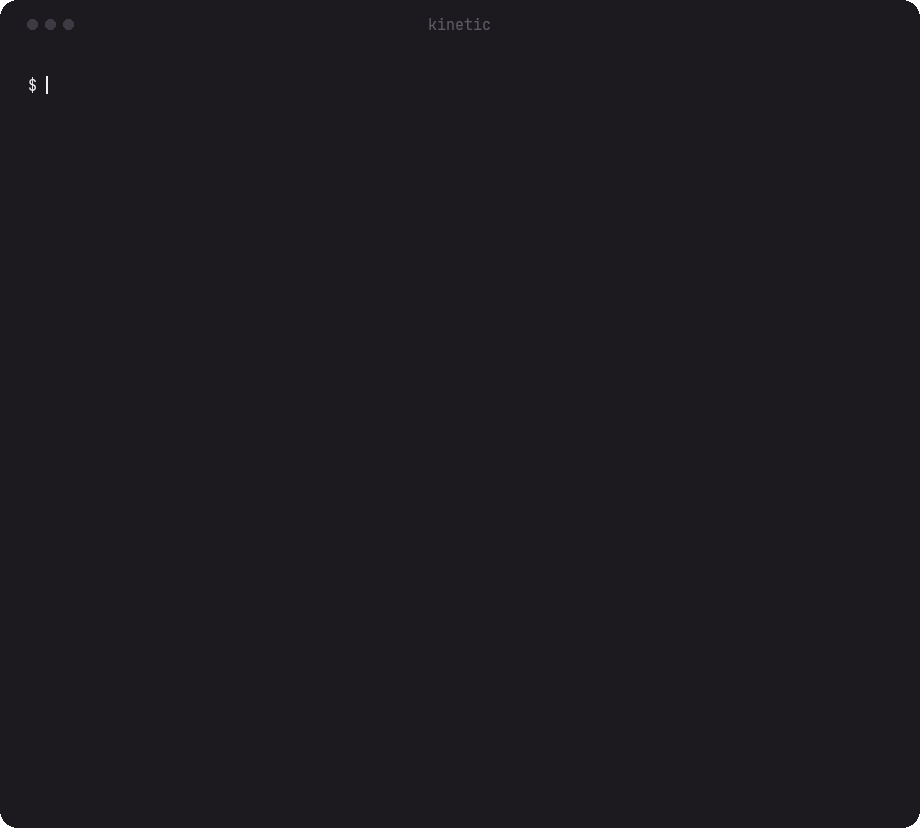

<p align="center">
<picture>
  <source media="(prefers-color-scheme: dark)" srcset="assets/diagrams/rad1-dark.svg">
  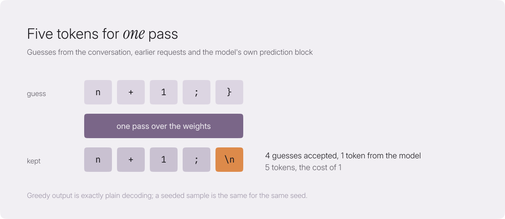
</picture>
</p>

### Warm Start

Chat clients resend the whole conversation with every request; Warm Start
resumes from the exact state an earlier prompt left behind, in memory or on
disk, so only the new tokens run, also on recurrent models such as Qwen3.5
and LFM3. CPU, CUDA and Vulkan.

<p align="center">
<picture>
  <source media="(prefers-color-scheme: dark)" srcset="assets/diagrams/warm-start-dark.svg">
  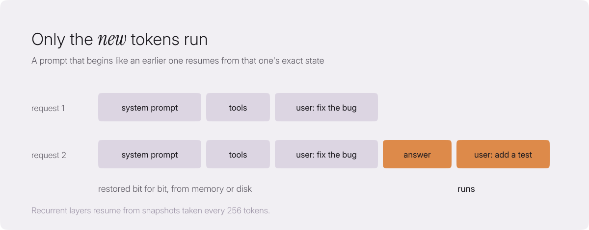
</picture>
</p>

States are kept in memory (up to 1 GiB) and in your cache directory (up to
2 GiB, oldest dropped first), so a restarted server picks up where it left
off. `--cache-dir DIR` moves them, `--no-prompt-cache` turns Warm Start off.

### Zero Wait

A pasted document is processed while you are still typing the question, so
when you press Enter only the last few words are left. CPU and CUDA.

<p align="center">
<picture>
  <source media="(prefers-color-scheme: dark)" srcset="assets/diagrams/zero-wait-dark.svg">
  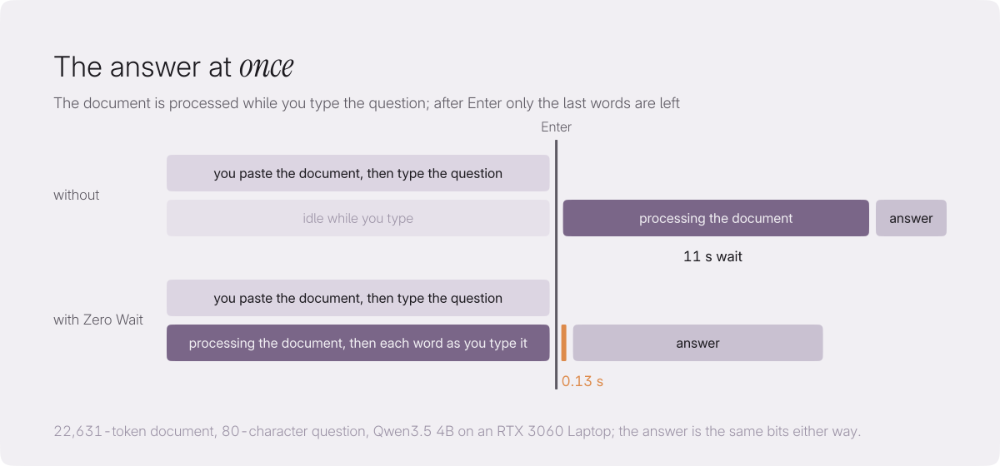
</picture>
</p>

A 22,631-token document pasted, then an 80-character question typed, on
Qwen3.5 4B on the RTX 3060 Laptop:

| | First token after Enter |
|---|---:|
| llama.cpp `llama-server` | 10.95 s |
| Kinetic without Zero Wait | 13.07 s |
| Kinetic | **0.13 s** |

It gets that close to zero when the typing takes at least as long as the
document does to process; a question typed in three seconds still saves
those three seconds. Editing text that already ran goes back only as far as
the edit. `kinetic chat` does it on its own; apps send the draft ahead with
[`POST /v1/prefill`](https://veloresearch.github.io/kinetic/server.html#prefill).

### Torque

A decode step is hundreds of small GPU kernels; Torque records the step once
as a CUDA graph (a replayed command buffer on Vulkan) and launches it with
one call per token.

<p align="center">
<picture>
  <source media="(prefers-color-scheme: dark)" srcset="assets/diagrams/torque-dark.svg">
  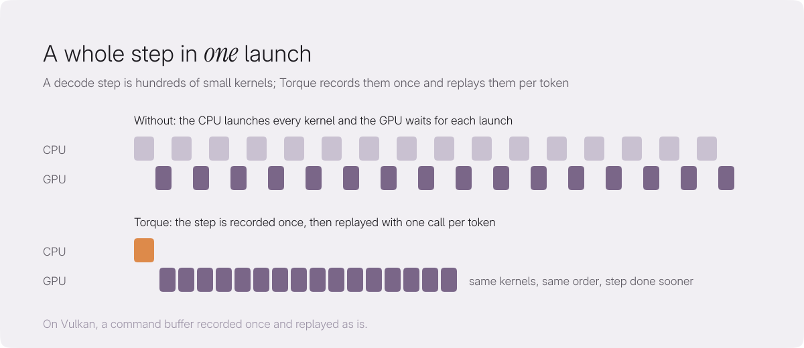
</picture>
</p>

### Convoy: several users at once

With `kinetic serve model.gguf --parallel 4` (llama.cpp's `-np 4`), up to
four requests share every pass over the weights, and each answer is exactly
what that request would get alone. CPU, and CUDA when the whole model is on
the GPU; elsewhere requests take turns.

<p align="center">
<picture>
  <source media="(prefers-color-scheme: dark)" srcset="assets/diagrams/convoy-dark.svg">
  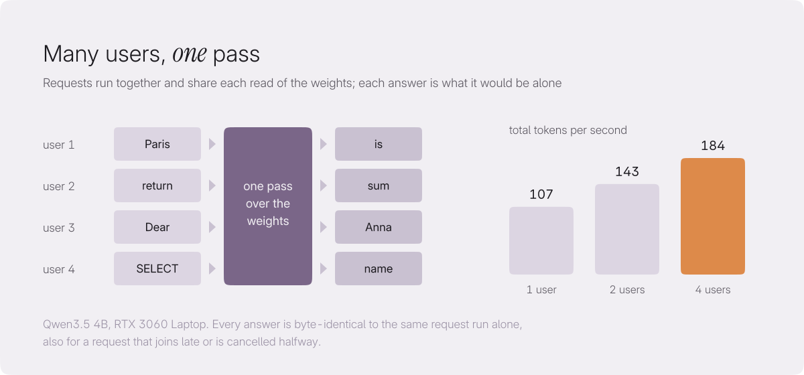
</picture>
</p>

### Shortlist

Choosing the next token reads an output layer of up to a quarter of a
million rows; Shortlist bounds every row's score from a small copy and
computes exact scores only for the rows that can still win. CPU.

<p align="center">
<picture>
  <source media="(prefers-color-scheme: dark)" srcset="assets/diagrams/shortlist-dark.svg">
  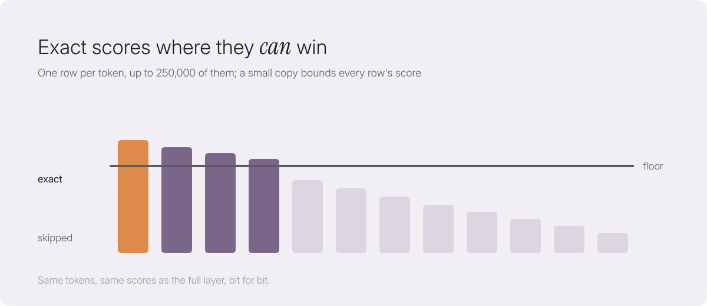
</picture>
</p>

### Burst

Long prompts run as tiled int8 matrix products, so each weight block is
unpacked once and used for many tokens. CPU (AVX2) and CUDA.

<p align="center">
<picture>
  <source media="(prefers-color-scheme: dark)" srcset="assets/diagrams/burst-dark.svg">
  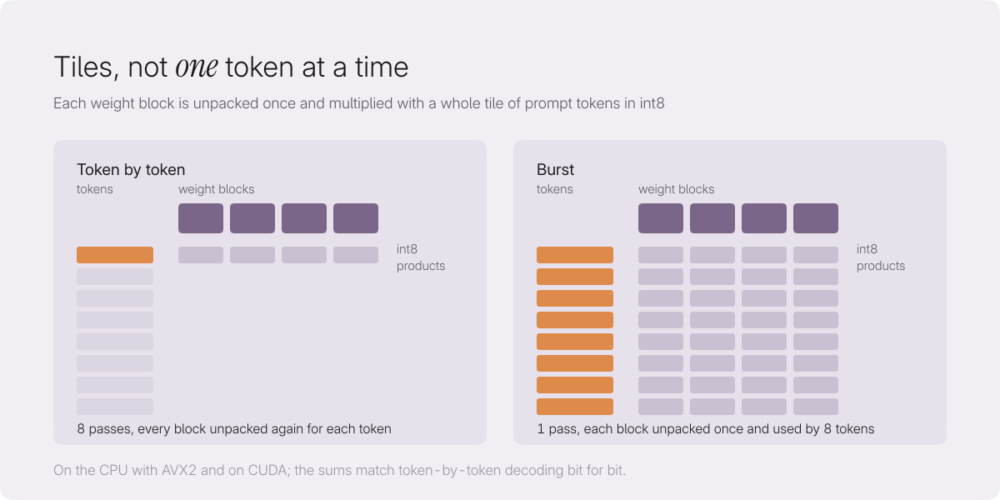
</picture>
</p>

### Flywheel

A mixture-of-experts model keeps the experts in use on the GPU and the rest
in system memory, and runs each missing expert on the CPU or copies it over,
whichever is cheaper at that moment. CUDA; see
[models bigger than your GPU](#run-models-bigger-than-your-gpu).

### Exact batching

All of the above rests on one rule: every row of a batch is summed in the
same order as that token would be on its own, so checking eight guesses at
once or sharing a pass with three other users gives the same bits as plain
decoding. A conversation resumes only from a state a fresh run of the same
prompt would also reach. The test suite checks this on every supported
architecture, and `kinetic bench` checks it on your machine.

<p align="center">
<picture>
  <source media="(prefers-color-scheme: dark)" srcset="assets/diagrams/exact-batching-dark.svg">
  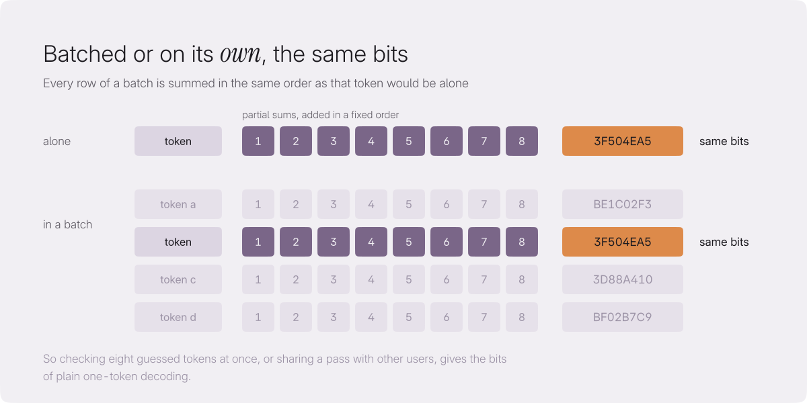
</picture>
</p>

<p align="right"><sub><a href="#top">Back to top</a></sub></p>

## Switching from llama.cpp

Your GGUF files work unchanged when their model family is supported, and one binary stands in for `llama-server`,
`llama-cli`, `llama-bench`, `llama-quantize` and `llama-perplexity`, with
their flags. Pick your case; each is one step.

| You use | Do this |
|---|---|
| `llama-server` | write `kinetic serve`, keep every flag |
| an app that starts `llama-server` | copy `kinetic` to `llama-server` (`.exe` on Windows) |
| `llama-cli` | `kinetic chat -m model.gguf` |
| `llama-quantize` | `kinetic quantize in.gguf out.gguf Q4_K_M` |
| `llama-perplexity` | `kinetic perplexity model.gguf text.raw` |
| llama-cpp-python | `llama-cpp-kinetic`, then `import llama_cpp` runs on Kinetic |
| Ollama | stop Ollama, run `kinetic serve <model> --ollama` |

For example `kinetic serve -m model.gguf -c 8192 -ngl 99 -fa on --jinja`
works as written. One port answers the OpenAI API under `/v1`,
llama-server's own API (`/completion`, `/tokenize`, `/detokenize`, `/props`,
`/health`, `/embedding`, and `/slots` and `/metrics` in its format) and
Ollama's under `/api`, so clients keep their settings. `quantize` writes the
same bytes as llama.cpp for Q4_K_M, Q5_K_M, Q6_K, Q8_0 and Q4_0 (no
`--imatrix` yet); `perplexity` runs on the CPU, with `--kl-divergence`.
`--lora`, `--lora-scaled`, `--api-key`, `--alias`, `--mlock`, `--no-mmap`
and `--chat-template-file` work as in llama.cpp. Flags for what Kinetic does
by itself, like `-fa`, `--jinja` or `-b`, are accepted; the few with no
equivalent stop with a line saying what to use instead.

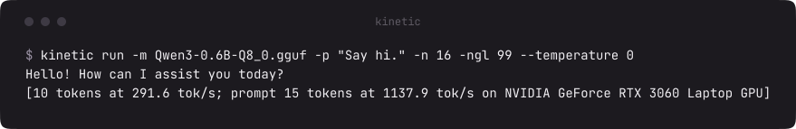

`pip install llama-cpp-kinetic` makes `import llama_cpp` run on Kinetic. libllama itself is not replaced;
Kinetic has its own [C API](https://veloresearch.github.io/kinetic/bindings.html#c).
Details: [Switch from llama.cpp](https://veloresearch.github.io/kinetic/switch-from-llama-cpp.html)
and [every llama.cpp flag](docs/src/llama-flags-table.md).

<p align="right"><sub><a href="#top">Back to top</a></sub></p>

## Chat in the terminal

```sh
kinetic chat LiquidAI/LFM3-1.7B-GGUF
kinetic run model.gguf "Explain recursion in two sentences."
```

`chat` keeps a conversation and processes only your new message each turn;
`run` answers one prompt (or what you pipe in) and ends with a line giving
the speed and the device:

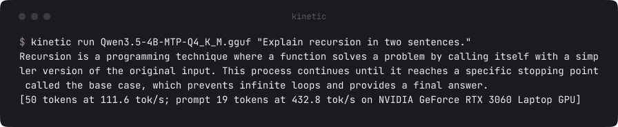

**Markdown.** Answers are drawn as they stream: headings, lists, tables and
code blocks with highlighting. `/raw` shows the plain text for copying.

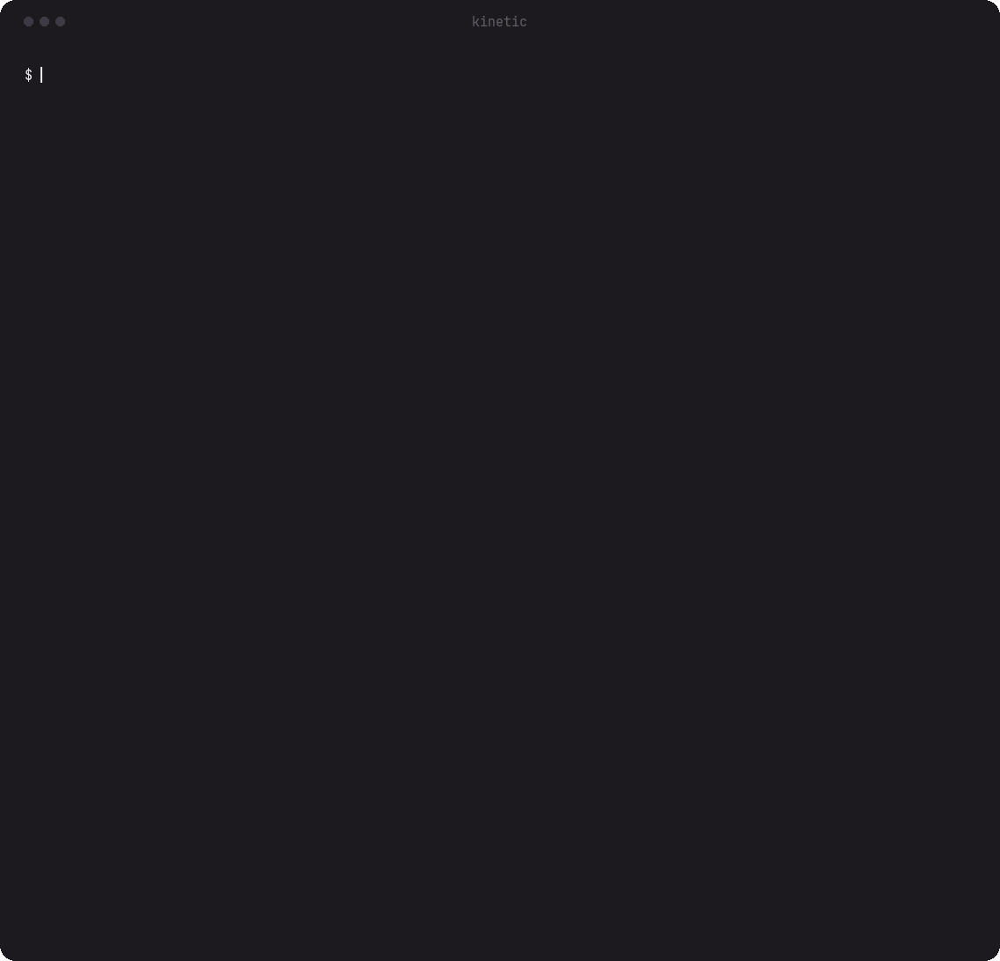

**Images.** Qwen3.5 and Gemma 4 see images through their vision projector,
stored with the model or given with `--mmproj`. `/image PATH` attaches a
file; `/image` alone takes the image on the clipboard.

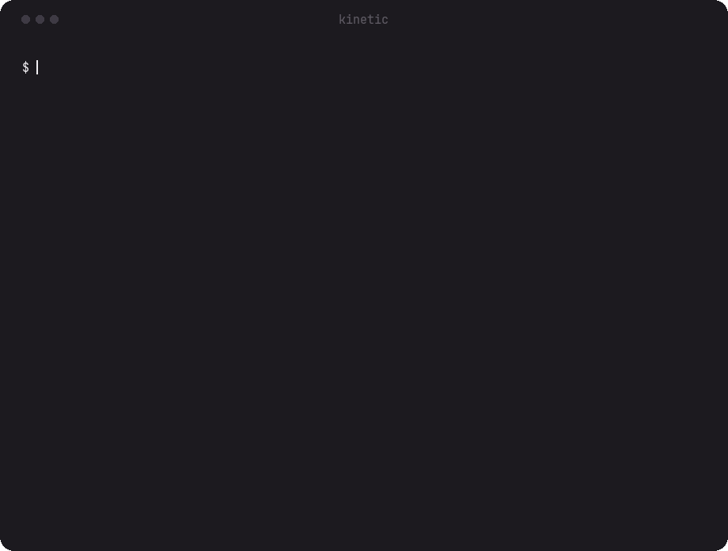

**Commands.** `/think` turns a model's reasoning on or off, `/system` sets
the system prompt, `/clear` starts over, Ctrl+C stops an answer. Sampling
defaults come from the model file; `--temp 0` always takes the likeliest
token and `--seed` makes a sampled answer repeatable. All options:
[command line](https://veloresearch.github.io/kinetic/cli.html).

<details>
<summary><b>Every command</b></summary>

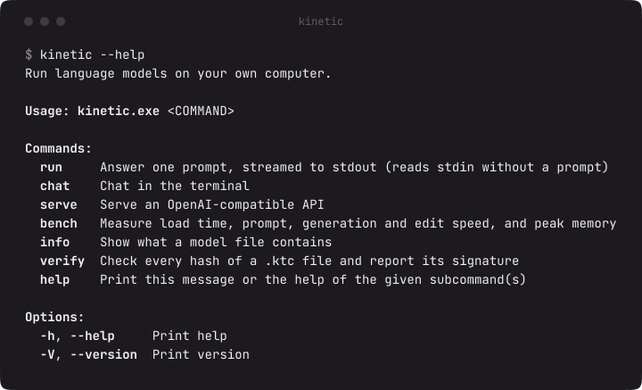

</details>

### Receipts

```sh
kinetic run model.gguf "Name three rivers." --temp 0.8 --receipt answer.json
kinetic verify-receipt answer.json
```

Because nothing outside the request changes the output, an answer can come
with a receipt: the model file's hash, the build, the device class, the
exact prompt tokens, every sampling setting with the seed and the output
tokens, optionally signed with an Ed25519 key. `verify-receipt` reruns it
and reports `identical` or the first token that differs. Ask for one with
`--receipt`, `/receipt` in chat or `"receipt": true` on the API.

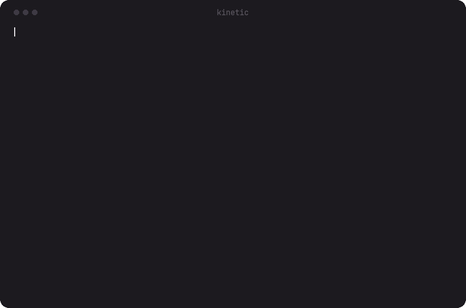

Ten runs of one prompt at temperature 0.8 with a fixed seed, under load from
three other clients, give ten identical answers. What a receipt does and
does not prove: [Receipts](https://veloresearch.github.io/kinetic/receipts.html).

<p align="right"><sub><a href="#top">Back to top</a></sub></p>

## Use it from your app

```sh
kinetic serve model.gguf
```

The server speaks the OpenAI API on `http://127.0.0.1:8080/v1`. Any OpenAI
client, editor plugin or agent framework that takes a base URL works.

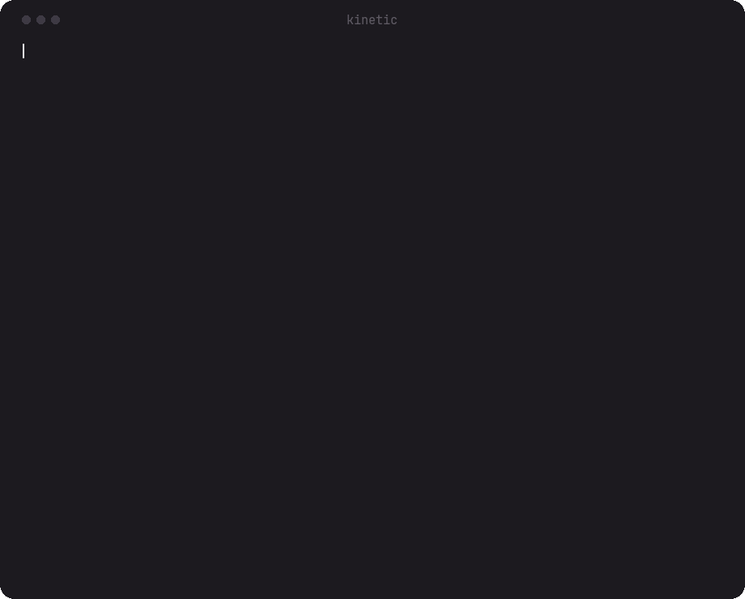

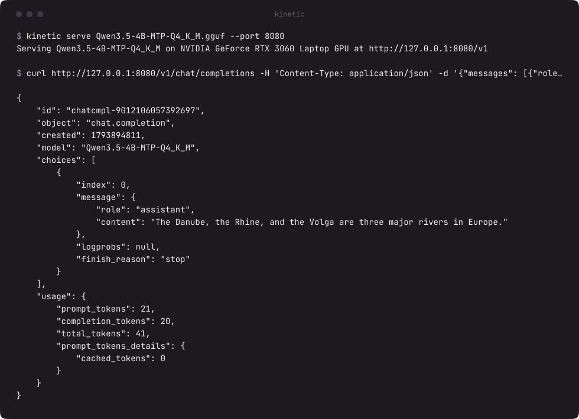

**Python**

```python
from openai import OpenAI

client = OpenAI(base_url="http://127.0.0.1:8080/v1",
                api_key="local")
stream = client.chat.completions.create(
    model="model",
    messages=[{"role": "user", "content": "Hello!"}],
    stream=True,
)
for chunk in stream:
    if chunk.choices:
        print(chunk.choices[0].delta.content or "", end="")
```

**JavaScript**

```js
import OpenAI from "openai";

const client = new OpenAI({
  baseURL: "http://127.0.0.1:8080/v1",
  apiKey: "local",
});
const reply = await client.chat.completions.create({
  model: "model",
  messages: [{ role: "user", content: "Hello!" }],
});
console.log(reply.choices[0].message.content);
```

**Tool calls and structured output.** Models call your functions in the
OpenAI shape. `response_format` with a JSON Schema, or a GBNF `grammar`,
holds the answer to that shape while it is generated, so it always parses;
`tool_choice` set to `"required"` or to one function is enforced the same
way.

<table>
<tr>
<td width="50%" valign="top">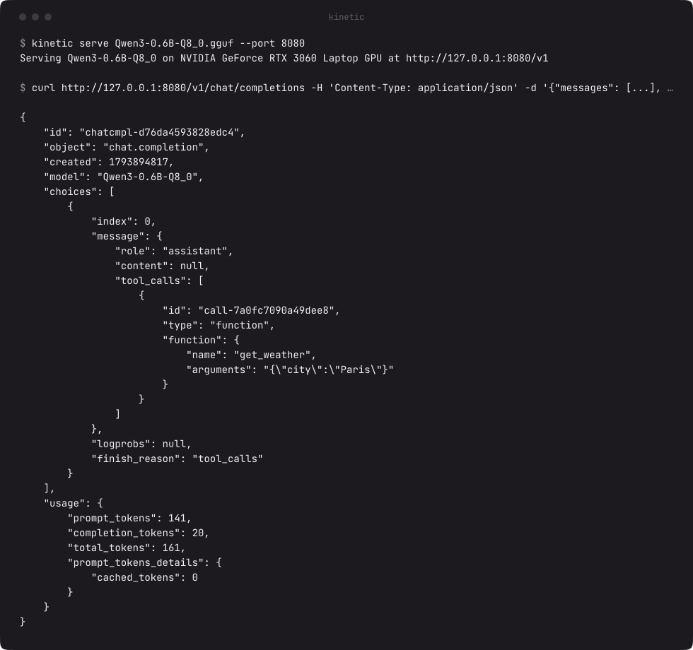<br><sub><b>Tool calls</b>: Qwen3 0.6B asks for the weather in Paris.</sub></td>
<td width="50%" valign="top">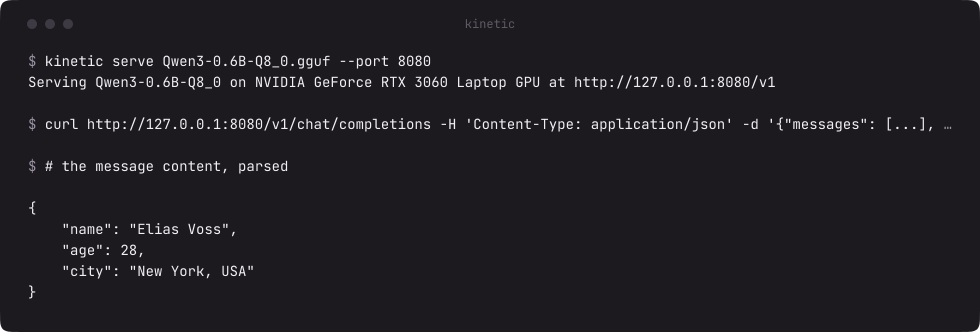<br><sub><b>JSON Schema</b>: the reply always matches the schema.</sub></td>
</tr>
</table>

**Streaming.** Answers arrive as server-sent events, token by token.
**Embeddings and reranking.** An embedding model (BGE, nomic-embed,
EmbeddingGemma, Qwen3-Embedding) answers `/v1/embeddings`; Qwen3-Reranker
answers `/v1/rerank`. **Images.** With `--mmproj`, chat requests carry
images for Qwen3.5 and Gemma 4, as inline data only: the server never
fetches a URL.

<p align="center">
<picture>
  <source media="(prefers-color-scheme: dark)" srcset="assets/diagrams/request-path-dark.svg">
  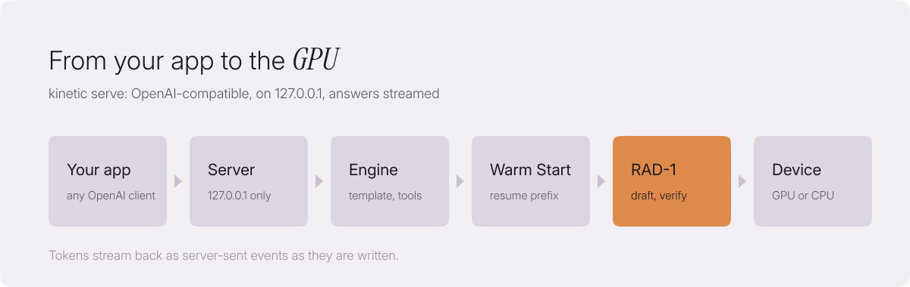
</picture>
</p>

Every endpoint and field: [Server API](https://veloresearch.github.io/kinetic/server.html).

**Without a server.** Kinetic is also a library for Python
(`pip install kinetic-engine`), Rust (the `kinetic` crate) and C
(`include/kinetic.h`: load a model, chat with a streaming callback, embed):

```python
import kinetic

model = kinetic.Model("model.gguf")
print(model.chat([{"role": "user", "content": "Hello!"}], max_tokens=64))
```

Examples: [Python, C and Rust](https://veloresearch.github.io/kinetic/bindings.html).

<p align="right"><sub><a href="#top">Back to top</a></sub></p>

## Supported models

| Family | GGUF architecture | Notes |
|---|---|---|
| Qwen3.5, dense and MoE | `qwen35`, `qwen35moe` | drafts from its MTP block, images |
| Gemma 4 | `gemma4` | E2B and E4B with images; the 26B A4B mixture of experts is not supported yet |
| Qwen3, Qwen2.5 | `qwen3`, `qwen2` | thinking and tool calls |
| Llama 3, Mistral, SmolLM2 | `llama` | |
| Gemma 3 | `gemma3` | |
| LFM3, LFM2 | `lfm3`, `lfm2` | convolution and attention |
| Granite 3 and 4.0 | `granite`, `granitehybrid`, `granitemoe` | dense, hybrid, MoE |
| OLMo 2, Falcon-H1 | `olmo2`, `falcon-h1` | |
| EXAONE 4.0, ERNIE 4.5, Hunyuan | `exaone4`, `ernie4_5`, `hunyuan-dense` | |
| PrismML Bonsai (ternary) | `qwen35` | PQ2_0 weights, CPU and CUDA |
| BGE, BERT, nomic-embed | `bert`, `nomic-bert` | `/v1/embeddings` |
| EmbeddingGemma, Qwen3-Embedding | `gemma-embedding`, `qwen3` | `/v1/embeddings` |
| Qwen3-Reranker | `qwen3` | `/v1/rerank` |

Images need the model's vision projector (`mmproj`): `qwen3vl_merger` for
Qwen3.5, `gemma4v` for Gemma 4.

**Weights:** F32, F16, BF16, Q8_0, Q4_0, Q4_1, Q5_0, Q5_1, the K-quants
(Q2_K to Q6_K), the IQ formats (IQ1_S to IQ4_XS), TQ1_0, TQ2_0, MXFP4 and
PrismML's PQ2_0. Which run on which device, and what to do with a file that
does not load: [Models and formats](https://veloresearch.github.io/kinetic/models.html).

`kinetic info` shows what a file holds before you load it:

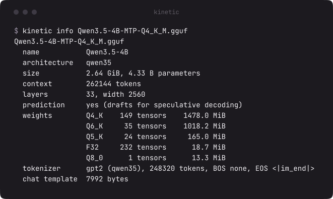

### Long contexts

Kinetic reads the rotary scaling a model file asks for (linear or YaRN) and
lets you override it, as in llama.cpp; `-c` may then reach the stretched
context:

```sh
kinetic serve model.gguf -c 131072 --rope-scaling yarn --rope-scale 4 --yarn-orig-ctx 32768
```

`--rope-freq-base` sets the rotary base for NTK-aware scaling.

### .ktc files

A `.ktc` file holds the weights, the tokenizer and the chat template in one
file, with a manifest of BLAKE3 hashes for every section, an optional
Ed25519 signature and an optional execution profile for a kind of hardware.
Every command that takes a `.gguf` takes a `.ktc`, and `kinetic verify`
checks every hash and the signature. Format: [FORMAT.md](crates/kinetic-ktc/FORMAT.md).

<p align="right"><sub><a href="#top">Back to top</a></sub></p>

## Devices

| | CPU | NVIDIA (CUDA) | Vulkan |
|---|---|---|---|
| Hardware | x86-64 with AVX2 | RTX 20, GTX 16, newer | AMD, Intel, NVIDIA |
| Models | all | all text models | Llama, Qwen, LFM3 |
| Bigger than the GPU | | layer split, MoE offload | coming |
| Needs | nothing | the NVIDIA driver | the graphics driver |

Vulkan runs Llama, Qwen2.5, Qwen3, Qwen3.5 and LFM3 today. `--device auto`
(the default) tries CUDA, then Vulkan, then the CPU, and prints one line
when it skips a device and why; `--device cuda`, `vulkan` or `cpu` picks one.

<p align="center">
<picture>
  <source media="(prefers-color-scheme: dark)" srcset="assets/diagrams/devices-dark.svg">
  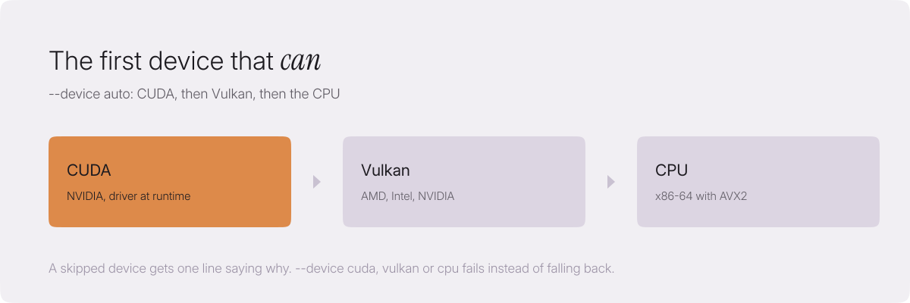
</picture>
</p>

<table>
<tr>
<td width="50%" valign="top">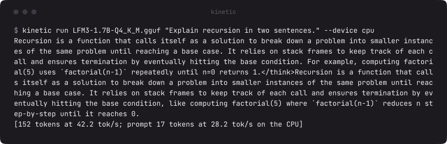<br><sub><b>CPU</b>: LFM3 1.7B with <code>--device cpu</code>.</sub></td>
<td width="50%" valign="top">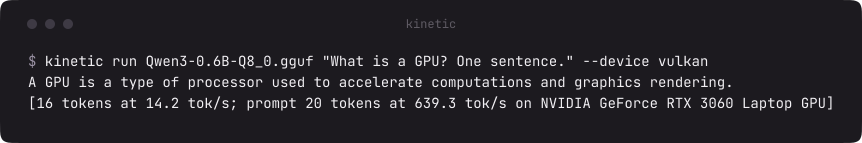<br><sub><b>Vulkan</b>: Qwen3 0.6B with <code>--device vulkan</code>.</sub></td>
</tr>
</table>

### Run models bigger than your GPU

<p align="center">
<picture>
  <source media="(prefers-color-scheme: dark)" srcset="assets/diagrams/offload-dark.svg">
  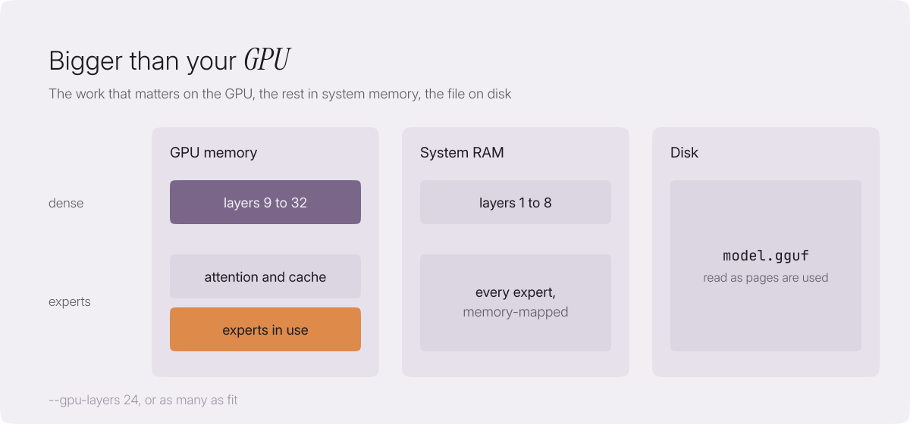
</picture>
</p>

**Dense models.** Kinetic puts as many of the last layers on the GPU as fit
and runs the first ones on the CPU; only one hidden state per token crosses
between them. `--gpu-layers N` (llama.cpp's `-ngl N`) caps the layers on
the GPU, and the status line says how the model was split:

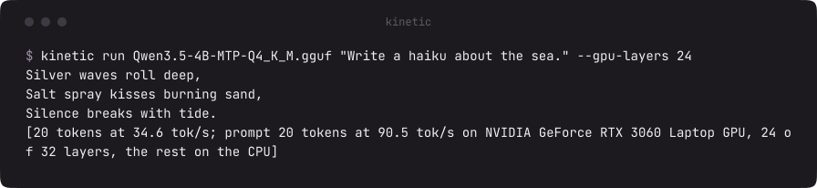

**Mixture-of-experts models.** With [Flywheel](#flywheel), Qwen3.5-35B-A3B
(12 GB in Q2_K_XL) runs on a 6 GB laptop GPU: attention and the shared weights
on the GPU, a cache of experts in the memory left over, every other expert in
system RAM. For speed, the whole file should fit in RAM next to your other
programs.

> [!TIP]
> GPU memory for the whole context is reserved at load time. If a model
> only just does not fit, a smaller context (`-c 8192`) often puts it back
> on the GPU entirely.

More on memory, threads and drivers: [Devices and offload](https://veloresearch.github.io/kinetic/devices.html).

<p align="right"><sub><a href="#top">Back to top</a></sub></p>

## Benchmarks

Tokens per second, higher is better, against llama.cpp b12001 on the same
files and settings, on a Ryzen 5 6600H with an RTX 3060 Laptop GPU (6 GB).
"Edit" is a greedy request that rewrites a file, with llama.cpp's own
speculative decoding on (`draft-mtp` for Qwen3.5, `ngram-simple` for LFM3);
Kinetic's output is checked to be identical to plain decoding.

**GPU**

| Model | Test | llama.cpp | Kinetic | |
|---|---|---:|---:|---:|
| LFM3 1.7B Q4_K_M | edit | 229.7 | **1033.7** | **4.5x** |
| LFM3 1.7B Q4_K_M | generate | 194.3 | **198.4** | 1.02x |
| LFM3 1.7B Q4_K_M | prompt, 512 | **7642.7** | 6820.6 | 0.89x |
| Qwen3.5 4B Q4_K_M | edit | 121.0 | **348.1** | **2.9x** |
| Qwen3.5 4B Q4_K_M | generate | 76.4 | **89.9** | 1.18x |
| Qwen3.5 4B Q4_K_M | prompt, 512 | 2871.3 | **3329.5** | 1.16x |

**Bigger than the GPU**, Qwen3.5 4B Q4_K_M, generate:

| Layers on the GPU | llama.cpp | Kinetic | |
|---|---:|---:|---:|
| 24 of 32 | 25.4 | **35.7** | 1.4x |
| 16 of 32 | 16.1 | **24.2** | 1.5x |
| 8 of 32 | 5.1 | **13.3** | **2.6x** |

**CPU only**, no graphics card used:

| Model | Test | llama.cpp | Kinetic | |
|---|---|---:|---:|---:|
| LFM3 1.7B Q4_K_M | edit | 28.1 | **128.1** | **4.6x** |
| LFM3 1.7B Q4_K_M | generate | 26.8 | **31.1** | 1.16x |
| LFM3 1.7B Q4_K_M | prompt, 512 | 225.8 | **244.9** | 1.08x |
| Qwen3.5 4B Q4_K_M | edit | 19.6 | **38.7** | **2.0x** |
| Qwen3.5 4B Q4_K_M | generate | 11.2 | **11.3** | 1.0x |
| Qwen3.5 4B Q4_K_M | prompt, 512 | 91.9 | **97.3** | 1.06x |

**Several users at once**, `serve --parallel 4` against `llama-server
--parallel 4` on the GPU, total tokens per second, every request with its
own prompt. Each of Kinetic's answers is byte-identical to the same request
run alone; llama-server's are not.

| Model | Users | llama.cpp | Kinetic |
|---|---:|---:|---:|
| Qwen3.5 4B Q4_K_M | 1 | 60 | **107** |
| Qwen3.5 4B Q4_K_M | 2 | 105 | **143** |
| Qwen3.5 4B Q4_K_M | 4 | 134 | **184** |
| LFM3 1.7B Q4_K_M | 4 | 314 | **420** |

The six GPU rows were measured on an idle machine; the layer split, CPU and
several-users rows with other programs running, so they are on the low side
for both programs. GPU prompts still trail llama.cpp on LFM3 and on very
short prompts, and are being tuned.

**Measure your own machine.** `kinetic bench model.gguf --compare` runs
llama.cpp's `llama-bench` on the same file with the same settings and prints
the comparison as a Markdown table, ready to paste into an issue; the LFM3
GPU rows and the CPU table above are its output.

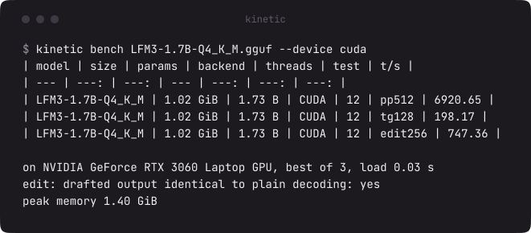

Method and [`scripts/bench_vs_llamacpp.py`](scripts/bench_vs_llamacpp.py):
[Benchmarks](https://veloresearch.github.io/kinetic/benchmarks.html).

<p align="right"><sub><a href="#top">Back to top</a></sub></p>

## Privacy

**Kinetic never connects to the network, except when you run `kinetic pull`.**
No telemetry, no update checks, no accounts.

- The server listens on `127.0.0.1` unless you pass `--host`, and warns when
  you do; `--api-key` requires a key on every route but `/health`.
- Requests from web pages are refused, so a website you visit cannot use your
  local model.
- Warm Start keeps prompt states in your cache directory, up to 2 GiB; delete
  `kinetic/warm` there to clear them, or run with `--no-prompt-cache`.

<p align="right"><sub><a href="#top">Back to top</a></sub></p>

<a name="faq"></a>
## FAQ

<details>
<summary><b>Is the output really identical with all the speed-ups?</b></summary>

Yes, on the same device. Greedy output is token for token plain decoding,
and a seeded sampled answer is the same with and without drafting and
prompt caching: verification picks each token from the same logits, with
rejection sampling when sampling. The test suite checks it on every
supported architecture, and `kinetic bench` checks it on yours. The CPU and
the GPU round differently, so a CPU answer and a GPU answer can differ in
rare tokens; each is exact for its device.

</details>

<details>
<summary><b>Do I need a GPU?</b></summary>

No. The CPU kernels are built for an ordinary laptop with AVX2, and the
biggest speed-up in the table above, 4.6x, is on the CPU. A GPU makes it
faster still.

</details>

<details>
<summary><b>Does it work with AMD or Intel graphics?</b></summary>

Yes, through Vulkan, for Llama, Qwen2.5, Qwen3, Qwen3.5 and LFM3 today;
more architectures are coming. Other models run on the CPU on those machines.

</details>

<details>
<summary><b>Does it run on a Mac?</b></summary>

No. Kinetic supports Windows and Linux on x86-64 and is not planned for
macOS.

</details>

<details>
<summary><b>Which model should I start with?</b></summary>

On a laptop CPU, a small model such as Qwen3-0.6B or LFM2 1.2B answers
quickly. With a GPU of 4 GB or more, Qwen3.5 4B in Q4_K_M is a capable
everyday model and drafts with its own prediction block, which makes it
especially fast. Or just run `kinetic` and pick from its suggestions.

</details>

<details>
<summary><b>How does it compare to llama.cpp, Ollama and LM Studio?</b></summary>

llama.cpp is the engine that defined GGUF; Kinetic reads the same files and
takes its common flags, and is written from scratch in Rust with exact
speculative decoding and prompt caching on by default. Ollama and LM Studio
are applications built around llama.cpp; Kinetic is the engine itself, a
single binary with a command line and an OpenAI-compatible server. It also
answers Ollama's API under `/api`, and `kinetic models` runs the models
Ollama and LM Studio have already downloaded by name.

</details>

<details>
<summary><b>My model does not load. What now?</b></summary>

`kinetic info` and the error say what is missing: an architecture, a
tokenizer or a feature. [Models and formats](https://veloresearch.github.io/kinetic/models.html#files-that-do-not-load)
explains each message. Please open a
[model not supported](https://github.com/Veloresearch/kinetic/issues/new?template=model-not-supported.yml)
issue with the output of `kinetic info`.

</details>

<details>
<summary><b>Can I use it in a commercial product?</b></summary>

Yes, under the Apache License 2.0. The name and logo have their own rules;
see [TRADEMARKS.md](TRADEMARKS.md).

</details>

More: [FAQ and troubleshooting](https://veloresearch.github.io/kinetic/faq.html).

<p align="right"><sub><a href="#top">Back to top</a></sub></p>

## Roadmap

| Area | Coming next |
|---|---|
| RAD-1 | block drafters: many tokens guessed per pass |
| GPU | faster short prompts, two GPUs |
| Models | Gemma 4 26B A4B, LFM2.5 MoE, Qwen3 MoE |
| Formats | PrismML's 1-bit types at full speed |
| Vulkan | MoE, layer split, faster prompts |
| Install | winget, scoop, Docker images |
| `.ktc` | models from Velocity, tuned for your hardware |

The full list: [roadmap](docs/roadmap.md).

## Contributing

Bug reports, benchmarks on your hardware, fixes and new model support are
welcome. Each model family is one file on top of blocks every family
shares, and every device implements those blocks:

<p align="center">
<picture>
  <source media="(prefers-color-scheme: dark)" srcset="assets/diagrams/architecture-dark.svg">
  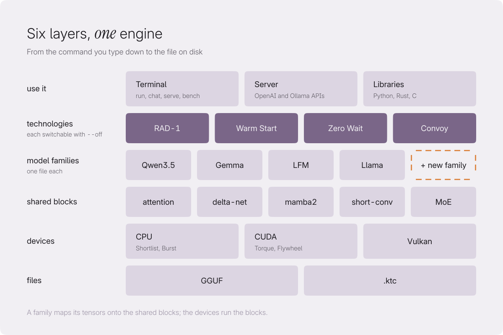
</picture>
</p>

Start with [CONTRIBUTING.md](CONTRIBUTING.md) and the
[contributor guide](https://veloresearch.github.io/kinetic/contributing.html),
which walks through adding an architecture and a weight format step by step;
the [good first issues](https://github.com/Veloresearch/kinetic/labels/good%20first%20issue)
are a good start. Security problems go privately to contact@veloresearch.com;
see [SECURITY.md](SECURITY.md).

## License

Kinetic is licensed under the [Apache License 2.0](LICENSE). Third-party
material is listed in [NOTICE](NOTICE). "Kinetic" and its logo are
trademarks of Velocity; see [TRADEMARKS.md](TRADEMARKS.md).

<br>

<div align="center">

**Kinetic is made by [Velocity](https://veloresearch.com), an independent AI company.**

[veloresearch.com](https://veloresearch.com) &emsp; [Documentation](https://veloresearch.github.io/kinetic/)

</div>
